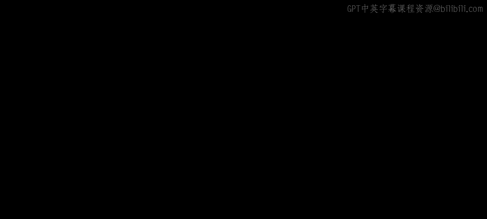
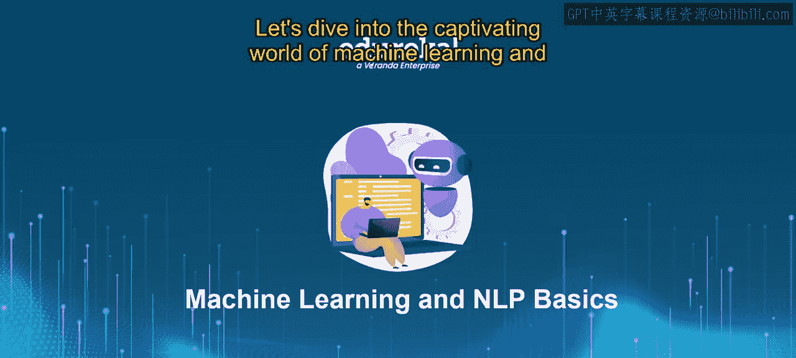
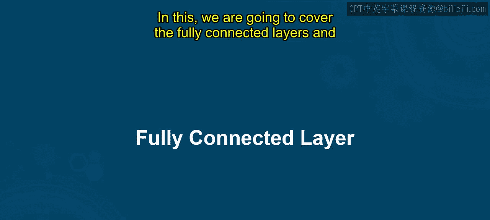
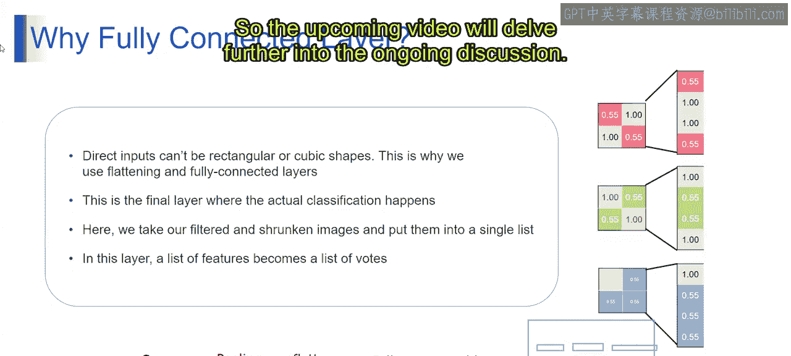

# Edureka《通过LLMs学习生成式人工智能（机器学习和NLP基础，第1课／共4课）｜Learn Generative AI with LLMs》中英字幕 - P72：71_全连接层.zh_en - GPT中英字幕课程资源 - BV1q4421Q7qh

Hello everyone， let's dive into the captivating world of machine learning and the foundational concepts of NLP together in this。

 we are going to cover the fully connected layers。😊。

And the topic sir， why fully connected layer and what is final layer By the end of the session。

 you are able to understand， learn how the fully connected layer operates as the final classification strip and you are able to grasp how data is transformed and interpreted。

 So first of all， let's understand why fully connected layer before this。

 what exactly a fully connected layer is all about。

 imagine you are hosting a party and you want to invite friends from different social circles like work。

 school and sports you have separate list of friends from each circle。

 So now to ensure everyone is invited you create a master list where each friend from all circles is listed together this master list。

😊，Represents a fully connected network of friendships where every friend is connected to every other friend。

 regardless of their social circle means now it's connected with the technical definition。

 so fully connected layer is a type of layer in a neural network where each neuron is connected to every neuron in the previous layer In other words。

 each neuron in a fully connected layer receives input from all the neurons in the preceding layer and produces an output that is passed to all neurons in a subsequent layer。

In simple words， lets say these are are my input layers and these are going to be my output layers now the input from all the input layer is going to connect with all the output layers means。

😊，One circle with three inputs like this means what exactly happening here。

 a fully connected layer is characterized by a matrix of weights connecting the input neurons to the output neurons。

 Each neuronsn is fully connected layer has its own set of weights and the output of the layer is computed as the weighted sum of the input plus bioom followed by the activation function。

 So let's understand how exactly it is going to work So why do we need this first of all。 Okay。

 we understand what exactly a fully connected layer。

 but why it is actually required here you can see the similar representation So here the direct inputs cannot be regular rectangular or cubic shapes。

 This is why we use plaing and fully connected layers in neural network convolutional and。😊。

Puling layers， which we understood in the last module typically process the input data in the form of multidimensional arrays or feature maps。

 However， fully connected layers require input in one dimensional vector format means flattening layers are used to convert multidimensional output from the convolutional and the pooling layer into a linear vector。

 Then fully connected layers can receive this flattened vector as input means it is going to be the final layer where the actual classification happens fully connected layers often serves as a final layer in the neural network architecture。

 especially in the classification task means after passing the input data through the convolutional and pooling layer the flattened feature here。

 the flattened feature vector is past。😊，To the fully connected player。

Means how exactly the process is going means once we process the input data through the convolutional and the pooling layers。

 if it is applicable， then the flattened feature vector is passed to the fully connected layers for the final classification decision here we take are filtered and shrunken images and put them into a single list。

 we are putting them in a single list after feature extraction and dimensionality reduction through the convolution and pullinging layer。

 The feature maps are flattened into a one dimensional list This list represents the processed and abstracted features from the input images in this layer the list of features becomes a list of wordss means in the fully connected layer each neuron receives input from the every neuron in the previous layer representing。

😊，A comprehensive set of features each neuron in the fully connected layer contributes to the decision making process by voting for a particular class or outcome based on the learned weights and biases means the output of the fully connected layer represents the network's prediction or classification decision with each neurons activation contributing to the final outcome That is the reason fully connected layer is very。

 very important so the upcoming video will delve further into the ongoing discussion。😊。

