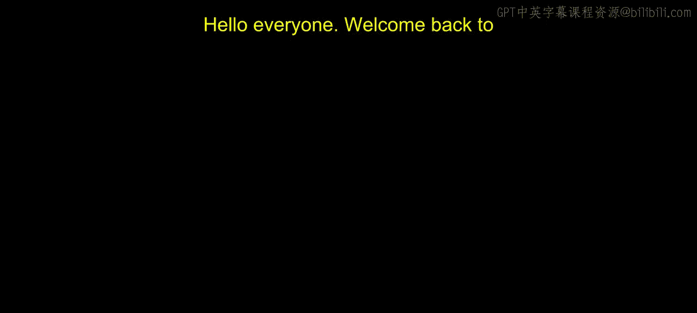
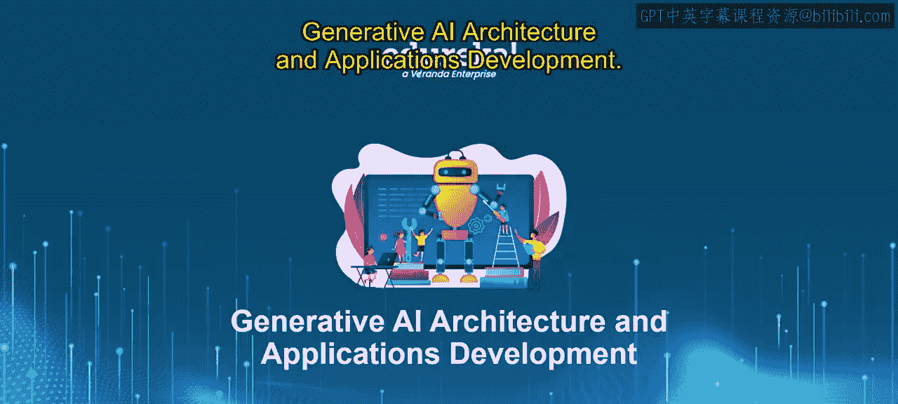
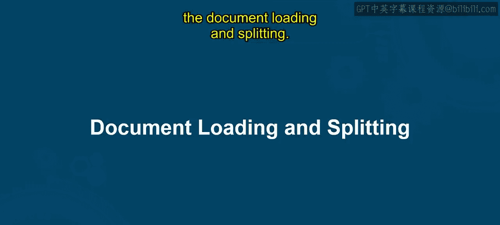
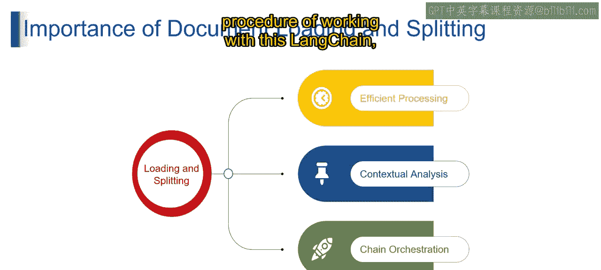

# Edureka《通过LLMs学习生成式AI（基础、应用开发、流行工具，第2、3、4课／共4课）｜Learn Generative AI with LLMs》中英 - P73：36_文档加载和分割.zh_en - GPT中英字幕课程资源 - BV1ym421V7gx

Hello everyone， welcome back to Generative AI Architecture and Appplication development Month。😊。

So now let's understand the document loading and splitting in this we are going to cover what exactly the document loading and what exactly the splitting and why it is actually required So by the end of the session you are able to understand the effective document loading and splitting for rag data preparation So let's get started the document loading and splitting So we have tackled the rack and now it's time for data preparation this next module entirely dives into the document loading and splitting the crucial steps for getting your text data into far mar usable for the LLM tasks within the la so we will explore how to efficiently load the documents and split them into manageable chunks for your LLM to process effectively So this loading and splitting is one of the important aspect in the NLP and the information retrieval system。

😊。

Particularly when dealing with the large dataset sets and as well as logic documents。

 so this process involves loading actual information from the various sources like any kind of databases or any kind of external sources such as documents articles web pages into the system for further analysis once the document is loaded the text is then often split into the smaller manageable units like paragraphs sentence or even sections to facilitate more efficient processing as well as analysis。

😊，Now let's understand what is document loading and splitting so here is a breakdown like how it connects to the previous topics and emphasizes the user friendly response so building on the rack remember how we empowered our LLM friend with our helpful library nothing but rack in the previous module so document loading and splitting are like getting the library ready for them so here is a breakdown the first one is of the loading so imagine bringing books that is nothing but your data from the different sources like website files or any kind of data structures or databases into the library our library here is nothing but a la so this involves converting various file formats nothing but TxT PDFf or whatever it is into the format the LLM can understand within the la so that's about the loading then the next one is of splitting so。

😊，Think of organizing the books That is nothing but data in our case on the shelves。

 Spting involves breaking down the large documents into the smaller units like paragraphs。

 sections or chapters。 this makes it easier for the LLM to process the information similar to how it's easier to read a book chapter by chapter means by loading and splitting the documents effectively。

 you prepare your data for seamless use within the language。

 This allows your LLM to access and process information efficiently paving the way for powerful NLP applications。

 So now let's understand the importance of the document loading and splitting。

 So why it is important。 The first one is of efficient processing。

 So imagine having a massive unorganized library finding specific information would be a nightmare right similarly。

 processing large unsplit documents。😊，And over LLMs by splitting this document into smaller chunks like paragraphs or the sentences。

 L allows for efficient processing。 This LLM can focus on the smaller units at a time making the overall task less resource intensive and faster to complete。

 So that's about efficient processing。 Then the next one is of contextual analysis。

 Think about understanding a complex story reading individual sentences without context might be confusing。

 splitting document allows for better contextual analysis。 For example。

 sentiment analysis might require understanding the sentiment of entire sentences while topic modeling could benefit from analyzing a broader context of paragraphs or even entire documents splitting helps maintain this context enabling the LLM to grasp the true meaning of the information。

 So that's about contextual analysis。Then the next one is of chain orchestration。

 So imagine choreographing a complex performance with the actor data components from the various books like documents。

 splitting documents plays a vital role in Lchas chain orchestration。

 These chains which combine different La components like pros and passes often operate on smaller units of the text splitting ensures that each component in a chain receives the appropriate data。

 size for optimal performance means by efficiently processinging the information。

 enabling contextual analysis and facilitating chain orchestration document loading and splitting or the foundation for building effective LLM applications within the L just like organizing a library these steps ensure your data is readily available and usable for your LLM to perform its magic。

😊，So now let's understand the step by step procedure of working with this line chain。

 the document loader and architecture。😊。

So stay tuned for the next video where we will elaborate on this topic， Thank you。😊。

