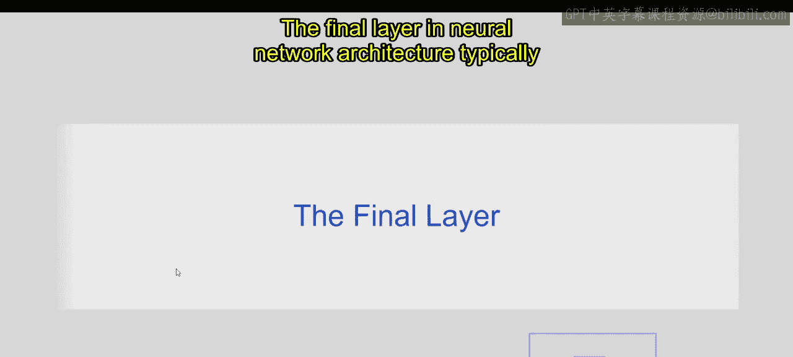
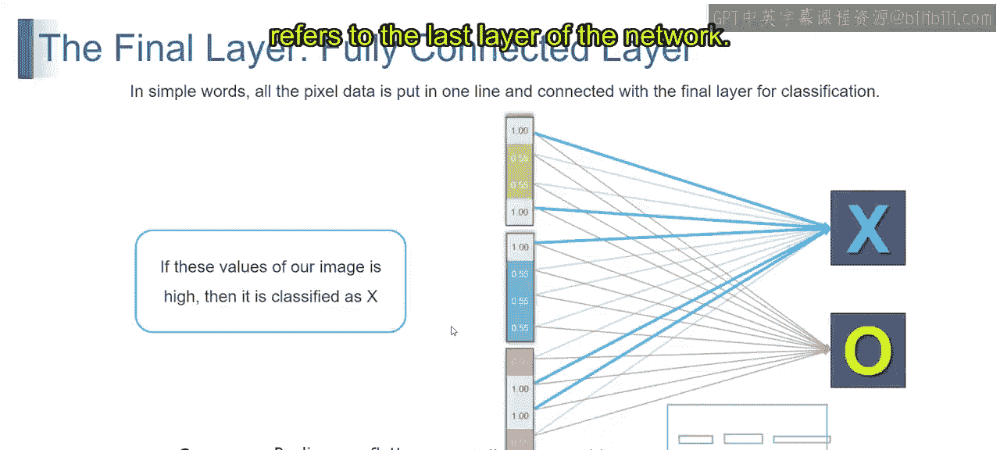
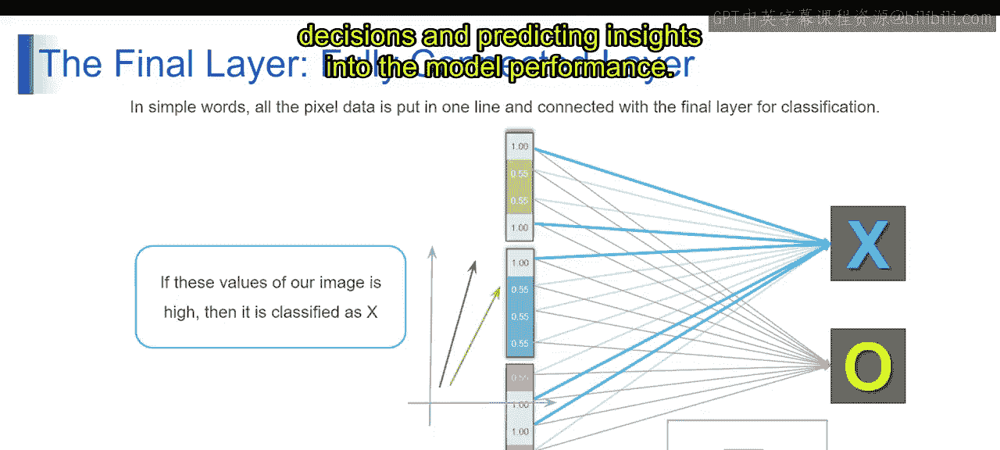
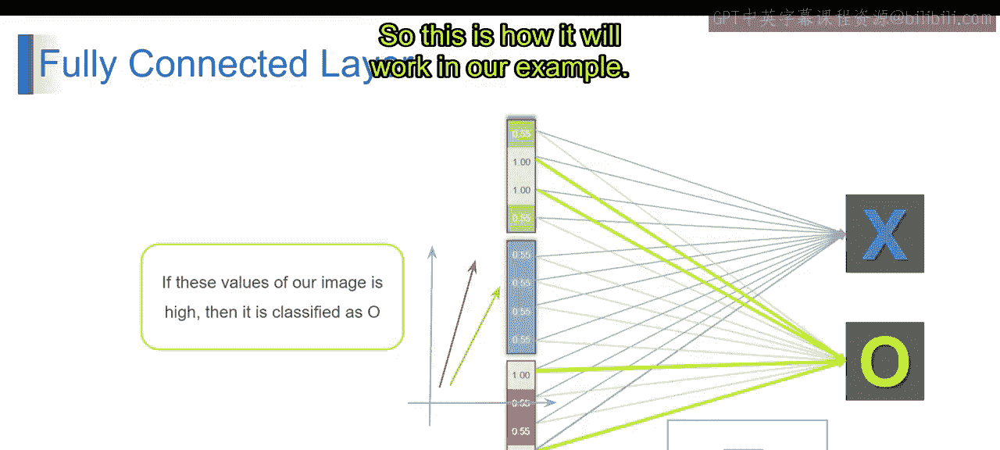
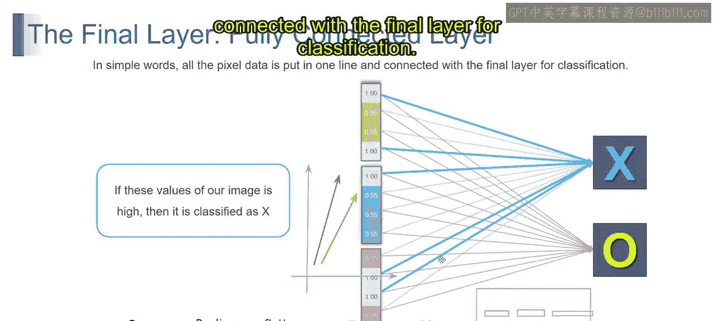
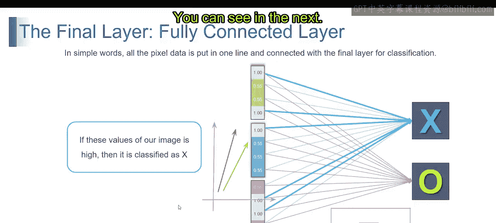
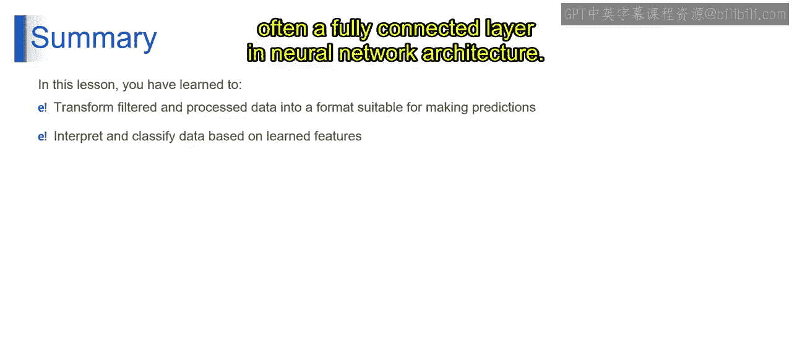

# Edureka《通过LLMs学习生成式人工智能（机器学习和NLP基础，第1课／共4课）｜Learn Generative AI with LLMs》中英字幕 - P73：72_最后一层.zh_en - GPT中英字幕课程资源 - BV1q4421Q7qh

So let's now explore the progression from our previous discussion so now let's understand the final layer so what exactly the final layer the final layer in neural network architecture typically refers to the last layer of the network it is going to be the last layer which produces the final output or the prediction based on the processed input data in the classification task the final layer usually consists of one or more neurons each representing a class label or a category what are the key points in this the first one is going to be the decision making means final layer is responsible for making the ultimate decision or the prediction based on the features extracted from the input data so now we can see here the first thing what are the key points of the final layer is。

😊。

The decision making and the activation function means in the classification task。

 the activation function used in the final layer often depends on the specific requirement of a problem statement for binary classification task a sigmoid activation function might be used to predict probabilities between the0 and1 and in the multiclass classification the soft match activation function is commonly used to produce probabilities that sum up to one across all the classes then coming to the loss function the final layer is associated with a loss function that measures the difference between the periodic output and the true labels for example。

 let's say。😊，Here is a representation of my output and input layer in this let's say this is a predicted one and this is going to be the actual one means what exactly the loss function do here here in this case the loss function measures the difference better the predicted output and the true labels during the training the network are just its weights and biases to minimize this loss function。

 improving the accuracy of the prediction then coming to the output format the output format of the final layer depends on the nature of the task for binary classification task the final layer might consist of a single neuron predicting the probability score and for the multiclassification task the final layer might consist of multiple neurons each producing a probability score for different classes then coming to the interpret。

😊，So， the output of the final layer can be interpreted in various ways depending on the task in classification。

 the predicted layer labels or label or probabilities course can provide insights into the model's decision making process and confidence in its prediction。

😊，Final layer serves as an endpoint of a neural network architecture producing the final output or prediction based on the processed input data。

 it plays a very important role in classification tasks by making decisions and predicting insights into the model performance。

😊。

So the final layer， as we discussed， often a fully connected layer serves as the last stage in a neural network before making the predictions in simple terms it takes all the pixels of the data from the previous layers and arrange them into a single line this flattening data is then connected to the fully final layer for classification so this is how it will work in our example in a simple words all the pixel data is put in one line and connected with the final layer for classification if these values of our image is high means if the values are high then it will classify the information as x you can see it is taking one11 and also one one wherever there is the one it is taking in the bold blue color line and it is providing the output as x ors if it is of the。

😊。

Ealue of our image is low。 Then it will classify the output as O。 You can see in the next。😊。

So that is how it will work now the summary in this lesson you have grasped the process of transforming filtered and processed data such as flattened feature vector into a former suitable of making prediction Additionally you have gained insights into interpreting the classifying the data based on the learn features particularly through a final layer often a fully connected layer in neural network architecture Thank you。

😊。

