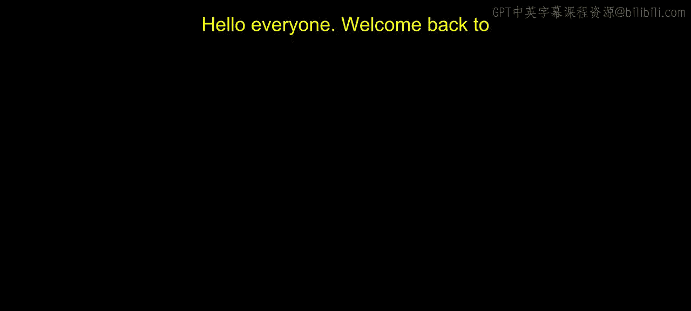
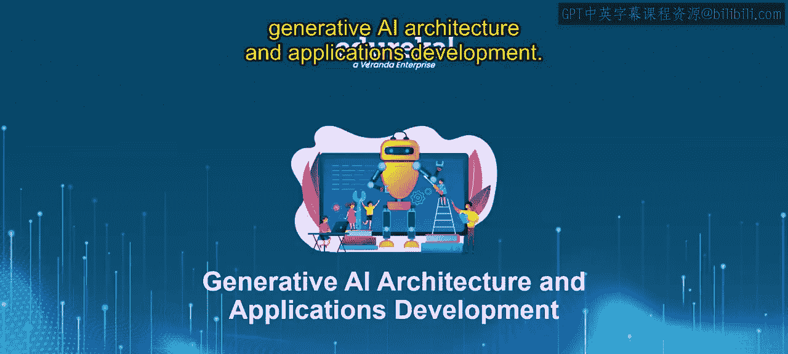
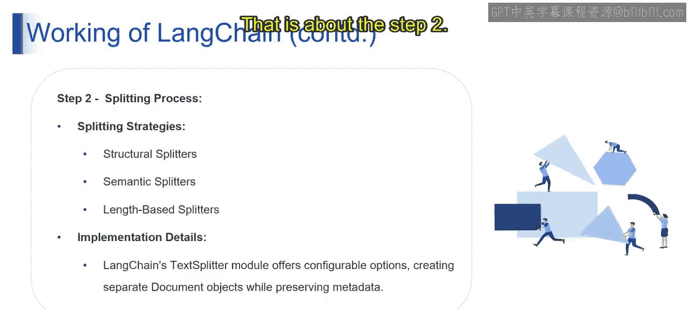
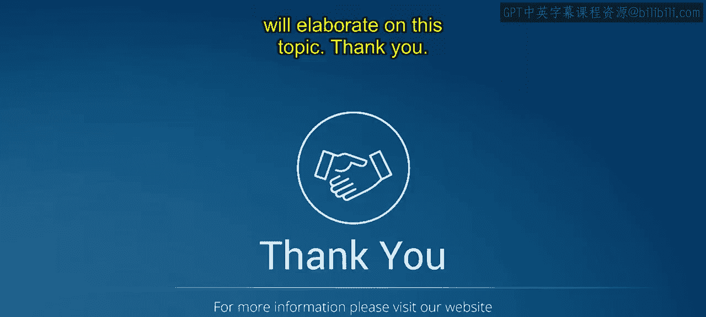

# Edureka《通过LLMs学习生成式AI（基础、应用开发、流行工具，第2、3、4课／共4课）｜Learn Generative AI with LLMs》中英 - P74：37_LangChain的工作原理.zh_en - GPT中英字幕课程资源 - BV1ym421V7gx

Hello everyone， welcome back to Generative AI architectureitecture and Appplication Travel Month。😊。

So the step1 is of document loader architecture with the modular design。

 so imagine having a specialized term of libraries each an expert in handling a specific type of book that is nothing but a data format Lang chain adopts a modular design for document loaders。

 this means there are distinct loader modules for each supported document or data format for example whether if is of the text file or another PDF each module is like specialist well equipped to handle specific format efficiently then the next one is that loader responsibilities these analyze the loader modules shoulders several key aspects First one is of accessing data from the sources the act like librarians receiving books that is nothing but data from various sources this could involve accessing files from your local files system which。

😊，Data from the databases or even interacting with web APIs that provide access to textual information。

 Then the next one is of passing raw content into the structured data means imagine the librarian carefully examines a newly acquired book。

 which is having a raw content loaders use format specific libraries to pass the raw content and transforms it into a structured data format that chain can understand this might involve extracting text from the different sections of the p or converting special characters in a downloaded file Then the next one is of cleaning and normalizing text Think of librarian cleaning and organizing the books that is nothing but a text before placing them on the shelves。

 loaders often perform the essential cleaning and normalization steps on the extracted text this could involve。

😊，Tokenization， which is nothing but breaking down the text into individual words or meaningful units for further processing and then handling the encodings means ensuring consistent character representation across the different data sources then we will be removing the noise from this meanss eliminating the relevant information like special characters or the extra white spaces So that's about the step one。

 Now let's understand the step two that is splitting process。

 Imagine organizing your library by using the different criteria to categorize the books into the different types。

 The first one is of structural splitters。 These are like librarians who categorizes the books based on their physical structure So L offers structural splitters that can divide the documents based on the elements like paragraphs sentence and sections that is。

😊，About structural splitting then the next one is of semantic splitters。

 think of the librarian who categorizes books based on their content while still under the development in La semantic splitters aim to split the documents based on the meaning or thematic shifts within the text this can be particularly useful for tasks like topic modeling or information extraction。

 So that's about semantic splitters， then the next one is of lengthbased splitters So imagine a librarian organizing books based on their size lengthbased splitters allow you to divide the document into chunks of the specialized length。

 for example， splitting a long article into smaller length of 200 words each This can be useful for ensuring efficient processing especially for resource constrained environments that's。

the splitting strategies。 Then the next one is of implementation details。

 So Lang provides a user friendlyly text splitter module for handling the splitting process this module offers configurable options allowing you to choose the desired splitting strategy like paragraph sentence and extra based on your specific needs importantly。

 L splitter process creates separate documents objects while preserving metadata associated with the original document This ensures that even after splitting。

 you can retain the information about the sources or context of the different textual context by offering the variety of splitting strategies and maintaining the met datata Lang empowers you to organize your data in a way that optimizes processing and analysis for your LLM application So that is about the step 2。

😊。

So stay tuned for the next video where we will elaborate on this topic， thank you。😊。

