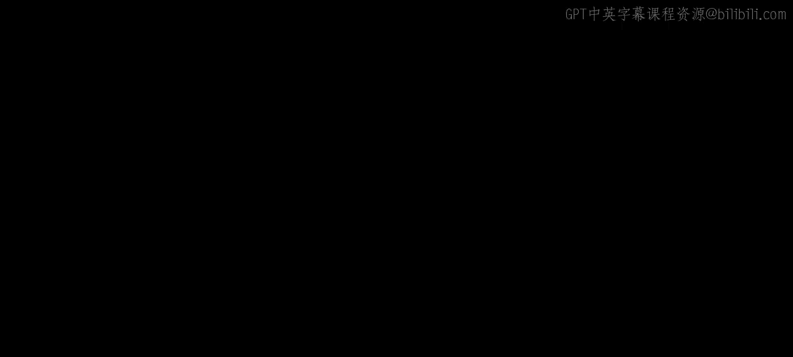
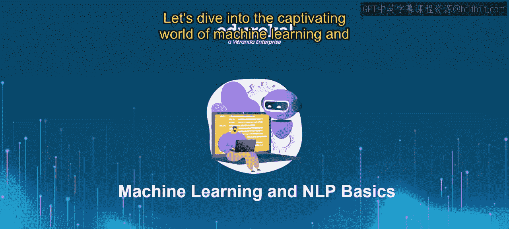
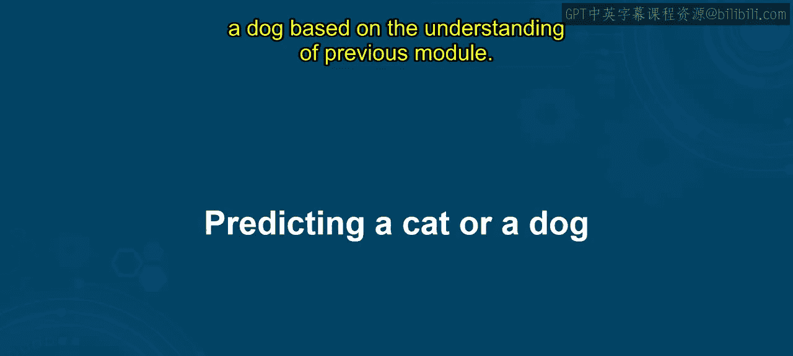
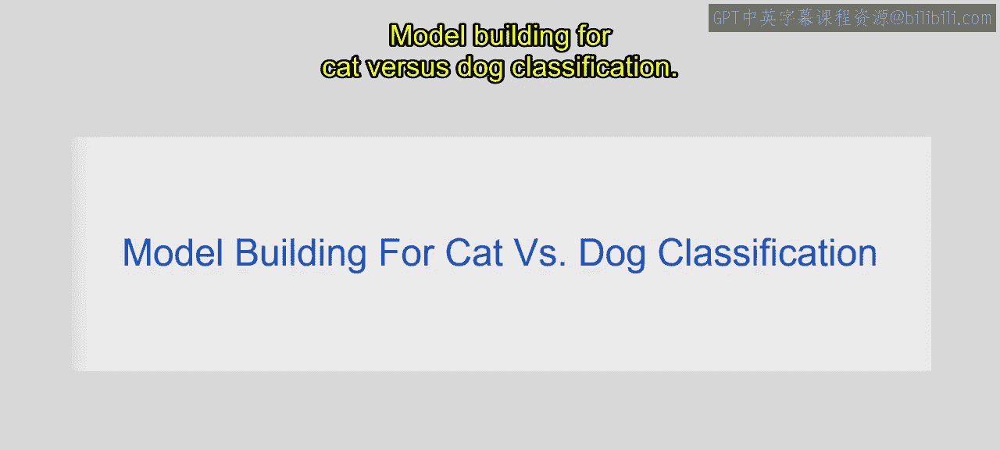
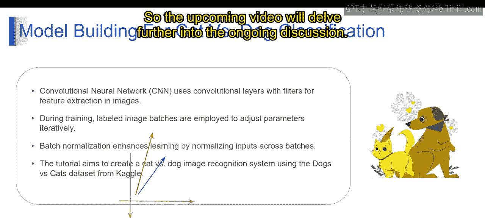

# Edureka《通过LLMs学习生成式人工智能（机器学习和NLP基础，第1课／共4课）｜Learn Generative AI with LLMs》中英字幕 - P74：73_预测猫或狗.zh_en - GPT中英字幕课程资源 - BV1q4421Q7qh

Hello everyone， let's dive into the captivating world of machine learning and the foundational concepts of NLP together。

 Now we are going to understand predicting a cat or a dog based on the understanding of previous module。

 So now let's get started in this we are going to understand the model building for a cat versus a dog that is nothing but a classification using the CNN and by the end of this session you are able to construct a convolutional neural network model specifically designed for the classification of images deing cats and dogs。

 First I am going to explain the theoretical part。 and then I will be showing the practical examples So let's get started model building for cat versus dog classification So in this module we focus on constructing this particular CNN model tailored for special。

😊。

For classified images， it involves several key aspects。 The very first step is going to be。😊。

It totally contains six different steps。 The first step is going to be the data collection2，3，4。

5 and finally the deployment here I'm going to explain the step by step what exactly we are going to have the very first step is going to be the data collection and preprocessing and then the next step is going to be model architecture design and then the next step is going to be the training and once if the model is trained the next step is going to be the validation and then testing and evaluation once everything is in place we will go for the deployment Okay so let's understand all this step by step so I will be just interlinking all this。

😊，So now let's understand how exactly it is going to work as I mentioned the first step is going to be the data collection and processing preprocessing in this we will gather the data set containing images of cats and dogs in the initial step the data is then preprocessed to ensure uniformity in size color and the quality across all the images preprocessing might involve resizing normalization and augmentation techniques then coming to the model architecture design so designing the architecture of the CNN invos deciding on the number and the configuration of convolutional pooling and fully connected layers this convolutional layer extracts features from the input images while pullinging layers down sample the feature maps to reduce the dimensionality that is what we previously。

😊，Understoed in the last module with fully connected layers like they will integrate the extracted features for the classification。

 Once if it is done means once the model architecture design is done。

 then we will be sending this for training the model means this model is trained on the preprocess to data set using the techniques such as stochastic gradient decentcent or autumn optimizer means So what exactly the stochastic gradient。

 It is an optimization algorithm use it to minimize the loss function As I mentioned again。

 the loss function is nothing but it is the difference between the predicted data versus the actual prediction。

 This is going to be the loss function。 So why we are using the stochastic gradient decentcent algorithm。

 it is an optimization algorithm used to minimize the loss function during the training by updating。

😊，Model parameters iteratively based on gradients computed on small random batches of the data coming to the atom optimizer。

 it is a variant of stochastic gradient descent that computes adaptive learning rates for each parameter by combining momentum and the root means square propagation enabling faster convergence and the better generalization。

 So these are of the two technique we generally use while we are performing or training the model。

 So during the training the model are just its parameters to minimize this predicted loss function。

 typically typically categorical cross entropy or multiclass classification once the training is done we will validate the model and then tune it means the trained model performance is evaluated using a separate validation data set hyperparmeter such。

😊，Learning rate， batch size and layer configurations are tuned to optimize performance and prevent overfitting。

 Then it can be sent to the test and evaluation。 Once the model is trained and tuned。

 it is tested on a separate test data set to assess its generalization capabilities。

 metrics such as accuracy precision recall an F score or commonly used to evaluate the model performance。

 Once if it is done， then we will be sending it for the deployment。 Finally。

 the trained model can be deployed into production environment for real world use It essential to monitor the model's performance over the time and retrain it periodically to adapt to changing the data distribution requirements。

😊，Here we represented the processor of same thing。 CNN uses convolutional layers with the filters for extracting the images means we are extracting the important features from the images during this training the labeled image batches are employed to adjust the parameters and then we will perform the batch normalization to increase the performance of it。

 and especially this tutorial aims to create the cats versus dogs image recognition using the dogs and cats data sets from the CAd girls so here the input data is going to be the data set of cats versus talk so it will take all the process like model architecture design and training then validation and testing and evaluation then the deployment in this process batch normalization is a technique used in CNNs to enhance learning by normalizing the inputs across the batches it standardizes。

😊，The activation of the layer ensuring that the distribution of features remains stable throughout the training process。

 this stabilization helps in preventing issues like vanishing or exploding gradients leading to faster convergence and the better performance so the upcoming video will delve further into the ongoing discussion。

😊。

