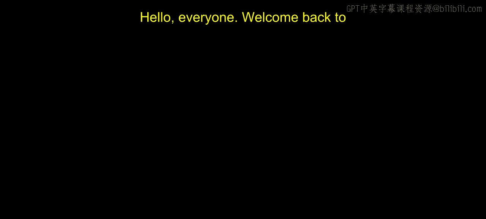
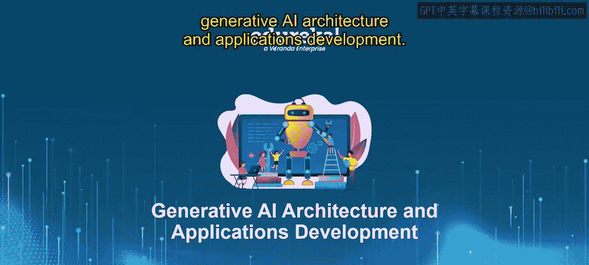
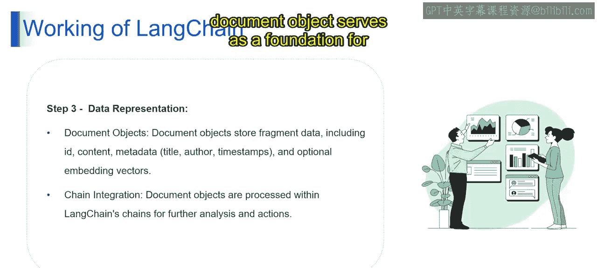
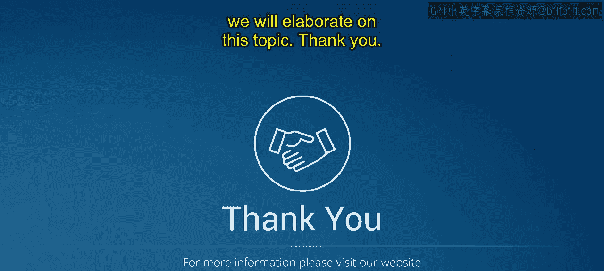

# Edureka《通过LLMs学习生成式AI（基础、应用开发、流行工具，第2、3、4课／共4课）｜Learn Generative AI with LLMs》中英 - P75：38_LangChain工作原理续.zh_en - GPT中英字幕课程资源 - BV1ym421V7gx

Hello everyone， welcome back to Generative AI architectureitecture and Appplication Travel Month。😊。

Now let's understand the step3 that is nothing but data representation so imagine the first one in this is document object imagine each split document section which is nothing but either paragraphs or sentence or etc as a well organizedized book on a shelf in yeah library L chain uses document objects to represent these individual sections each document object acts like a container holding various types of the information here we are performinging total five things the first one is of fragment data so this is the core content of the section the actual text itself then the next one is of ID including ID means a unique identifier for each document object allowing for easy referencing within the L workflows then the next one is of the metadata means additional。

😊，Information associated with the original document like title or the name。

 timestamp or even the sources of the URLs this metadata can be a crucial for tasks like tracking and understanding the context of the text that's about the metadata then the next one is of embedding vectors so in some advanced use cases these objects might also hold embedding vectors which are numerical representations of the text captured using the machine learning technique these vectors can be used for tasks like text similarity analysis so that's about the data representation here we are performing the chain integration think of these document as the building block for LLm integration with the la these objects are seamlessly integrated to line chain chains which are like assembly lines combining different components。

😊，like prompts， pause， etc， to process the data and achieve the specific goals。

 the document objects are fed into these chains where the LLM can access and analyze the text content to generate the responses answer questions and perform other NLP tasks based on your applications requirement means by providing a structured and informative representation of your data document object serves as a foundation for building effective LLM workflows within the line chain。

😊。

So stay tuned for the next video where we will elaborate on this topic， Thank you。😊。

