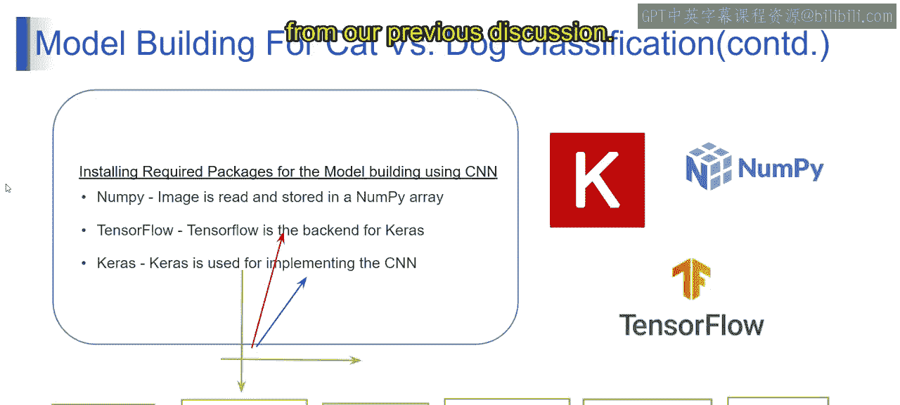
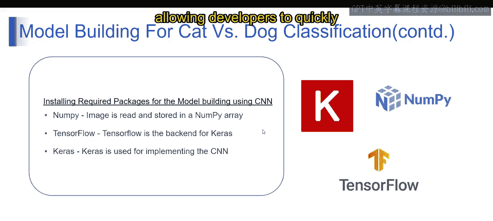
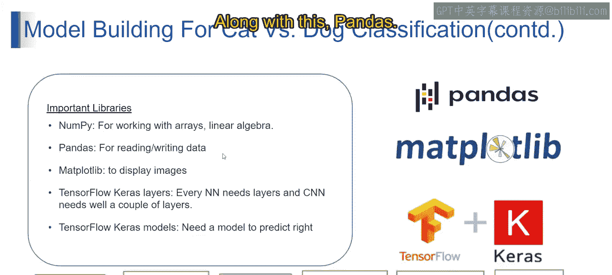
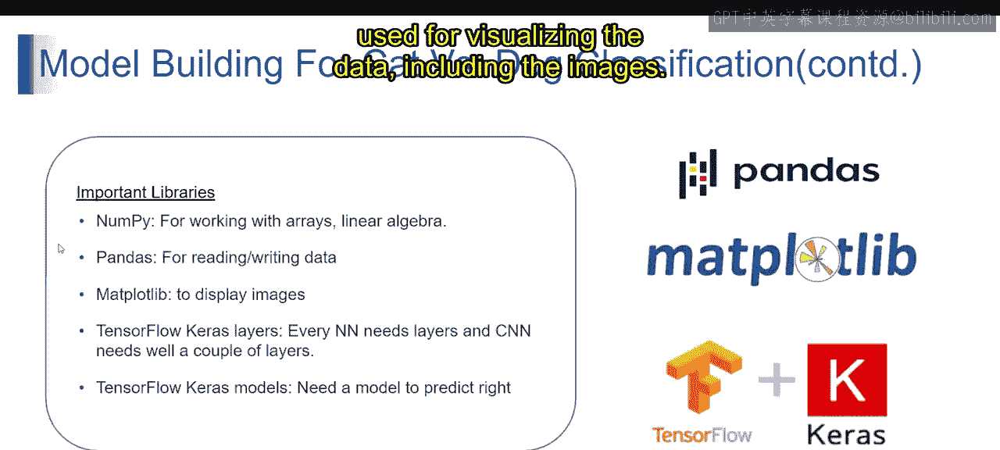
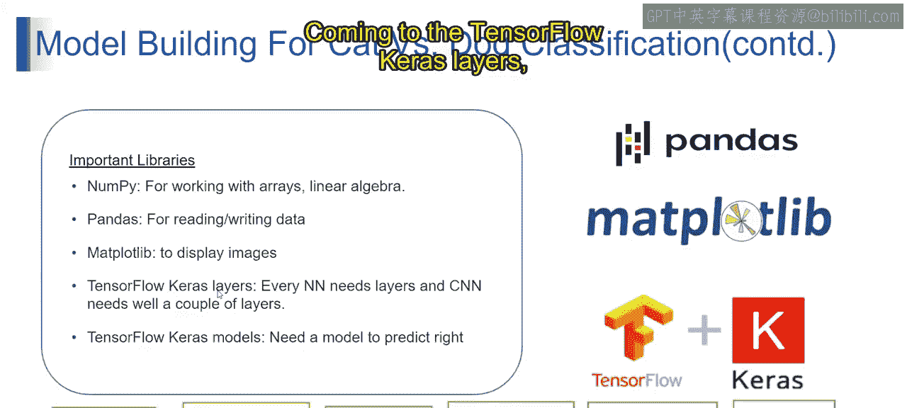
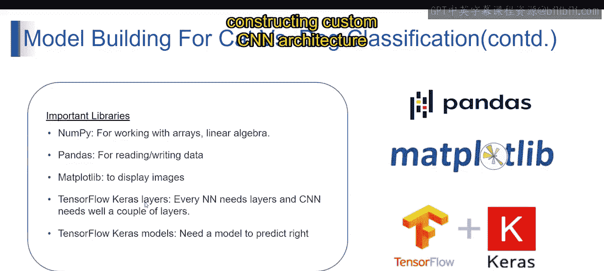
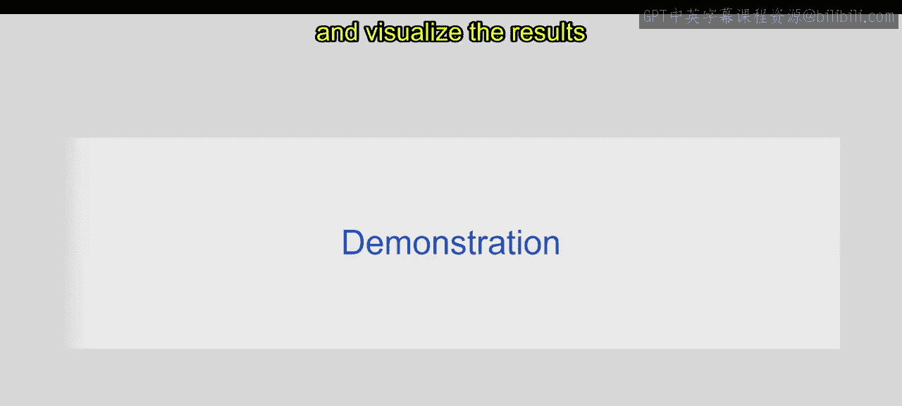
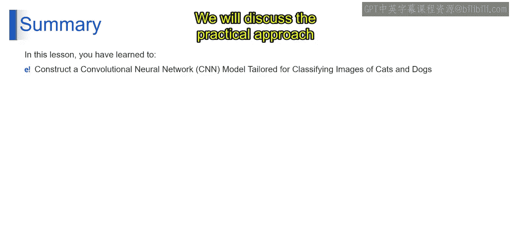

# Edureka《通过LLMs学习生成式人工智能（机器学习和NLP基础，第1课／共4课）｜Learn Generative AI with LLMs》中英字幕 - P75：74_猫狗分类模型构建.zh_en - GPT中英字幕课程资源 - BV1q4421Q7qh

So let's now explore the progression from our previous discussion now here we are providing installing the required packages for model building using the CNN so generally these are at the libraries to construct the CNN for image classification the first one we are using is Ny NI is a fundamental for working with the arrays and performing operations in linear AGra in the context of CNN Ns is used to read the images and stored them as NI arrays facilitating data manipulation and preprocessing。

 then coming to the tensorflow Tensorflow serves as the backend of ks a high levelve neural neural network API it provides efficient computation and optimization functionality required for training deep learning models including CNNs then coming。

😊。

To the ks， it is a user friendly library widely used for implementing deep learning models。

 including CNNs。 it offers simple yet powerful interface for building neural networks allowing developers to quickly prototype and experiment with different architecture along with this pandas pandas is utilized for reading and writing the data particularly in the tableular format and matlolip it is a comprehensive plotting library used for visualizing the data including the images so coming to the Tensorflow ks layers these are the building blocks of neural networks including CNNs layers such as convolutional polling and fully connected layers are essential for constructing the architecture of the CNN model that is what we have been discussing from couple of modules。

 then coming to the tensorflow。😊。

Models， they provide predefined models and architectures。

 simplifying the process of building and training the CNNs。

 These models serves as foundation for constructing custom CNN architecture。

 tailored to specific tasks， such as image classification。😊。

Installing Ny Tensorflow with ks， pandas matlolib and Tensorflow ks layers and the models is essential for effectively building and training the CNN models for tasklike image classification in our example of dogs and classification as you mentioned we will have to pass through all these steps to get it done these libraries provide the necessary tools and functionalities to handle the data construct the neural networks and visualize the results throughout the model building process Now the summary in this lesson you understood what are the required libraries as well as what are the steps follows to construct a convolutional neural network model specially designed for classifying the images utilizing essential libraries like Ny Tensorflow。

😊。

Paandndas， matlolip， Tensorflow ks layers and the models so we will discuss the practical approach in the next video。

😊。

Thank you。