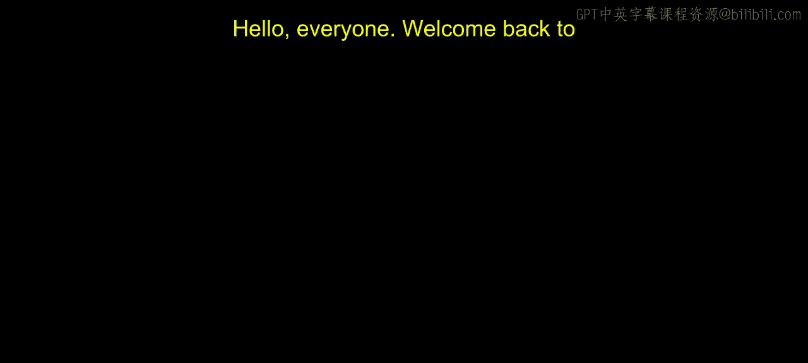
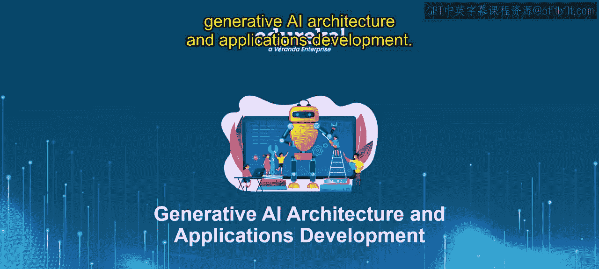
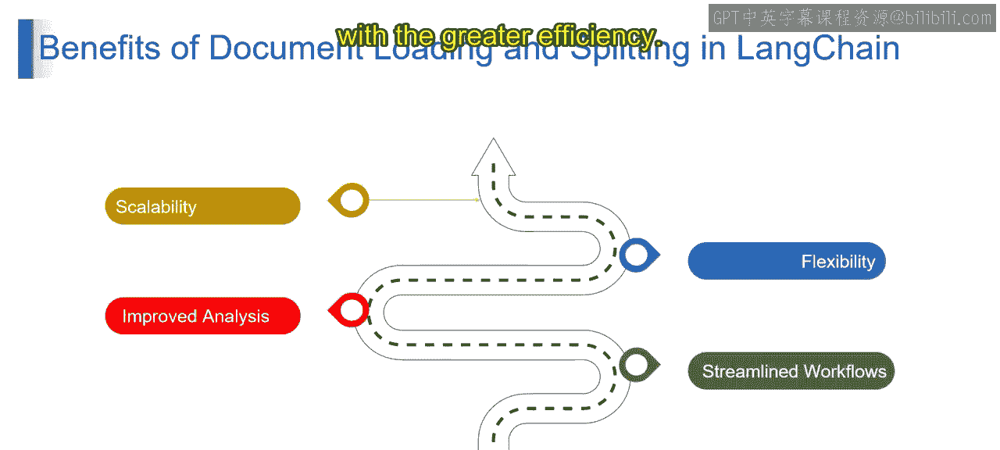
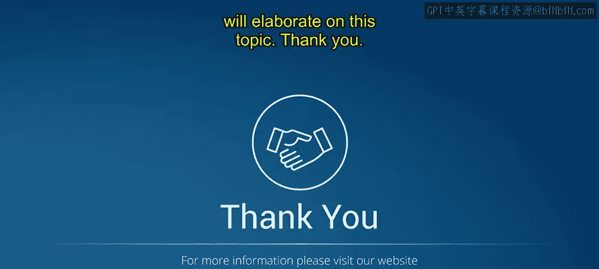

# Edureka《通过LLMs学习生成式AI（基础、应用开发、流行工具，第2、3、4课／共4课）｜Learn Generative AI with LLMs》中英 - P76：39_文档加载和分割的优势.zh_en - GPT中英字幕课程资源 - BV1ym421V7gx

Hello everyone， welcome back to Generative AI architectureitecture and Appplication Travel Month。😊。

So now let's understand the Bf the scalability flexibility improved analysis and steamline workflows scalability is like imagine a library that can effortlessly handle a massive information efficient document loading and splitting pave the way for scalability in the by breaking down the large documents into the individual chunks。

 Langch can process even extensive datas efficiently This allows you to handle larger and more complex NLP task without overwhelming the LLM or encountering performance bottlenecks So that's about the scalability。

 then flexibility。 think of the library that allows you to categorize the books in a various ways splitting strategies in L offer similar flexibility。

 you can choose to split the document based on the structure or meaning or even the predefined lens This flexibility allows you to tell。

😊，Data preparation process to the specific needs for your LLM application， ensuring optimal results。

 then improved analysis。 imagine having a well organizedized library that makes it easier to find specific information so splitting documents enhances the quality of analysis within the La by providing a smaller more focused units of the text splitting allows the elementss to analyze the information in a more granular way this can lead to more accurate and insightful results when performing the task like sentiment analysis topic modeling or even information extraction Then the last one is of streamline workflows in the same example like library that makes it easy to navigate and access the information unit document loading and splitting contribute to streamline workflows in La these steps ensure that data is。

😊，ally available and appropriately formatted for different components within a length chain this streamlines the overallural process allowing you to build and execute LLM applications with the greater efficiency So these all are the benefits。

😊。

So stay tuned for the next video where we will elaborate on this topic， Thank you。😊。

