# Edureka《通过LLMs学习生成式人工智能（机器学习和NLP基础，第1课／共4课）｜Learn Generative AI with LLMs》中英字幕 - P76：75_猫狗分类演示I.zh_en - GPT中英字幕课程资源 - BV1q4421Q7qh

Hello everyone welcome back so based on the theoretical understanding now let's understand the practical approach to classify the jobs and cats using the CNN on Tensorflow to 1x so this is a Google Collab that I'm using now for the execution of the coding part if you are using the Google Collab for the first time so Google Collab is a cloudbased platform provided by Google that allows users to write execute and share the Python code in collaborative environment。

 it provides access to GPU and TU resources for faster computation users can create and run the Jupyter notebooks directly in their web browsers eliminating the need for local installations of Python or the libraries so Collab integrates with Google Drive for seamless file management and sharing it is widely used for data analysis machine。

😊，Learning and educational purposes due to its accessibility and convenience。

 So now let's understand our project here。 if you want to load this file。

 you can click on the file and you can upload the copy from here directly you can say upload notebook So from your local you can upload the notebook and run on your local and coming to the runtime if you click on this and change the runtime。

 it will allow you whether you want to use CPU or t4 GPU and TU So these are the things that you can work on So now let's get started So in the tutorial we will be working with the dos versus CAs data。

 a popular computer vision data used for image classification tasks we will first prepare the data and install tensorflow 2。

 X for building our convolutional neural network model then we will develop the。😊。

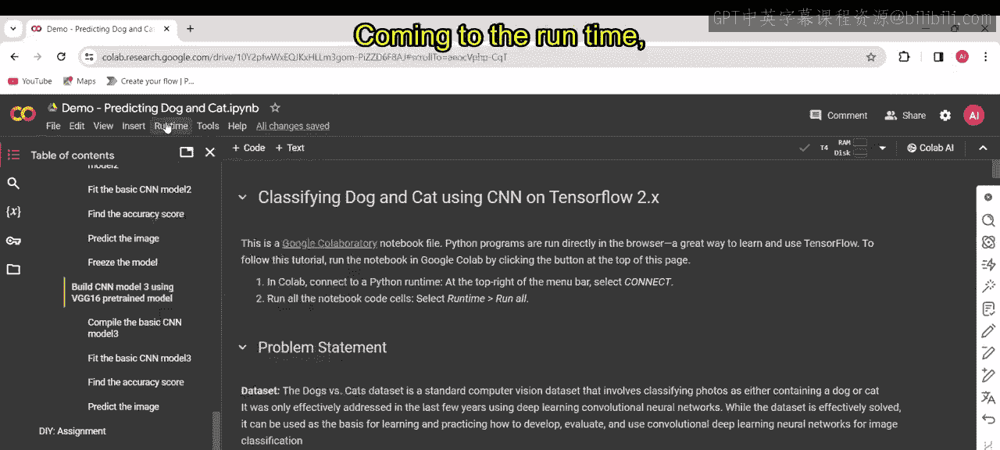

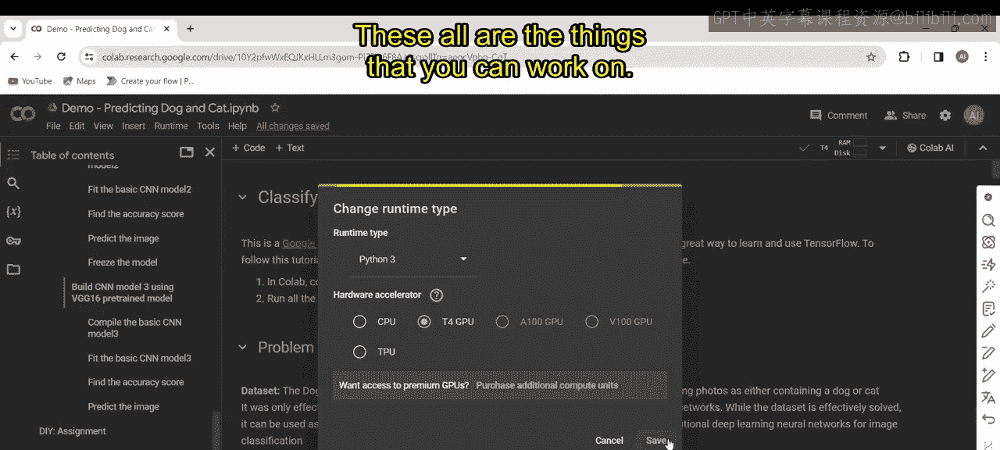

modelel to classify the images as either containing a dog or a cat。

 we will plot the change in accuracy put epoch and evaluate the model on testing data Additionallyly。

 we will analyze the model summary and add dropout layers to prevent overfitting and experiment with increasing hidden layers to absorb their effect on accuracy and manipulate bad size and epochs to study their impact on model performance So in our data set it comprises 8005 training images and 2023 testing images each belong to either dog or the cat class so we will leverage tensorflow to1 x functionalities for implementation and model improvisation and saving and loading the pretrained models。

 so let's get started here， first of all， this line provides。😊。

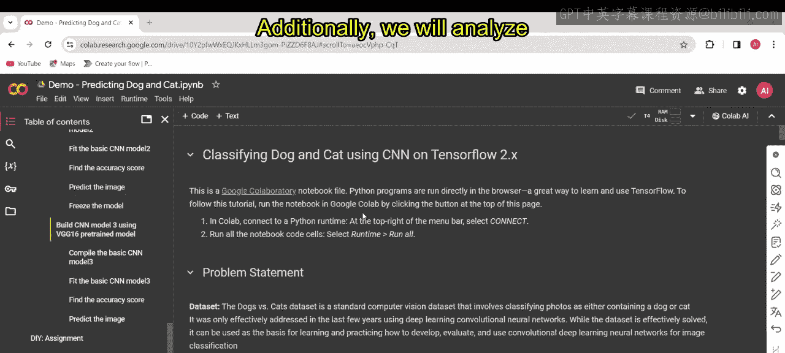

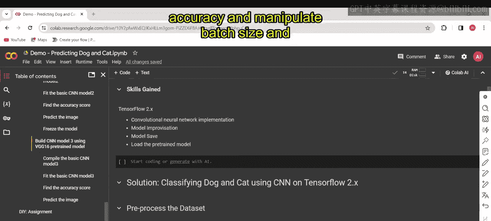

Or downloads the training dataset zip file from the provided URL and the second line。

 the Dropboxs dot co and this file it will download the testing data zip file from the provided URL means this contains training and testing data once if it is done now unziippped this line unzips the data file making it contains accessible for further processing and the second line of this zip this is a training and this is the testing it is used to unzip。

😊。

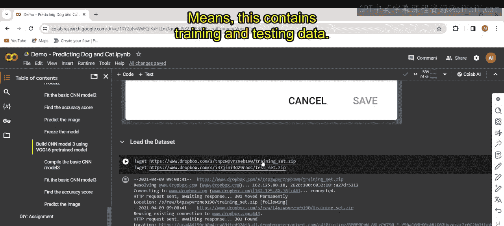

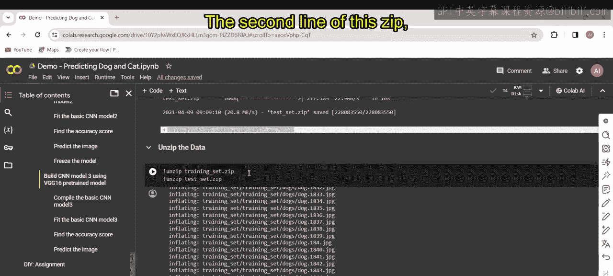

And then visualization of the data here， percentntile Plab in line。

 this line is a magic command in Jupiter notebook that imports Matplotlib and Ny libraries and sets up in line plotting。

 then coming to the Matpllib dot pipepl this imports Pipl module from the Matpl library which is used for plotting then coming to the MP image this imports the image module from the Matplotlib library allowing image related operations。

😊，And here we are reading the images means this line reads and loads an image of a catd from the specified file path and then displays the loaded image using the mat plot libs Im shoe function then plot dot show this line shows the plotted image and here is the output and similarly。

 you guys can execute this code and can work on this。 It is also similar way。

 you need to load the data and can show it and then importing the required libraries So here we are importing this library。

 these imports are essential for deep learning tasks using the tensorflow Tensorflow is for tensor library and dot chaos for building and training the neural networks Additionallyly modules are imported for tasks like image data preprocessing and defining the neural network architecture whether if it is of the sequential convolutional 2D or。

😊。

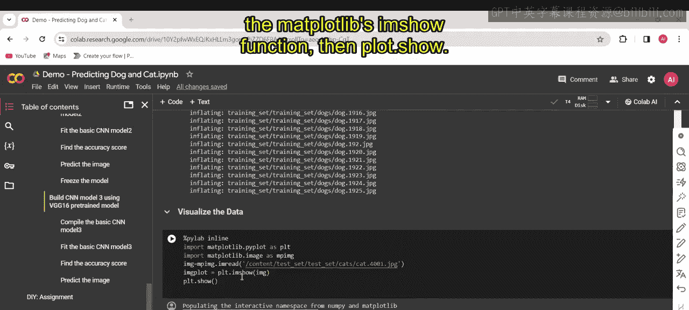

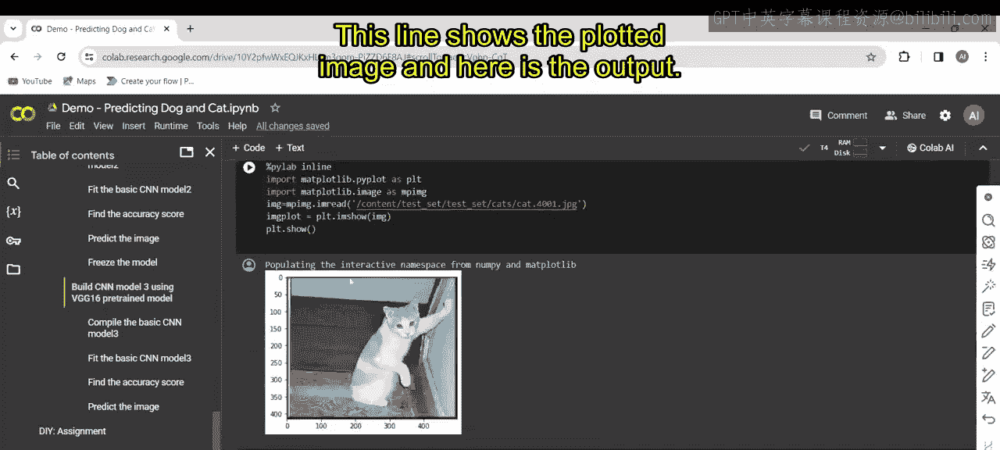

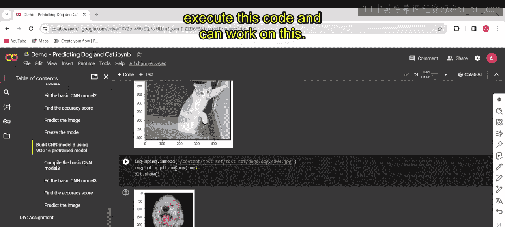

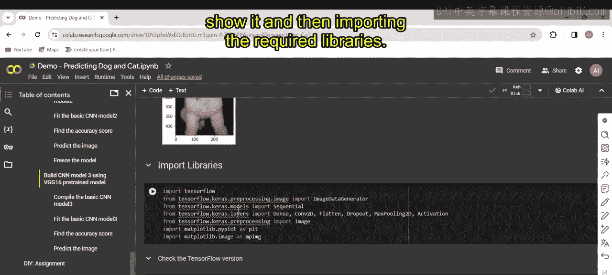

At layer or dense layer or the dropboard or maximum polling 2D and coming to the visualization we are utilizing matpl liplo pipe plot and the image so these all are the libraries that we are utilizing and we are just checking what is the version that is downloaded it is 204。

1 so the upcoming video will delve further into the ongoing discussion。😊。

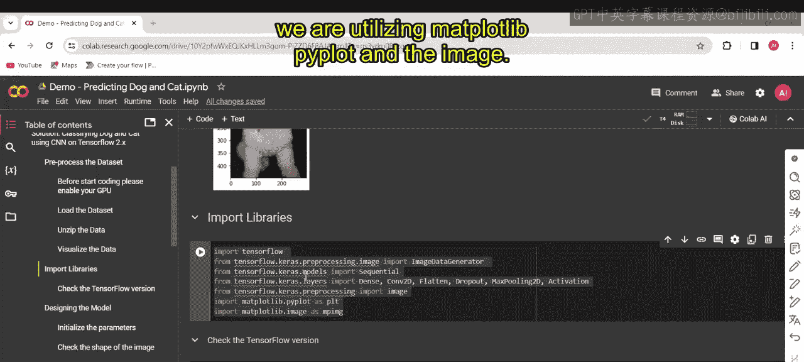

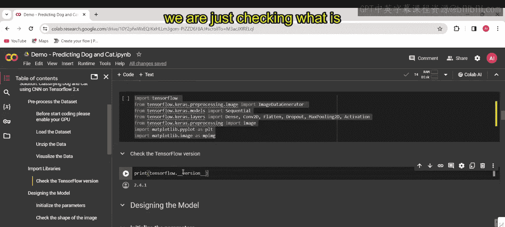

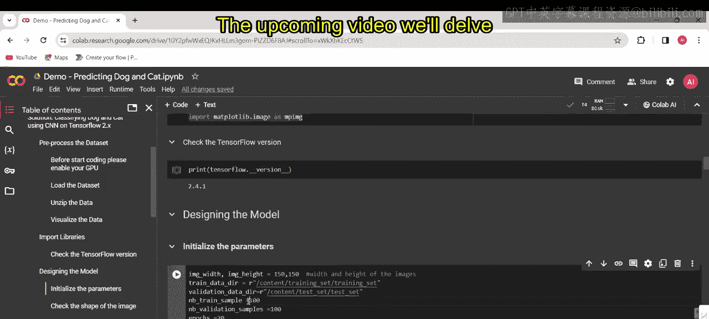