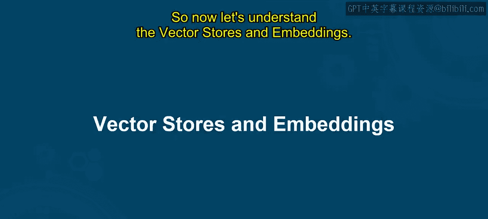
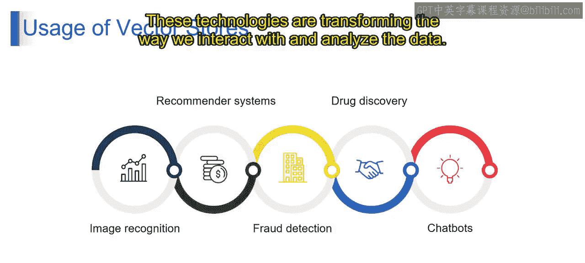
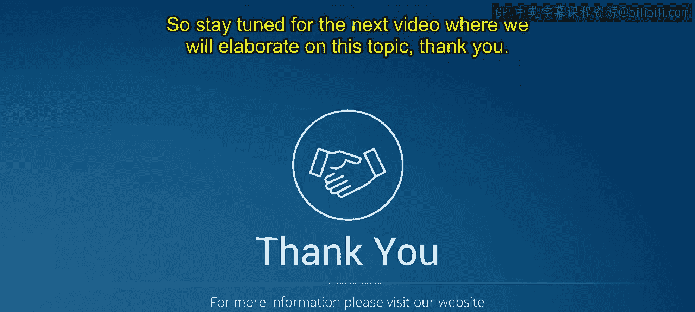

# Edureka《通过LLMs学习生成式AI（基础、应用开发、流行工具，第2、3、4课／共4课）｜Learn Generative AI with LLMs》中英 - P77：40_向量存储和嵌入.zh_en - GPT中英字幕课程资源 - BV1ym421V7gx

Hello everyone， welcome back to Generative AI Architecture and Appplication development Month。😊。

So now let's understand the vector stores and embeddings in this。

 we are going to cover what exactly the vector stores and embeddings is all about by the end of the session you are able to gain the insides of vector stores and embeddings in the rag models。

 So let's get started the vector stores and embeddings。

 first let's understand vector stores So imagine you are organizing against library imagine you are organizing against recipe collection for your super creativeative chef which is nothing but here the LLm you want them to easily find the recipes based on the similar ingredients or the themes like vegetarian dishes or the desserts or the non-vegetarian dishes。

 This is where the vector stores come in So think of a recipe index in a cookbook that is nothing but a vector stores This index helps you quickly find recipes by listing them。

😊。

Under the categories like vegetarian desserts or the keywords， that is nothing but the ingredients。

 Similarlyly， a vector store efficiently stores and retrieves the information about your text data So that's about the vector stores What about the embeddings imagine each recipe transformed into a unique shopping list code that is nothing but embeddings means this code captures the essence of the recipe that is nothing but the ingredients without all the details。

 vector stores use embeddings which are like condensed codes for text documents to perform the similarity searches So that's about the embeddings。

 So now let's connect this to the technical definition vector stores are specialized data designed to store and retrieve the information in the form of vectors These vectors are created using the embedding techniques which convert the textual data that is nothing but the documents data into。

😊，The numerical representation This allows the vector to to perform efficient similarity searches means think of cosine similarity as a fancy way of measuring how close two documents are based on the content means a high cosine similarities score between two documents indicate the share similar themes or the concepts by using the vector stores and embedding la chain rag system can effectively find the relevant information within your data collection to support the Lm's creative task It's like having a powerful search in specifically designed for text data eming your LLm to find the perfect information for any culinary textual challenge So that's about the vector stores and embeddings So now let's understand the usage of vector stores The first one is of image recognition so efficiently recognize。

😊，And classify the objects within the images by using these vector stores means images are converted into vectors using the techniques like convolutional neural network。

😊，That is nothing but CNN。Vectctor stores enable rapid retrieval of similar images based on their vector representations。

 allowing for accurate object recognition in tasks like image search or content moderation。

 So that's about image recognition。 then recommender systems。

 So here the recommended relevant products， articles or the content to users。

 So how exactly it happens。 So user profiles and the item descriptions are converted into the vectors。

 vector stores enable retrieval of items with highcosine similarity to your users' profile leading to personalized recommendations on the ecommerce-commerce platforms streaming services and many more。

 So that's about recommender systems。 Then the next one is of fraud detection。

 here the challenge is to identify fraud in transactions or the activities in real time。

 So the transaction data here amounts。😊，Los or the timets is converted into the vectors。

 so vector stores enable flagging transactions with high similarity to know the fraudulent patterns。

 helping the financial institutions and the other entities come fraud。 that's about fraud direction。

 Then the drug discovery。 So here the challenge is to accelerate the discovery and develop of new drugs means the solution here is that the molecular structures and the properties of existing drugs are now converted into the vectors。

 These vector to enable the identification of the molecules with similar properties potentially leading to a new drug candidates with desired therapeutic efforts。

 So that's about the drug discovery。 Then the next one is of chatbos。

 here the challenge is to develop the chatbos that can understand the user intent and respond in a natural。

😊，Means the solution for this is user queries and chatbo responses are converted into the vectors。

 the vector tools enable the retrieval of the relevant responses from your chatbot's knowledge base based on the user's query leading to more engaging and informative chatbo interactions means the vector tools and embeddings are the powerful tools that unlock the potential for efficient similarity search across the various domains from the image recognition to fraud detection and beyond these technologies are transforming the way we interact with and analyze the data。

😊。

So stay tuned for the next video where we will elaborate on this topic， Thank you。😊。

