# Edureka《通过LLMs学习生成式人工智能（机器学习和NLP基础，第1课／共4课）｜Learn Generative AI with LLMs》中英字幕 - P77：76_猫狗分类演示II.zh_en - GPT中英字幕课程资源 - BV1q4421Q7qh

So let's now explore the progression from our previous discussion。😊。

This block of code represents the variables define parameters for image processing and model training here。

 image width and image height specify the dimensions of the input images and train data directory and validation data directory denotes the path to training and validation data directories and N underscore training sample and validation sample indicates number of samples in the training and validation sets separately and coming to the apochx it signifies the number of training iterations and that size determines the number of samples processed per iteration and now this code segment are just the input shape based on the image data format If the data format is channels first the input shape is set to three comm image width and height where three represents。

😊。

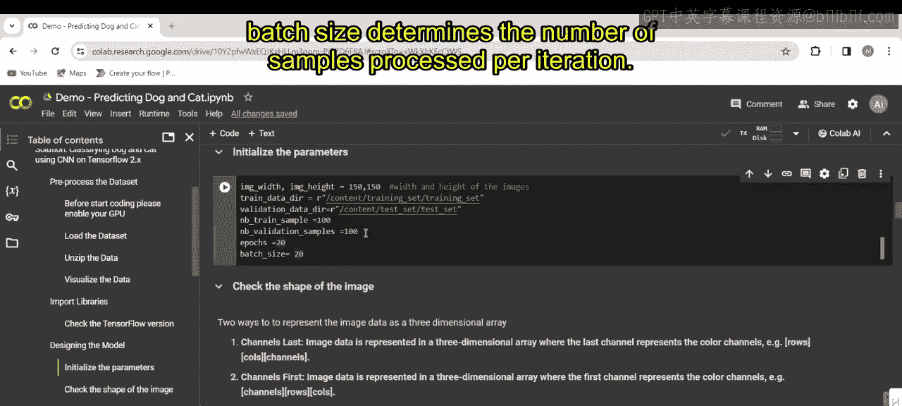

The number of color channels that is nothing but RGB。

 Otherwise for channel loss the input shape is image width image height comma 3。

 Now we can generate the images to the train the model rescale， share range。

 z range and whole gentle flip。 Now you can see the differences。

 This class allows to configure the random transformations and normalization of the provided image during the training time。

 It will prevent overfitting and helps to generate the generalized model never repeat the exact same image twice to the training model。

😊。

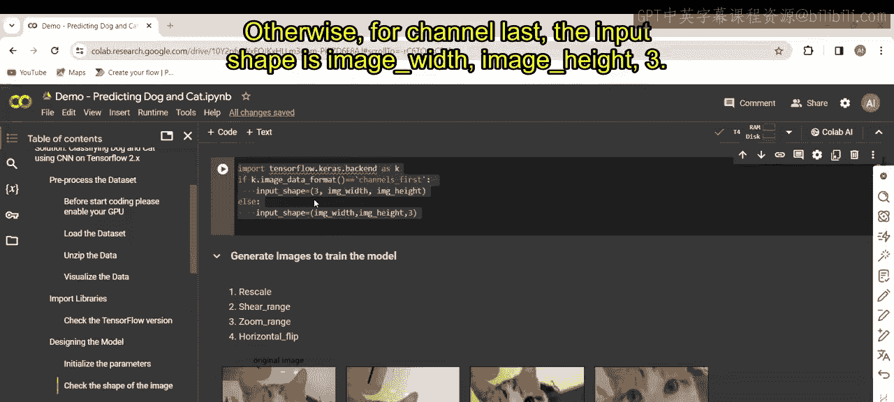

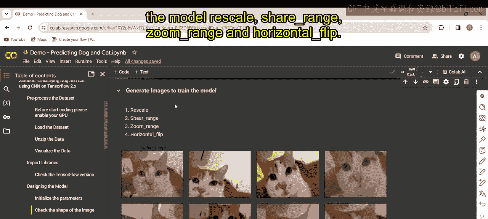

Now， this block of code initializes the image data generators for training and testing with specify transformations such as rescaling。

 sharing， du and horizontal flipping the second block of code here。

 this block of code generates the data iterations like train generator and validation generator for training and validation sets separately or respectively loading images from the directories like train data directory and validation data directory for both generators and the images are resized to the specific data size like image width and height path size is set to 20 and the class mode is set to binary as there are two classes that is cats and dogs to classify。

😊。

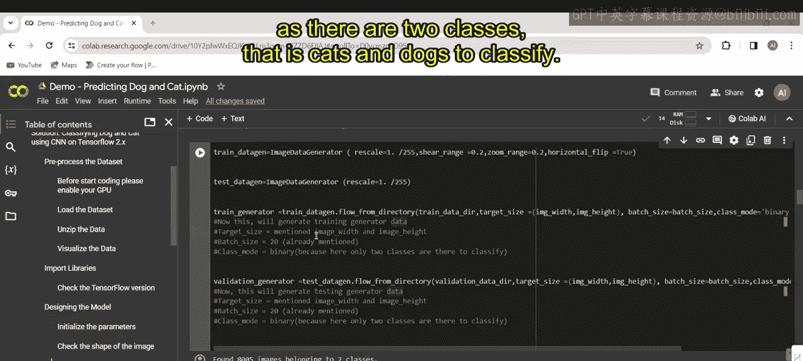

Now， this block of code visualizes a subset of images from the training data。

 It creates a5 by3 grid of subplots and iters through the first 15 batches of images from the train generator for each batch it extracts the first image like image is equal to x underscore batch of0 means the index position is0 and displays it in a subplot the loop breaks after the first batch to avoid displaying multiple images from the same batch。

 Finally， it adjusts layout and shows the plot and here we provided how to build the c model like by using the convolution and then raillu and then pulling layer and fully connected layer these are the things that we discussed during the theoretical explanation you can go through and understand all this adding convolutional neural network to the model that is a first step and it helps means。

😊。

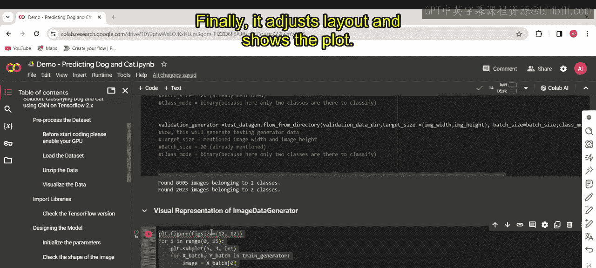

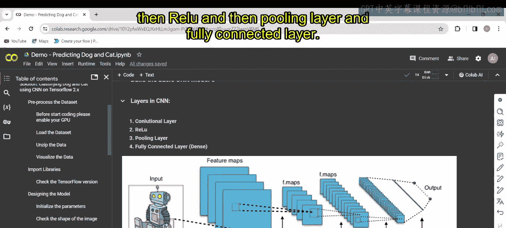

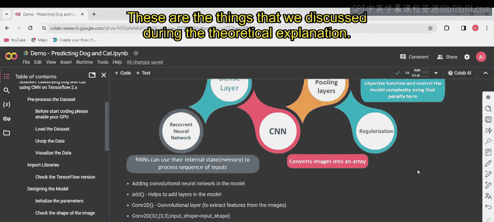

helps to add the model and here is the representation you can go through Now this block of code defines convolutional neural network model using the sequential API in the tensorflowers。

 It consists as soft convolutional layer with 64 filters of size 3 by3 followed by the relu activation function and maximum pooling layer to extract features and reduce spatial dimensionality。

 the flattened layer reshapes the output of the previous layer into one dimensional array followed by a fully connected layer with 64 neurons and relu activation function Here is the representation。

 Finally， there is an output layer with a single neuron and a soid activation function for binary classification Here is the representation and finally the model summary it provides the summary。

😊。

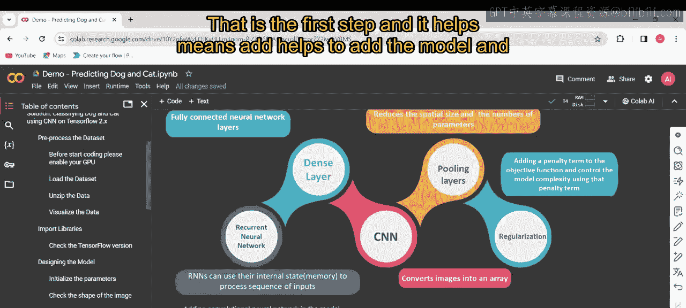

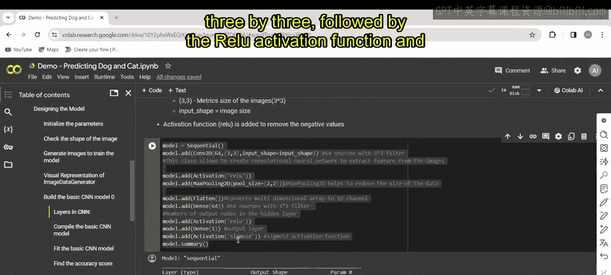

Of the model architecture， including。

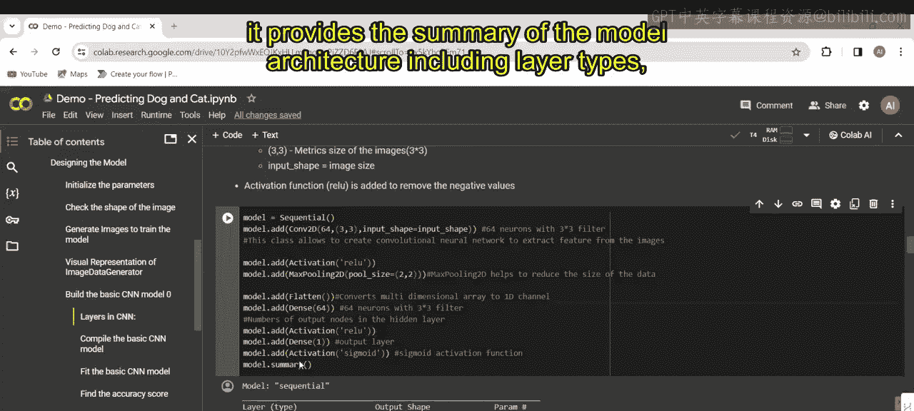

Layer types， output output shapes and number of parameters Here is the output now compile the basic CNN model this code compiles the previously defined model using the rMSs Pro optimizer and binary cross entropy loss function and accuracy as the evaluation metric model dot summary then prints the summary of the compiled model displaying the architecture layer types output shapes and the number of parameters along with the compilation setting here is the output for this。

😊。

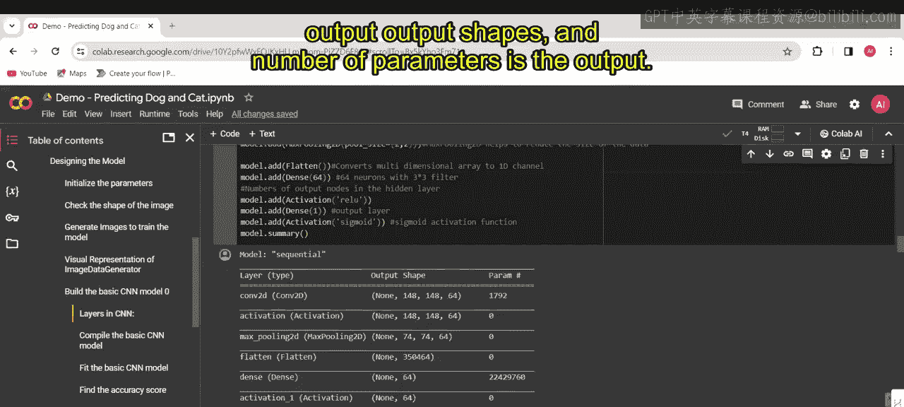

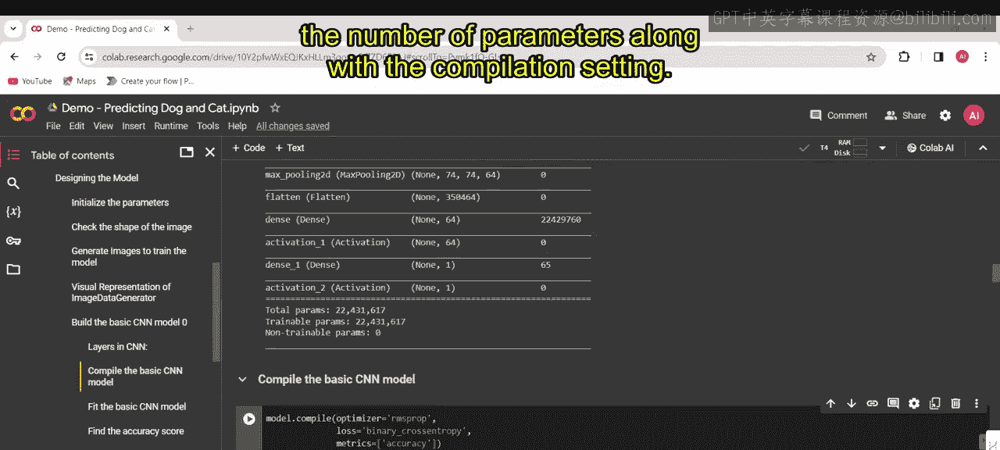

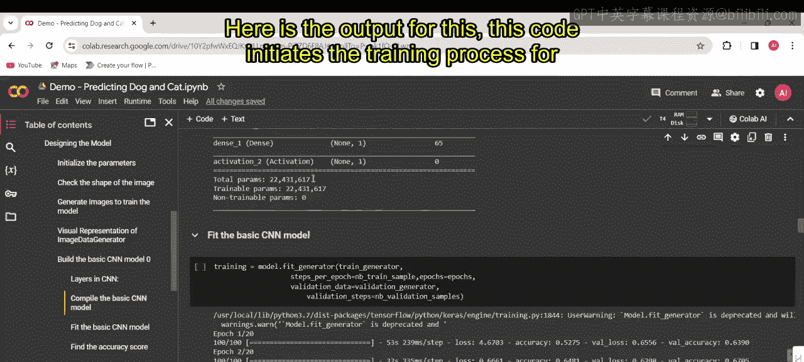

This code initiates the training process for the compiled model using the F generator method。

 It trains the model on the data generated batch by batch by train generator specifying the number of steps per epoch as N underscore train underscore sample and the total number of epochs as epoch so validation data generated by validation generator is used for validation during the training with the number of validation steps per epoch specified by validation steps set to N validation samples the training process is stored in the training variable for further analysis or visualization So this is a training process and then finally so the upcoming video will delve further into the ongoing discussion。

😊。

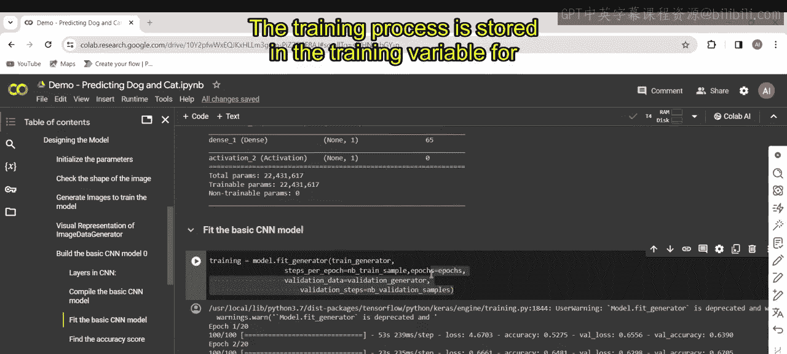

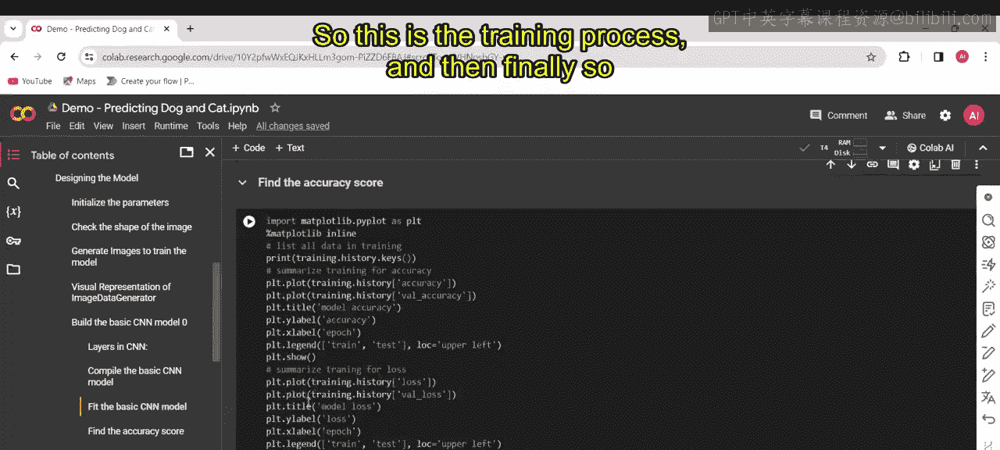

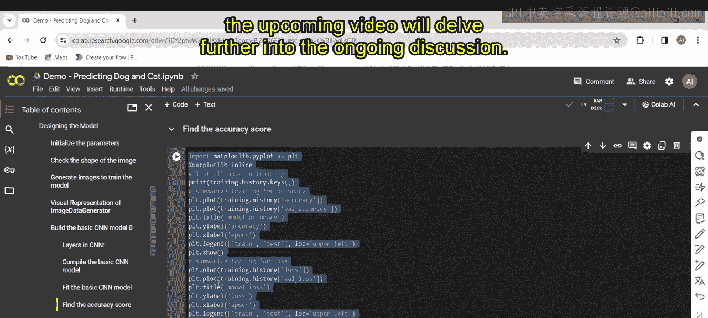