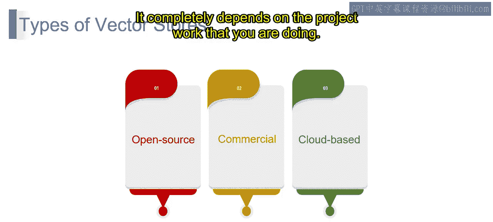

# Edureka《通过LLMs学习生成式AI（基础、应用开发、流行工具，第2、3、4课／共4课）｜Learn Generative AI with LLMs》中英 - P78：41_向量存储的类型.zh_en - GPT中英字幕课程资源 - BV1ym421V7gx

Hello everyone， welcome back to Generative AI architectureitecture and Appplication Travel Month。😊。

So now let's understand the types of the vector stores so the first one is of the open source here it is like freely available and customizable these stores offer the advantage of being accessible and modifiable to suit specific needs popular open source options include Pcoe fires which is nothing but the Facebook AI similarity search and Melvis and it is having the community drivenn support also means you will rely on the developers community for support and troubleshooting though some may have active community or the forums。

😊，And coming to the scalability considerations， scaling an open source solution might require additional technical expertise to manage infrastructure and the resources so that support the open source vector stores then the commercial one so it is about the enterprise grade feature and support commercial vectors offer features like highava robust security and dedicated customer support ideal for production environments and critical applications。

 examples include weviiate even vector base and manifold means who will manage these services。

 some commercial offerings provide managed services。

 taking care of the infrastructure and the maintenance。

 allowing you to focus on your application development rather than managing itself and then coming to the license costs these stores typically require paid licenses with cost varying based。

😊，the features， storage and the usage。 So that's about the commercial one。

 Then the last one is of the cloudbased one。 They are used for the deployment flexibility and the scalability。

 So cloudbased stores offer easy deployment on major cloud platforms like AWs GCP or azure simplifying infrastructure management and enabling seamless scaling on demand examples include Amazon Kenra as your cognitive search and Google cloud AI platform for this。

 you can go with pay as you go pricing So cloudbased options often follow a pay as you go pricing model aligning cost with your actual usage and coming to the potential vendor lockin while offering ease of use switching between the cloud providers might be more complex with cloud based stores choosing the right vector stored depends on your specific needs considering the factors like budget。

😊，Technical expertise， design features， skillalability requirements and the data privacy concerns when making your decisions it's also worth exploring hybrid options that combine elements of open source and commercial solutions It completely depends on the project work that you are doing。

 So now let's understand working with the vector stores。😊。

So stay tuned for the next video where we will elaborate on this topic， Thank you。😊。

