# Edureka《通过LLMs学习生成式人工智能（机器学习和NLP基础，第1课／共4课）｜Learn Generative AI with LLMs》中英字幕 - P78：77_猫狗分类演示III.zh_en - GPT中英字幕课程资源 - BV1q4421Q7qh

So let's now explore the progression from our previous discussion this block of code visualizer。

 the training history of the model plotting accuracy loss metrics over the epoch it utilizes mat plotlib for plotting and prints keys of the training dictionary then it plots accuracy accuracy and loss curve for both training and validation sets providing insights into the model performance during the training process here the blue color line represents training dataset and this is the testing dataset it is approximately doing better now this code segment visualizes the training history of the model plotting accuracy accuracy and loss metrics over the epochs using the matpllib it first prints the keys of the training history dictionary to identify the available metrics then it plots accuracy and the。

😊。

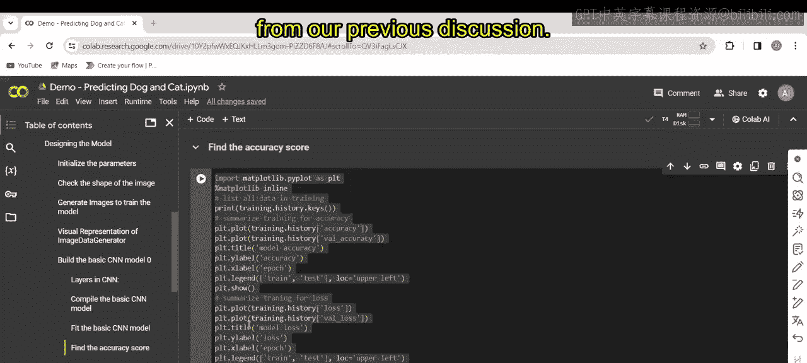

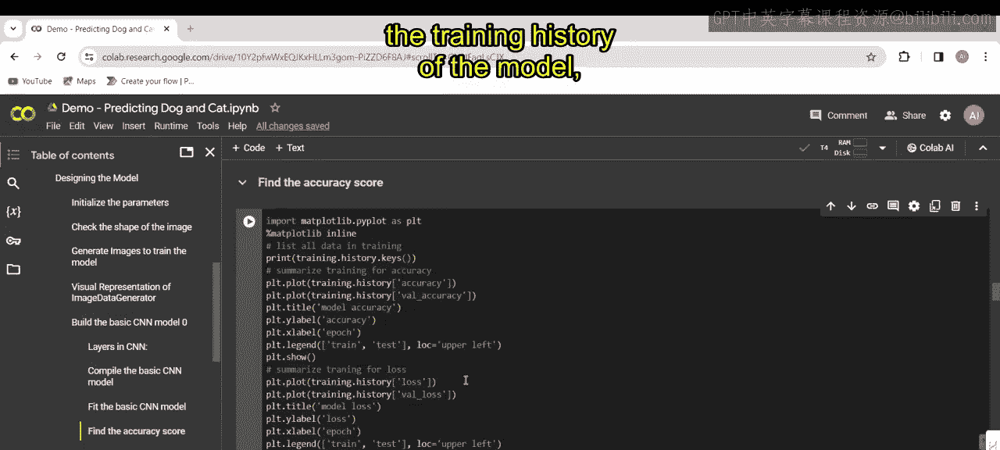

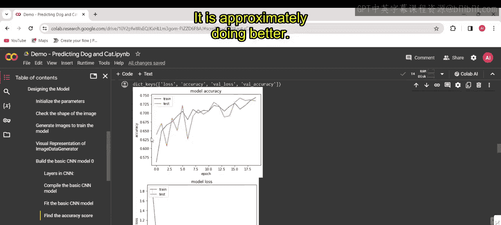

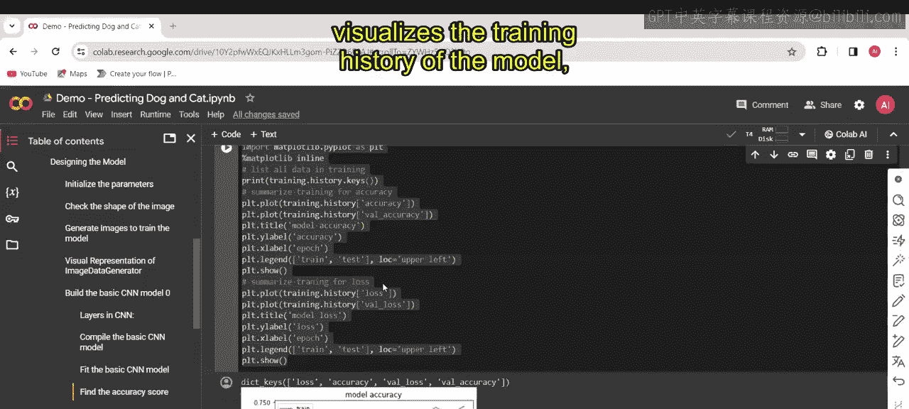

Cves for both training and validation sets， aiding in analyzing the model performance during the training process。

 and now the prediction model training is done and now we are going to predict。

 So how can we do that This code segment loads the image first of all here and preprocess it and makes a prediction using the trained model。

 it first loads an image from the specified path。 It resizes it to 150 comma 150。

 then it converts the image into an array it expands its dimensions and passes it through the model for the prediction the prediction result is printed and based on the result。

 it prints whether the image represents a dog or cat Finally it displays the loaded image using the matpl lab Now predict the image So this code segment also perform similar tasks we considered。

😊。

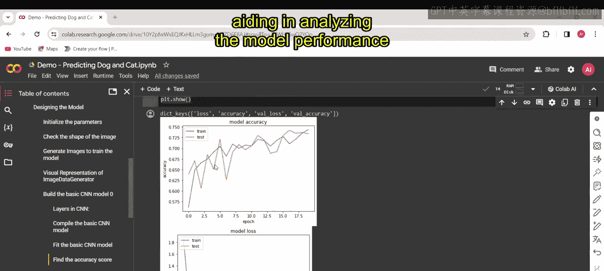

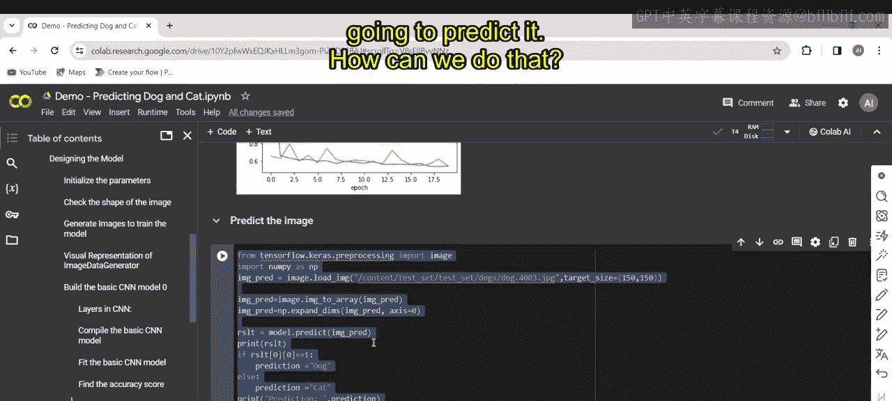

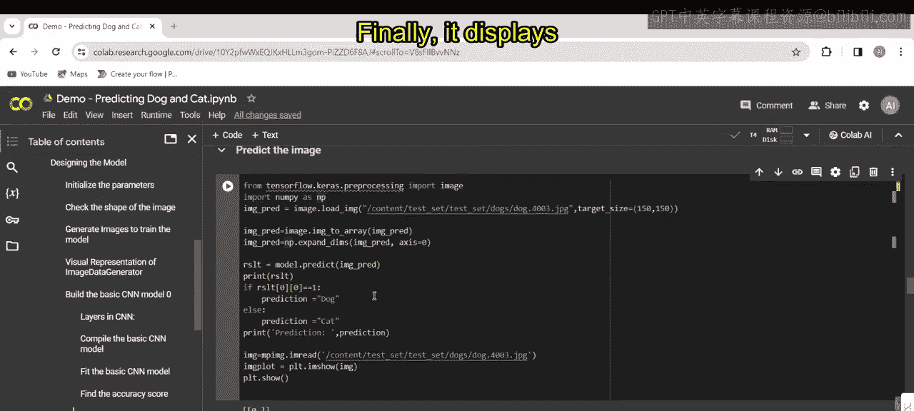

The other image with a different image means it loads an image of a cat preprocess it and predicts its class using the trained model。

 the prediction result is printed you can see it here so now you can see it is predicting the character telling that the provided images cat and based on the results it prints whether the image represents a cat or dog and finally displays the image using the mattepl lip like this similarly you can even go with the other models also we provided multiple models with the similar functionality I request everyone to work on this code so that you will get the good insights out of it。

😊。

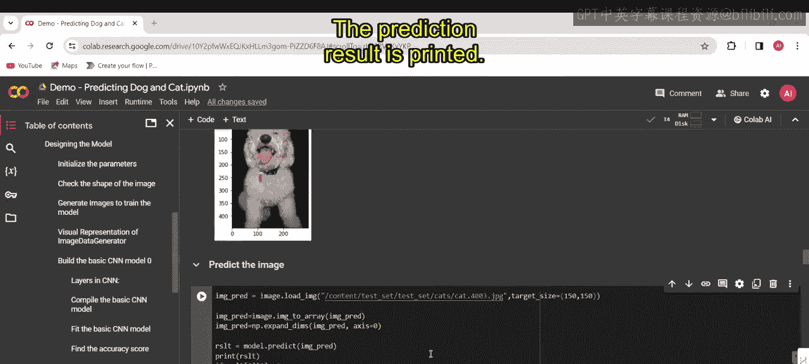

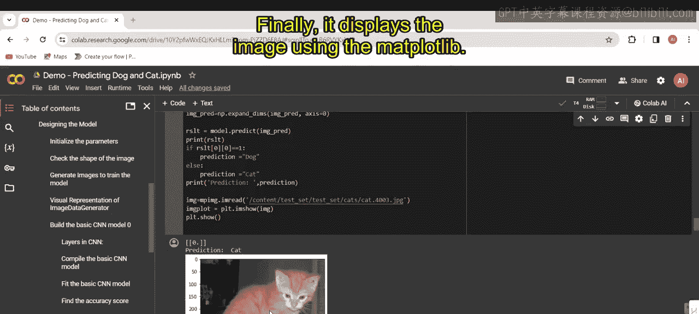

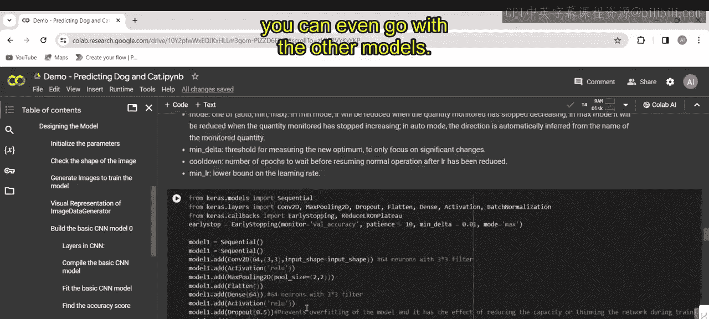

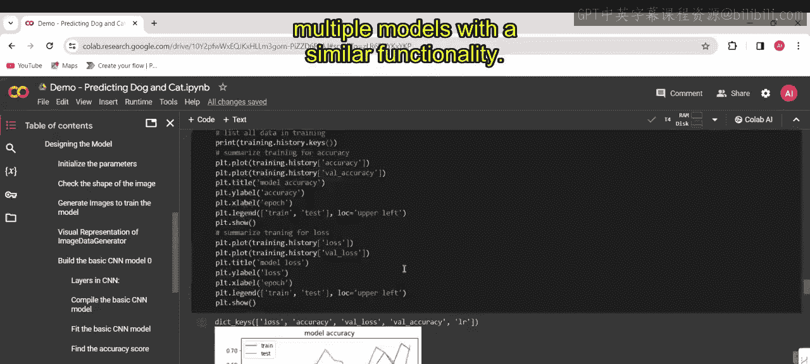

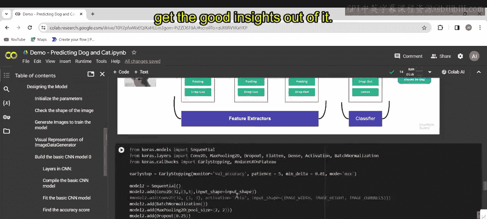

Once the model start predicting the images now we have to freeze the model this code saves the architecture of Kra model to a JSON file that is model2 dot JSO whatever the model you are working and its weights to an HF5 file that is first tri dot H file these files can later be used to reconstruct the model architecture and load the learned weights for inference without retraining as I mentioned this is an example of saving the model。

😊。

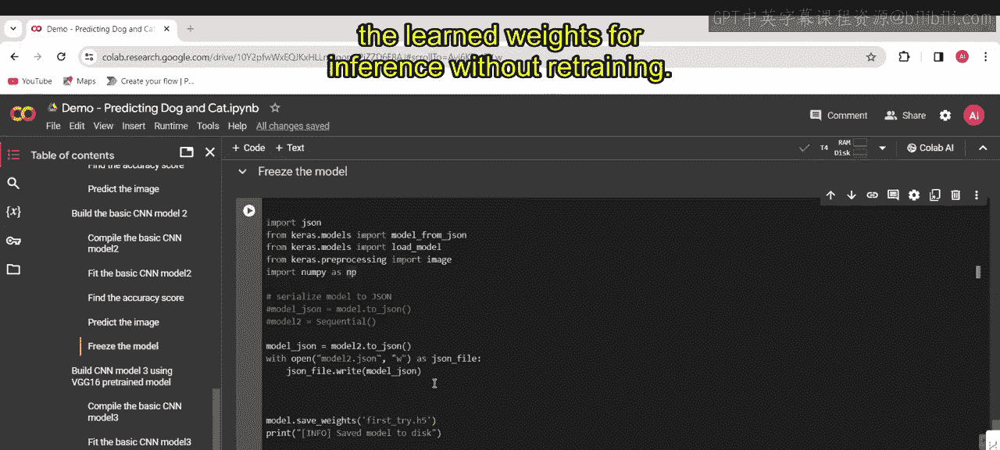

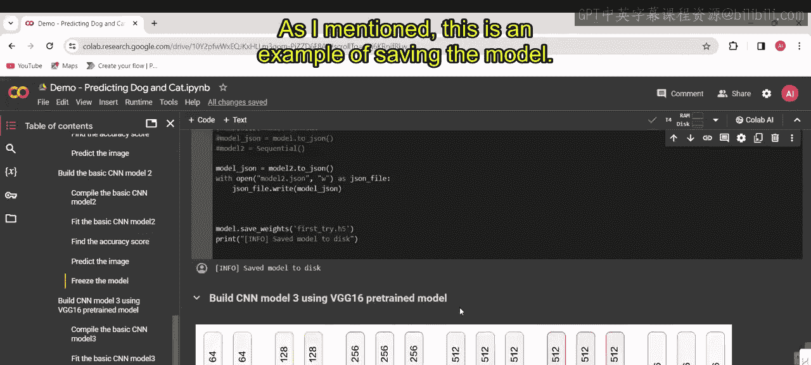

Now build CNN using the VGG16 pretrained model once we are done with the model training this code constructs a CNN model using the pretrained VGG16 network which feature extraction it freezes the first 15 layers of VGG16 while allowing training for subsequent layers means the output of VGG16's last pooling layer is pla and connected to a fully connected layer with 512 units means 512 units followed by dropout layer and regularization here is a representation finally a dense layer with a single neuron and sigmoid activation is added for binary classification task。

😊。

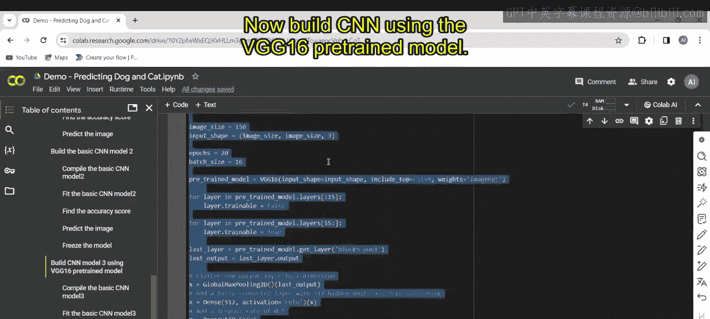

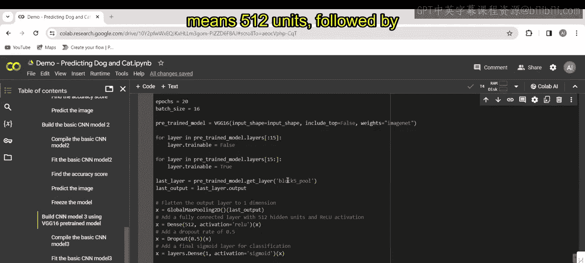

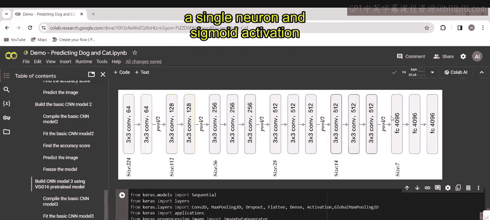

Same like this， we will be compiling the constructed model using the binary cross entropy laws using stochastic gradient decent optimizer with the learning rate of 1 e minus4 and momentum as 0。

9 and the accuracy or evaluation metrics you can go through the code and understand how all these models are working Finally we are printing the accuracy and predicting the image whether the provided image is cat or dog so I can suggest you guys to go through this data sets and understand how exactly it is working Thank you。

😊。

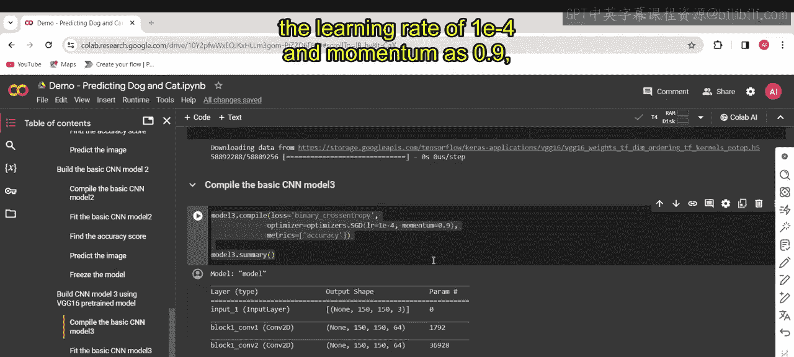

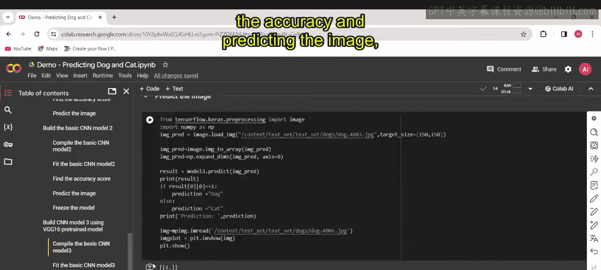

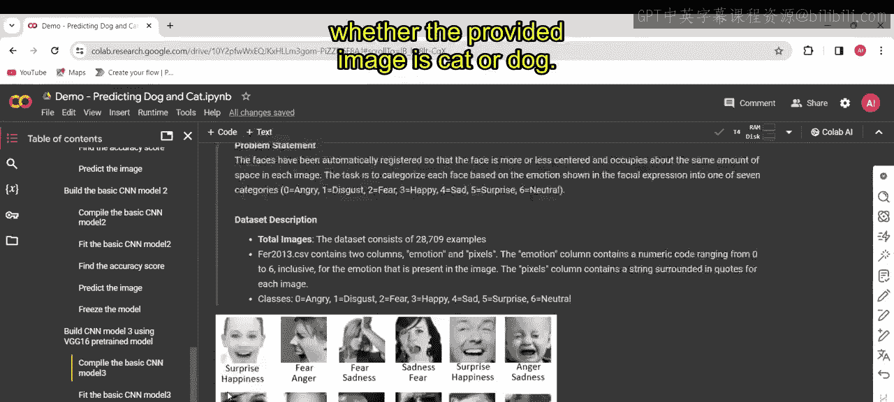

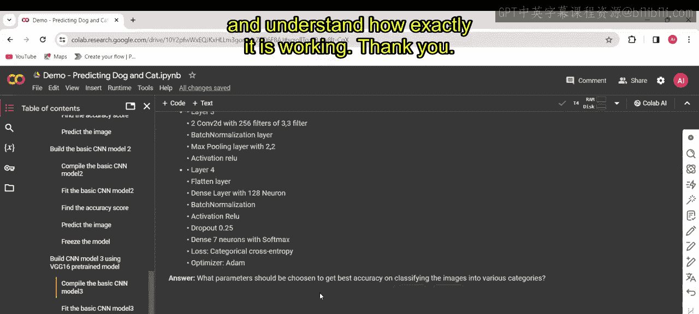