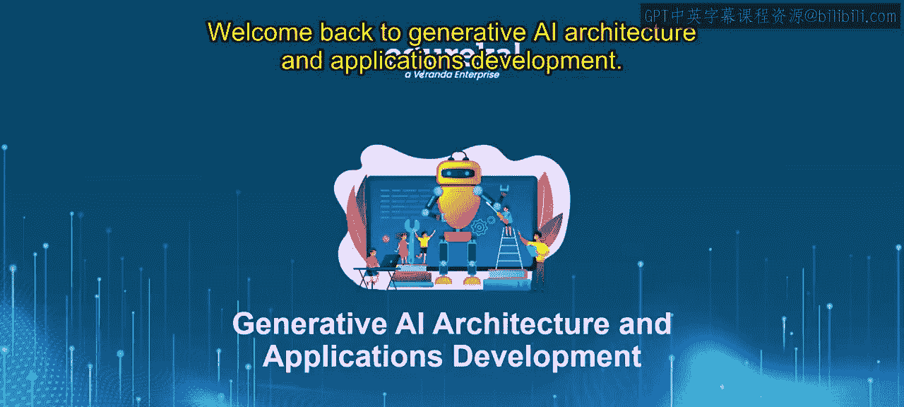
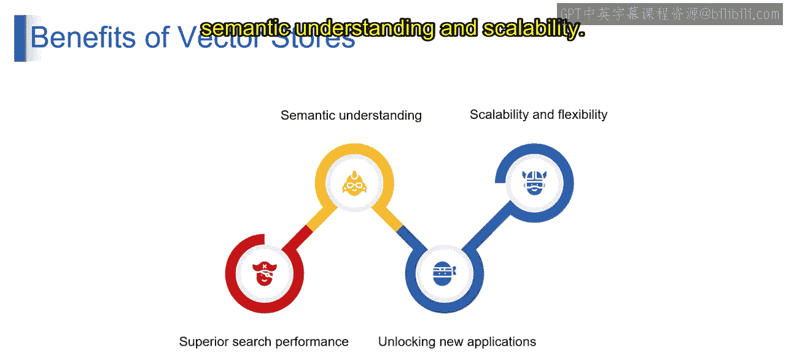

# Edureka《通过LLMs学习生成式AI（基础、应用开发、流行工具，第2、3、4课／共4课）｜Learn Generative AI with LLMs》中英 - P79：42_向量的工作原理.zh_en - GPT中英字幕课程资源 - BV1ym421V7gx

Hello everyone， welcome back to Generative AI architectureitecture and Appplication Travel Month。😊。

The first step is data encoding so the journey begins with converting the textual data that is the documents or the sentences or whatever it is。

 We are converting the textual data into the numerical representations called the embeddings these embeddings capture the essence of the data in the compressed format focusing on semantic meaning rather than the exact words themselves。

 That's about the data encoding with the foundation Then here we will perform encoding techniques。

 the popular encoding techniques involves word embeddings。

 for example we can do it by using the word to way clo。

elmo and many more So these methods capture the semantic relationship between the words where words with a similar meaning have similar vector representation then there is also one encoding techniques that is sentence embeddings sentence embeddings for example we can use the sentence bird universal sentence encoded these。

😊，Enco entire sentences considering the context and relationship between the words within the provided sentence。

 So thats about the first step， which is nothing but data encoding。😊。

So the next step is of indexing in this first one the efficient retrieval once encoded as vectors the data is stored within the vector store however for efficient retrieval The store employs indexing techniques similar to the traditional databases that can be performed by the efficient retrieval then we are having the indexing strategies for this common indexing strategies include hein Sw IVFF Hein Sw is nothing but hierarchical navigable small world this method creates a multilayed index structure allowing for efficient exploration of similar vectors within the search space so that's about Hin SW then the next one is of IVFF it is nothing but inverted index with flat file this technique bills an inverted index that maps vectors to their corresponding data points enabling faster。

😊，Based on the specific queries。 So that's about IVF。 Then the next one is of similarity search。😊。

So now let's understand the similarity search。 So here the first thing is of finding the closest matches when your users submits a query the vector store performs a similarity search this involves comparing the query vector to the index vectors representing the distort data then the next one is of similarity metrics the core of similarity search lies in calculating the distance between the query vector and the stored vectors common matrix include cosine similarity and L tod when we say cosine similarity this metric measures the angle between the two vectors a higher cosine similarity score indicates greater semantic closeness between the query and the document vector and coming to the L2 distance this metric cs the Euclidean distance between the two vectors in a high dimensional space by leveraging these core processes vector stores enable。

😊，id retrieval of the information that shares the semantic similarity with the users query。

 This empowers La rag system to access the relevant knowledge from your data collection。

 informing the elements responses and fostering more effective interactions within your NLP applications。

 So that's about working with the vector stores。 So now let's understand the benefits of the vector stores。

 The first one is of superior search performance。 It is like beyond the keyword search traditional search engines often rely on the keyword matching。

 which can be limited。 vector to Excel at semantic search retrieving the information based on the meaning and context。

 even when the exact keywords are not present。 This is achieved by leveraging vector representations that capture the essence of the data and also efficiency at scale vector stores excel at handling the large dataset set efficiently。

😊，Indexing techniques like Hin S W IV F put that whatever we discussed in the previous slide。

 enable rapid retrieval of similar vectors， even as the data collection grows。

 making them ideal for applications dealing with massive amounts of the textual information。

 Then the next one is of semantic understanding。 So moving beyond the surface level similarities。

 unlike keyword matching vector to consider the semantic relationship between the words and the concepts。

 this allows them to identify the documents with the similar meaning。

 even if they use different vocabulary， this capability is crucial for tasks like question answering。

 where understanding the user' intent is essential for providing the relevant responses。

 Then understanding the encoding shades of the language eming techniques capture the subtleties and context within the language。

 This allows the vectors。😊，Told to identify the documents that share similar themes or the viewpoints。

 even if they are expressed differently， So that's about semantic understanding。

 Then the next one is of unlocking new applications here it's like feelinging the advanced NLP tasks like vector stores empower the wide range of NLP applications like recommendation systems。

 chatbos and tech summarization and the next one is of scalability and flexibility here we are accommodating the growth。

 vector stores are designed to handle large datas efficiently indexing structures and cloudp deployment options enable seamless scaling as your data collection grows ensuring performance remains consistent even with increasing demands so along with that integration with driver system vector tools can be integrated with various NLP frameworks and tools providing the flexibility in building and deploying the。

😊，In applications， many stores offer APIs that allow easy integration with their development workflows means vector stores offer a powerful combination of the efficient search semantic understanding and scalability so these all are the benefits。

😊。

So stay tuned for the next video where we will elaborate on this topic， thank you。😊。

