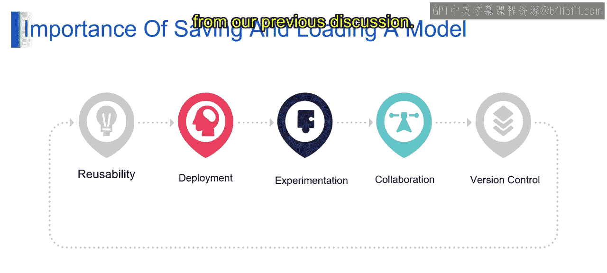
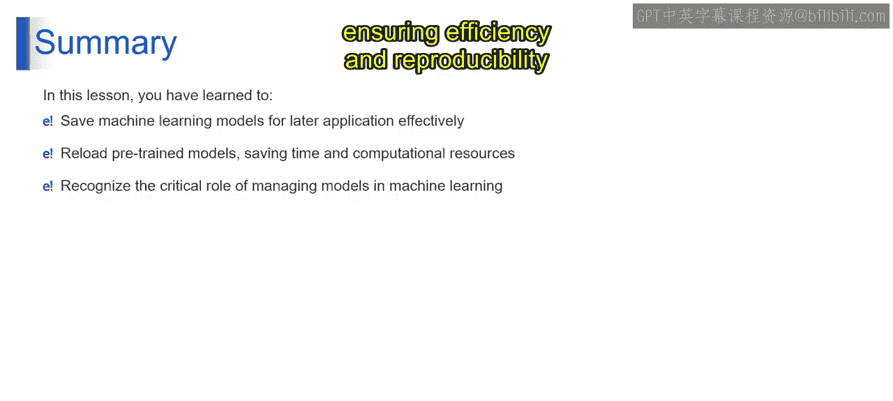

# Edureka《通过LLMs学习生成式人工智能（机器学习和NLP基础，第1课／共4课）｜Learn Generative AI with LLMs》中英字幕 - P79：78_保存和加载模型的重要性.zh_en - GPT中英字幕课程资源 - BV1q4421Q7qh

So lets now explore the progression from our previous discussion now let' us understand the importance of saving and loading the model the first one is of reusability。

😊。

Saving and loading a model enables reusability by preserving the trained parameters architecture and configuration This allows the model to be reused across different tasks or datas without the need to retrain it from the scratch saving time and computational resources then coming to the deployment let's say for example you are working on building the model for handwritten images so once after training the CNN model to identify the handwritten digits you can save the model and deploy as part of an application that recognizes digits in user inputted images means saving and loading a model facilitates deployment by enabling seamless integration into the real well applications or the systems the saved model can be easily load and used。

😊，For making predictions in production environments without the need for retraining then the next one is that experimentation。

 supposeuppose you are experimented with different CNN architectures for image classification after training each model you can save them and compare their performance metrics such as accuracy and the laws to determine the most efficient architecture means saving and loading the models。

 support experimentation by allowing researchers and practitioners to compare the multiple models。

 architectures and hyperpar。 This enable iterative model development and refinement to achieve the optimal references then collaboration saving and loading models promote collaboration by enabling the sharing and transfer of trained model among the。

😊，Team members or collaborators， this posts knowledge sharing。

 aates progress and promotes teamwork in machine learning projects。

 Then the next one is of version control。 So when making changes to your C models architecture or hyperpara。

 you can save each version of the model along with the description of the changes made。

 this allows you to track the models evaluation over the time and refer to previous versions。

 if needed， means saving and loading models support version control by providing a systematic way to manage and track changes to models。

😊，Throughout the development process， this ensures reproducibility。

 accountability and transparency in the machine learning workflow。 So now the summary。

 in this lesson， you have acquired the ability to save the machine learning models effectively for future applications and reload pretrained models。

 thereby conserving time and computational resources。 Moreover。

 you have gained insights into the critical role of managing models in machine learning workflows ensuring efficiency and reproducibility in model development and deployment。

 Thank you。😊。

