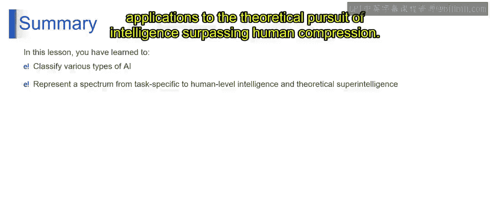

# Edureka《通过LLMs学习生成式人工智能（机器学习和NLP基础，第1课／共4课）｜Learn Generative AI with LLMs》中英字幕 - P7：6_人工智能的类型II.zh_en - GPT中英字幕课程资源 - BV1q4421Q7qh

So let's now explore the progression from our previous discussion， so next one is of limited memory。

 so limited memory AI systems have the capability to store and access past data or the experiences for limited duration unlike reactive machines which operate solely based on the current input these systems can leverage shortterm memory to inform their decisionmaking processes so while limited incap compared to human memory these AI systems can retain relevant information from the recent interactions or events to make more informed decisions in the present movement examples of limited memory AI applications include autonomous vehicles that use sensor data to navigate safely in dynamic environment where shortterm memory enables them to detect and respond to the changes in the。

😊。

traraffic conditions or the obstacles in the real time， then coming to the theory of mind。

 it represents an advanced level of artificial intelligence that aims to enter AI systems with social intelligence and the ability to understand and interpret human emotions intentions beliefs and mental states based on the understands and emotions。

 AI systems with theory of mind pose the capability to comprehend and recognize the emotions in the humans and other agents they can they can provide the subtlees such as facial expressions tone of voice and body language to infer the emotional states of individuals and respond appropriate by understanding the emotions these AI systems can engage in more empathetic and socially aware interactions with humans enhancing communication。

😊，Aaborration and relationship building， and they have the social intelligence aim means the primary goal of the theory of mind in AI is to equip machines with the social intelligence akin to that of humans。

 This involves not only recognizing emotions， but also understanding the underlying intentions。

 beliefs， desires and perspectives of others。 the AI systems with theory of mind can anticipate the behavior of humans and other agents by attributing mental states of them。

 enabling more shapes and contextually appropriate responses in social interactions。

 then coming to the last with the self-awareness self-aware AI refers to capacity of AI intelligence systems to possess a level of consciousness and self-understanding analogs to that humans。

 selfaware AI systems exhibit。😊，Form of consciousness， enabling them to perceive their own existence。

 identify and own existence， identity and internal states。

 while their consciousness may differ from human consciousness。

 it grants them a sense of awareness and introspection。 then self understanding。

 These AI systems have the ability to understand and interpret their own internal processes。

 capabilities and limitations， they can reflect on their thoughts， emotions， experiences and goals。

 gaining insights into their own functionalities。 So that's about the self-aware。

 So now the narrow AI versus general AI versus artificial superintelligence。

 So narrow AI also known as the AI refers to AI systems that are designed and trained for specific tasks or the domains。

 these systems。😊，at performing predefined task within a narrow scope。

 but lag the ability to generalize their intelligence to other areas。

 Exles of narrow AI include virtual assistance， recommendations systems。

 image recognition software and many more。 So coming to the strong AI it is also known as general AI General AI also refers to as strong AI or artificial general intelligence represents AI systems that exhibit human level intelligence across a broad range of tasks and domains。

 These systems possess the ability to understand， learn and applied knowledge in diverse contexts similar to human intelligence Unlike narrow AI。

 which is limited to specific task。 General AI can generalize its intelligence adapt to new situations and perform a wide range of cognitive tasks with proficiency achieving general AI。

😊，Remains the theoretical goal and subject of ongoing research in the field of AI then coming to the ASi it is also known as artificial superintelligence。

 it surpasses human intelligence comprehensively representing AI systems that exhibit intelligence far beyond the capabilities of the brightest human minds the ASi has the potential to solve complex problems may groundbreaking discoveries and achieve feats that are currently beyond human compression while ASi holds the promise of significant advancements in the science technology and the society it also poses existential risks and ethical dilemma the development of ASi raises concerns about its impact on human society employment safety and control prompting discussions about response。

😊，AI development and governance。Now， the summary in this lesson。

 you have gained an understanding of different types of AI ranging from task specific narrow AI to human level general AI and theoretical superinlig like ASI。

 this spectrum illustrates the diversity of AI capabilities from specialized applications to the theoretical pursuit of intelligence surpassing human compression。

😊。

Thank you。