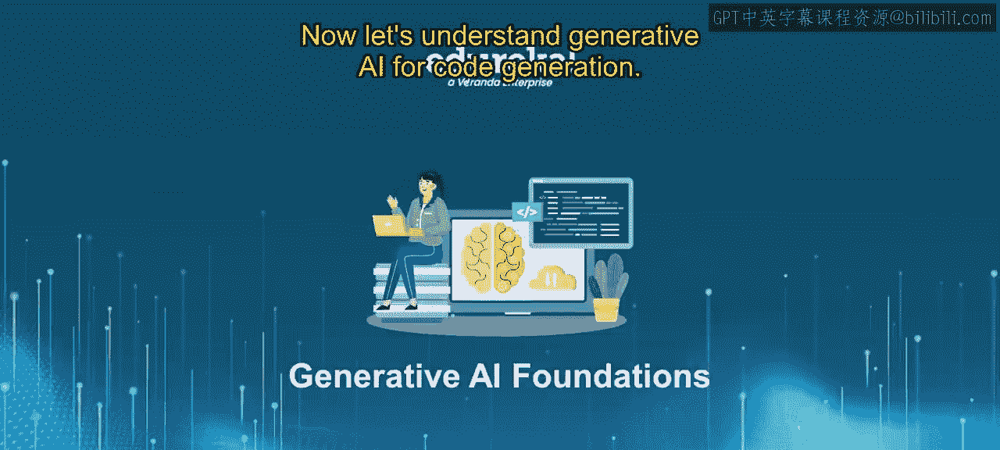
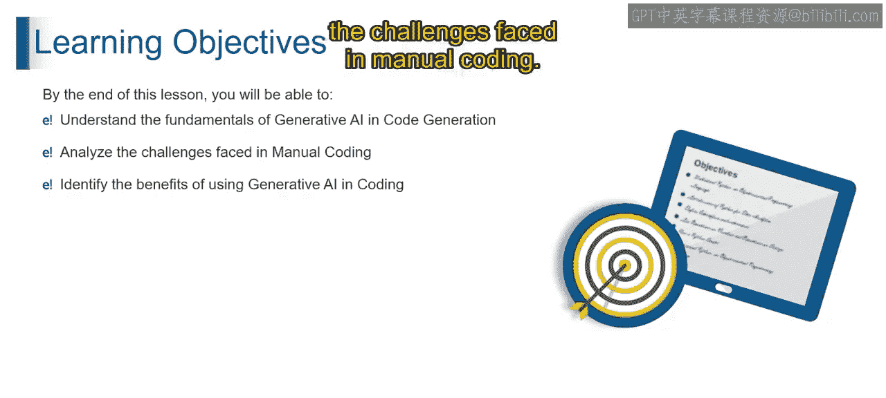
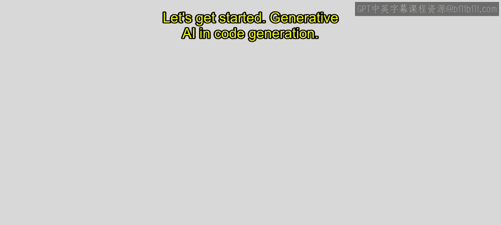
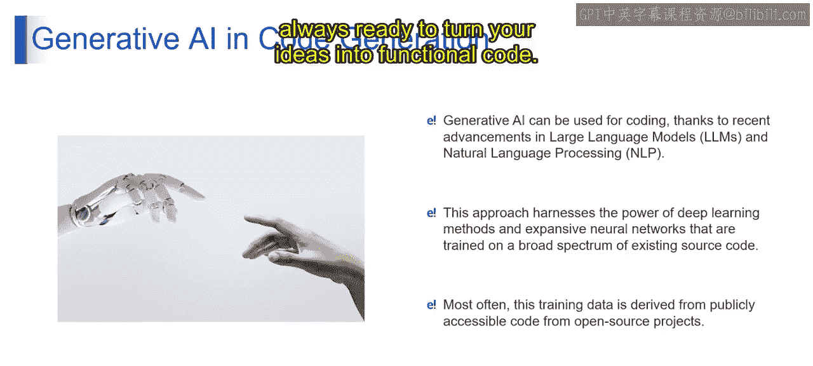
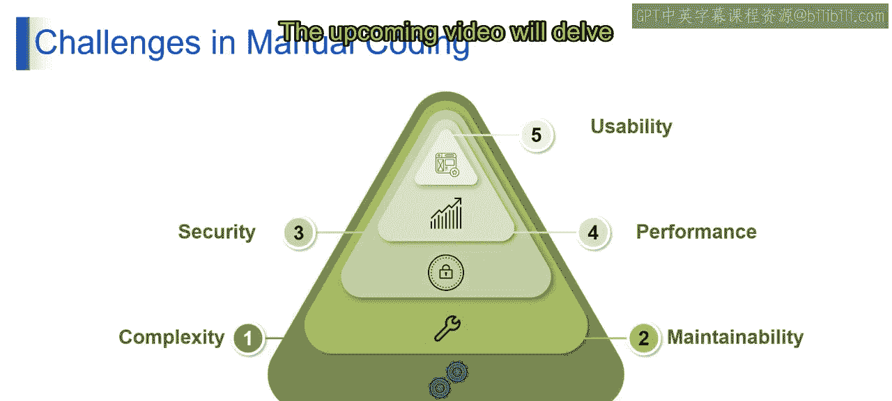

# Edureka《通过LLMs学习生成式AI（基础、应用开发、流行工具，第2、3、4课／共4课）｜Learn Generative AI with LLMs》中英 - P7：6_用于代码生成的生成式AI.zh_en - GPT中英字幕课程资源 - BV1ym421V7gx

Hello everyone， welcomele to generative AI foundations。

 So now let's understand generative AI for codegen in this。

 we are going to cover generative AI in code generation and the challenges in manual coding and then the benefits of generative AI code generation So by the end of the session you are able to understand the fundamentals of generative AI in code generation and you are able to analyze the challenges faced in manual coding and then identify the benefits of using generative AI in code。

 So let's get started generative AI in codegen So imagine a world where computers not only understand our language but also write code for us this magic is made possible by recent advancements in the LLMs。

 which is nothing but large language models and NLP。

 So let's dive in and explore the captive universe where AI becomes。😊。

coding companion The next one is of harnessing deep learning magic。

 So ever wished for a coding biiz by your side。 Well。

 thanks to generative AI your coding dreams are turning into reality。 Yes。

 you heard it right this cutting edge approach taps into theiz of deep learning and massive neural networks。

 These digital genuines are trained on a treasure trove of existing source code making them code writing masters Think of neural networks as the superheroes of the coding world。

 These networks are not just big。 they are colosal train on a vast spectrum of real world source code。

 they have become experts in the language of computers and the best part they are ready to assist you in your coding adventure but from where this code is coming from from where does this magical training data is coming from It's like a secret。

Recippe gathered from a treasure trove of open source project。

 Imagine learning the art of coding from the collective wisdom of countless developers worldwide。

 So generative AI feeds on this knowledge becoming your personal coding guru So just imagine this you express your coding thoughts in plain English and your AI companion transforms them into the lines of code beauty right it's like having a conversation with your computer in the language you understand making coding breeze even for big。

 So this generative AI becomes your coding sidekick always ready to turn your ideas into functional code。

 So now let's understand the challenges in manual coding。

 The first one is of complexity So let's start by understanding the challenge of complexity in manual coding So imagine building a magnificent skyscraper with countless intricate details Similarlyly manual。

Coding can become complex as project grows involving numerous lines of code and intricate structures。

 this complexity not only makes development time consuming but also increases the chances of introducing errors or bugs so that's about complexity Next one is of maintainability so picture a lush garden that needs constant care to flourish in manual coding as project evolve and expand maintaining the code base becomes crucial so the upcoming video will delve further into the ongoing discussion。

😊。

