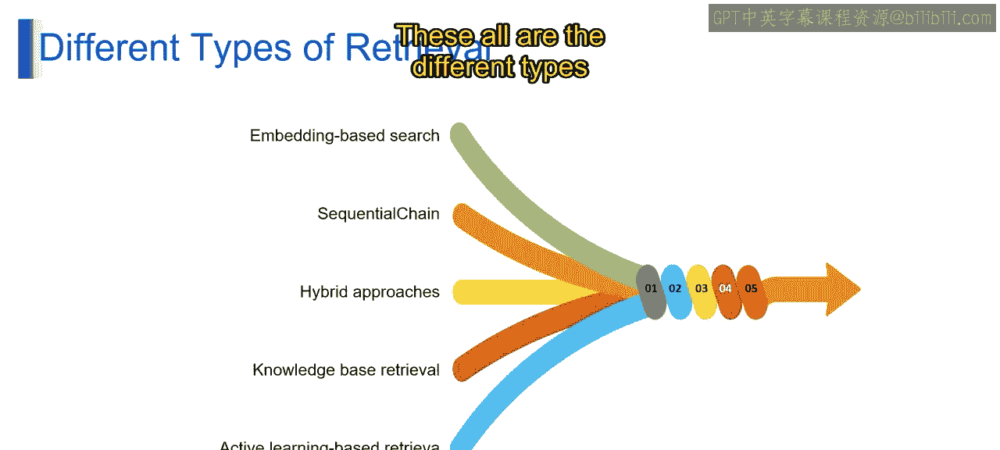

# Edureka《通过LLMs学习生成式AI（基础、应用开发、流行工具，第2、3、4课／共4课）｜Learn Generative AI with LLMs》中英 - P80：43_检索.zh_en - GPT中英字幕课程资源 - BV1ym421V7gx

Hello everyone， welcome back to Generative AI Architecture and Appplication development Month。😊。

So now let's understand the next topic retrieval in this we are going to cover what exactly the retrievals are。

 how do they work and what is the use of them by the end of the session you are able to acquire the skills for the retrieval and the question answering with the rag powered chat boards。

😊。

So let's get started the retrieval first of all， imagine you are a librarian in a gained library for your data collection filled with countless books。

 Imagine the books as a documents a student here student nothing but a user approaches you with the research question that is nothing but request in knowledge your job is to retrieve the most relevant books from the massive collection that can help them find the answer。

 This is exactly what the retrieval does in the L means think of the library card catalog it is nothing but a retrieval system This catalog helps you find the books quickly by listing them by T author or even the subject Similarlyly Lcha's retrieval system Use embeddings and similarity searches to efficiently find the relevant passages within your data。

😊，That matches the user request。 then imagine summarizing each books they point on an index card that is nothing but embedding。

 This card captures the essence of the book without the details So La chain uses embeddings which are like condensed summaries of the text document to perform the similarity searches means here we are having the by combining the embeddings and the similarity search L chain retrieval system efficiently retrieves the most relevant information from your data collection eming your LLm to access the knowledge it needs to complete the task or answer other queries efficiently Then the next one is of usage of retrieval。

 The first one is of enhances LLm performance and the second one is improves the search and navigation So LLm performance post retrieval bridgees。

 the gap between the。😊，Knowledge and the vast external data LLms access the relevant information a time。

 improving accuracy and informativeness， then coming to the enhanced search and navigation users efficiently explore the large data collections through similarity search iterative search allows users to refine the queries based on the retrieved information by providing contextually rich information and enabling the efficient exploration retrieval ems Llums and users within the lines NLP application So now let's understand the different types of the retrieval。

 The first one is of embeddingbased approach。 This fundamental technique already explain previously where it leverages the embeddings like condensed representation of the text and similarity search algorithm。

 that is nothing but acosine similarity to identify the documents with the。😊。

semantic similarity to the user's query。 It's a powerful and versatile approach for the general purpose information retrieval within your data collection。

 That's about embeddingbased search。 Then the next one is of sequential chain。

 It is like building on prior knowledge。 This technique goes beyond the single query。

 It leverages the output generated by the LLM is one step of the length chain as the query for the next retrieval step。

 This allows the retrieval process to be iterative progressively refined the search based on the LLms evolving understanding of the users intent means the LLm's output is converted into an embedding which is then used as the query for the new retrieval step。

 This retd document from the step informed the LLm subsequent actions within the chain。

 That's about the sequential chain next。😊，Next one is of hybrid approaches means combining the strength。

 hybrid approaches combines the embedding based search with the other retrieval techniques to leverage the advantages of the different methods。

 For example， a hybrid approach might involve using the keyword matching for an initial course filtering followed by the embeddingbased search for more precise retrieval means the specific implementation of the hybrid approach depends on the chosen techniques and the overall goal of the NLP application。

 So careful design and evaluation are crucial to ensure optimal performance。

 that's about the hybrid approach。 Then the next one is of knowledgebased retrieval。 So in this。

 the knowledgebased retrieval involves querying the knowledge based using the query language specially designed for the structure of the underlying data then。

😊，The next one is of active learningbased retrieval。

 So active learning retrieval algorithms often rely on the machine learning techniques to learn from the user interactions and improve the retrieval process over the time means choosing the right retrieval technique depends on the several factors including the type of the data that you are working with and the nature of the user stars and the desired level of accuracy Land change flexibility allows you to explore and combine these techniques to build effective NLP applications that meet your specific needs So these all of the different types of the retrieval methods。

😊。

So stay tuned for the next video where we will elaborate on this topic， thank you。😊。

