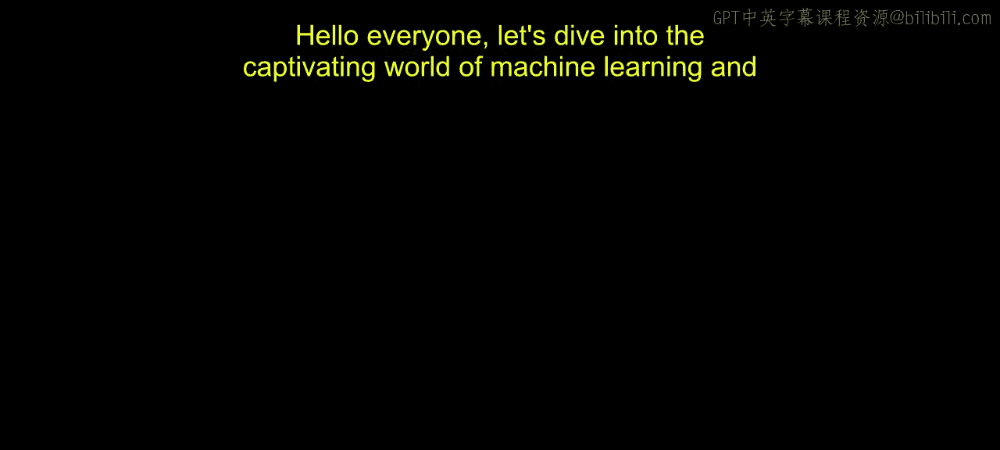
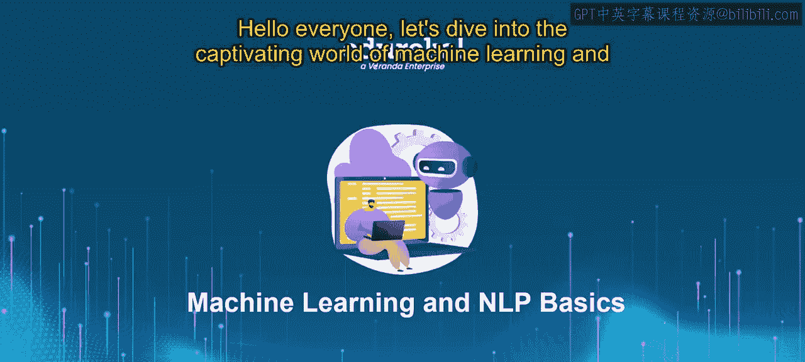
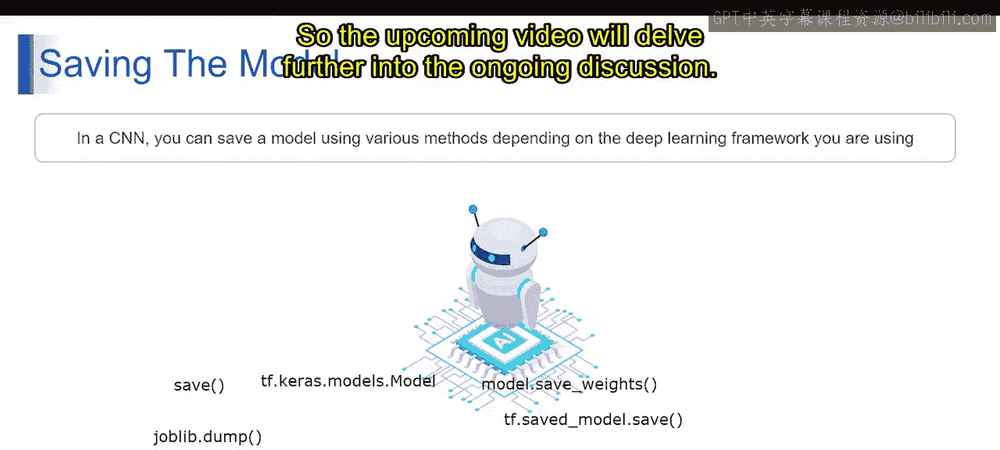

# Edureka《通过LLMs学习生成式人工智能（机器学习和NLP基础，第1课／共4课）｜Learn Generative AI with LLMs》中英字幕 - P80：79_保存和加载模型.zh_en - GPT中英字幕课程资源 - BV1q4421Q7qh

Hello everyone， let's dive into the captivating world of machine learning and the foundational concepts of NLP together。

 Now let's understand saving and loading a model。 So in the previous module we discussed how to build a classification problem and then once everything is done have to save and load a model in this。

 we are going to understand the procedure of saving the model and importance of saving the model and loading a model By the end of the session。

 you are able to understand how to effectively save machine learning models for future use cases and able to accurately reload pre-trained model to avoid redundant training time and also able to comprehend model management's critical role in machine learning workflows。

 So let's get started， saving the model。😊。

Saving the model refers to the process of storing the trained model。

 storing the trained machine learning models， parameters。

 architecture and configuration to a desk this allows the model to be reused or deployed in future applications without the need to retrain it from the scratch means imagine you have spent hours teaching a friend how to bakeg their favorite cake。

 let's imagine once they have mastered the recipe and techniques they decided to write down the instructions and stored them in a recipe book now。

😊，Whenever they want to bake the same cake again， they can simply refer to that recipe book instead of starting from the scratch each time means in the machine learning。

 saving the model involves exactly in a similar way It involves serializing its parameters and architecture to a file format that can be easily stored and accessed such as H3 F5 or JsonN file This allows the model to be reloaded and used for making predictions without needing to retain it means。

 technically saving the model involves using the libraries that whatever we discussed like transflow k number by Macloly specific tasks to the machine learning framework and。

 for example， in the tensorflow， you can use the save method to save the model file file in the size。

😊，Like it learn you can use joblib dot dumb function means just as writing down a recipe allows you to recreate a dish without starting from the scratch saving a machine learning model enables you to reuse it for making predictions without the need of retraining it from the scratch。

 This saves a lot of time and computational resources making model management as essential part of machine learning workflow So now let's understand how exactly it is going to happen in CNN。

 you can save the model using the various methods， depending on the deep learning framework that you are using means in the CNN especially different frameworks provide different functionalities and the APIs for saving the model allowing flexibility in how models are stored and accessed as mentioned intensive flow。

😊，We can simply use save method provided by Tf dot k dot model dot model This class is used to save the entire model including its architecture and weights in the tensorflow saved model format or the hF5 format Additionally you can save specific components of the model separately using model dot save underscore weights or you can also use Tf dot save underscore model dot save in case if we are going to use the tensorflow but what if we are going to use the pytoch we can simply say toch dot save and in k if you can simply save model dot save and as well as in the psyit learn。

 you can simply say job live dot job live dot load these functions are used or allows you to serialize the model。

😊，Object to disk using the Python pickle format， especially this joblib dot Dom making it easy to store and retrieve models for later use means regardless of deep learning framework used the primary objective of saving a model is to preserve its state and architecture so that it can be reused for making predictions or further training in the future the choice of saving the method depends on the factors such as compatibility with the framework is of use and specific requirements of the application so the upcoming video will delve further into the ongoing discussion。

😊。

