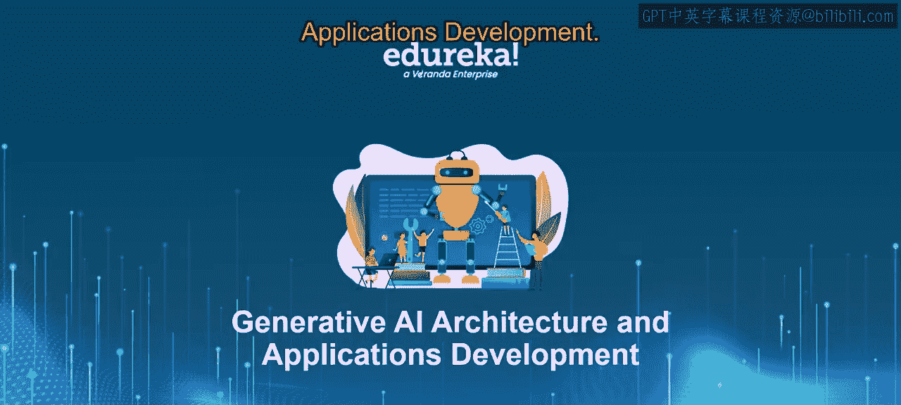
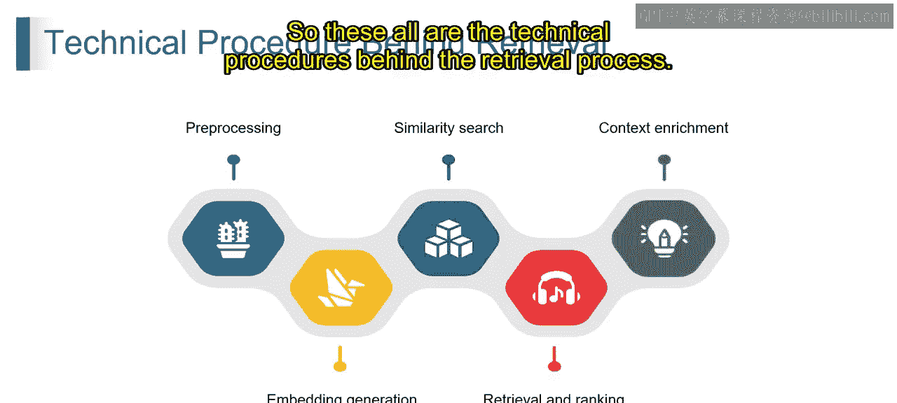

# Edureka《通过LLMs学习生成式AI（基础、应用开发、流行工具，第2、3、4课／共4课）｜Learn Generative AI with LLMs》中英 - P81：44_检索背后的技术过程.zh_en - GPT中英字幕课程资源 - BV1ym421V7gx

Hello everyone， welcome back to Generative AI architectureitecture and Appplication Travel Month。😊。

Then the technical processor behind the retrieval。 The first one is of the preprocessing and embedding generation similarity search。

 retrieval and ranking and context enrichment now understand all this step by step The first one is of preprocessing means in this initial step it involves cleaning the text data within their collection。

 This might include tasks like removing irrelevant characters handling thetys or converting the text into lowercase for consistency。

 it ensures the quality of the data used for subsequent steps and the tokenization the text data is broken down into the smaller units like words or the sentences depending on the chosen embedding technique tokenization prepares the data for the embedding generation stage Then the next process is embedding generation So what it will do it will capture the semantic meaning This crucial step。

😊，Ws converting the textual data to the numerical representation called embeddings。

 These embeddings capture the essence of the data in a compressed format。

 focusing on semantic meaning rather than the exact words themselvess。

 Some popular techniques to perform these encoding techniques or embedding generations are word embeddings and sentence embedding word embedding we have already discussed for example。

 word to back and globe coming to a sentence embedding。

 There is sentence word and universal sentence encoder。 So these all are the examples。

 Now the next step is similarity search means finding the closest match to the provided prompt。

 When a user submits a query， also converted into the embedding that is nothing bird a prompt。

 the reval system performs the similarity search， This involves comparing the query vector to the vectors represented in the stored document means。

😊，Then it will perform similarity metrics。 The core of the similarity search lies in cicculating the distance between the query vector and the document vector common metrics we discussed cosine similarity as well as L to distance then the next one is of retrieval and ranking so it identifies the relevant documents in the state based on the similarities scores Cald in this particular similarity search the retrieval system identifies the document with the highest similarity to the user's query these documents are considered the most relevant to the user's information need then ranking for representation The retd documents are typically rank based on the similarities scores document with the highest course are presented first ensuring the most relevant information surfaces at the top of the result then the next one is of context enrichment。

😊，So here we are enhancing the retrieved information in some cases。

 the retrieved document might be further enriched with additional context。

 This could involve extracting the key sentences means identifying the most important sentences within the retrieved documents that best addresses the user query then entity linking means linking entities mentioned within the retrieved documents to external knowledge basiss providing additional information about the entities by following these steps L chain retrieval system efficiently retrieves the relevant information from your data collection。

 Eming your LLM to access the knowledge， the need to perform tasks for or answer user queries effectively So these all are the technical processes behind the retrieval process。

😊。

So stay tuned for the next video where we will elaborate on this topic， Thank you。😊。

