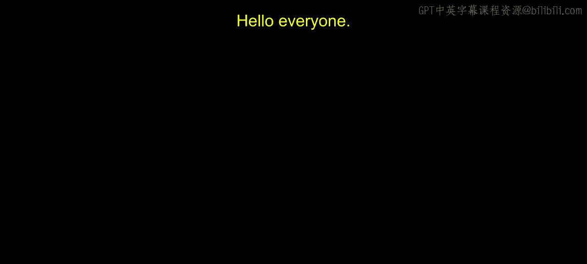
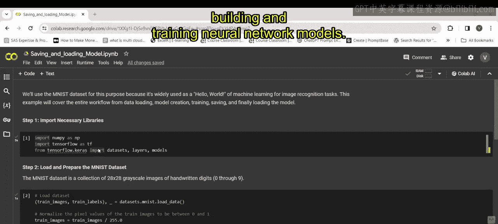
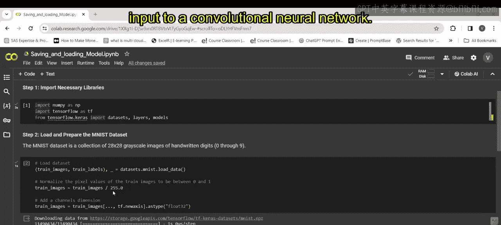
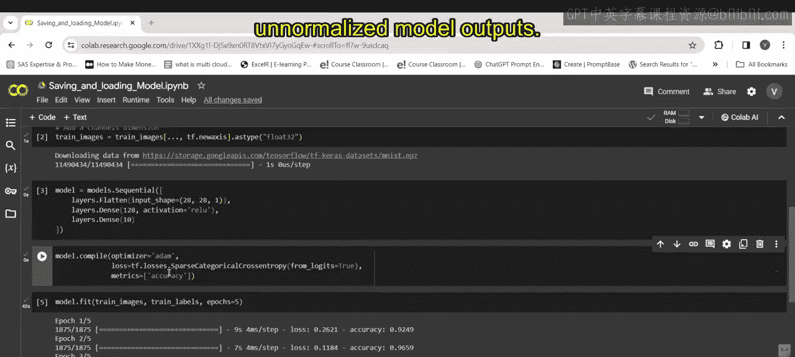
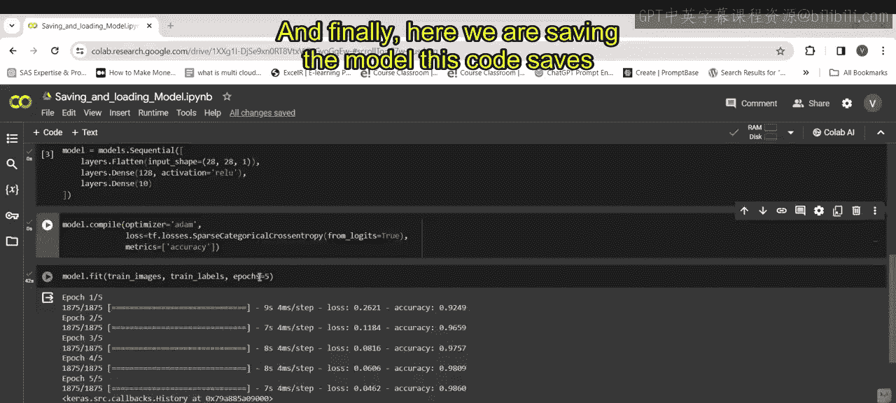
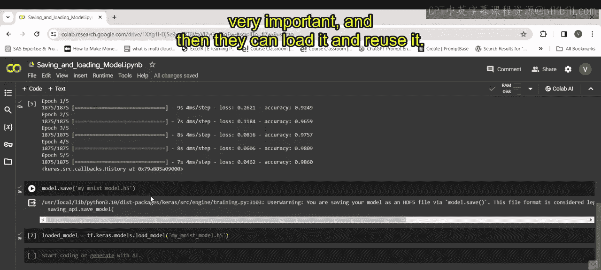

# Edureka《通过LLMs学习生成式人工智能（机器学习和NLP基础，第1课／共4课）｜Learn Generative AI with LLMs》中英字幕 - P81：80_保存和加载模型演示.zh_en - GPT中英字幕课程资源 - BV1q4421Q7qh

Hello everyone， welcome back based on the understanding of model development。

 now let's understand how to save and load the model。😊，In this。

 we are going to demonstrate a typical workflow of machine learning using the MIS dataset set serving as a foundational example for image recognition tasks it encompasses steps including data loading model creation training saving and model loading offering a comprehensive overview of the process。

 So now let's understand all this。 So here the first step is import the necessary libraries。

 So this code imports necessary libraries for data manipulation and deep learning tasks using the tensorflows Ks API specifically it imports NI for numerical computations and tensorflow for machine learning operations and K modules for building and training neural network models and then the next step is load and prepare the MNIS data。

😊。

In this， this code segment loads the Ms dataset consisting of handwritten digit images and their corresponding labels。

 it normalizes the pixel values of the training images to a range between0 and 1 then it adds a channel dimension to the images and convert them into float 32 data type preparing them for input to a convolutional neural network so this is a block of code and then coming to the next one this code defines a sequential model architecture using the Kra sequential API it starts with a flattened layer to reshape the input image into one dimensional array where we discussed in the theoretical understanding once it is done it is followed by a dense layer with 125 neurons and the。

😊。

function here we are using is relu activation and another dense layer with the 10 neurons we are passing for classification representing the output class the digits are between the0 and 9。

😊，And then once it is done， this code comps the defined model using the Adamom optimizer sparse categorical cross entropy loss function and accuracy as the evaluation metric it prepares the model for training on the M data set。

 especially here model dot compile configures the model for training by specifying the optimizer loss function and the evaluation metrics。

 then coming to the optimizer is equal to atom it selects the atom optr and adaptive learning rate optimization algorithm known for its efficiency and robustness means Adam optr basically adapts learning rate for each parameter during the training based on exponential moving average of past gradients and squared gradients which helps converge faster and。

😊，Ada to varying learning grades for different parameters。

 It combines the advantages of both a grid and rs probe algorithms for efficient optimization So coming to the Tf dot losses here Tf dot losses towards past categorical cross entropy defines the loss function as past categorical cross entropy suitable for multiclass classification tasks with integer labels and unnmalized model outputs Then finally we are fitting it this code contains the compiled model using the training images and labels for phi epos It iteratively adjusts the models parameters to minimize the defined loss function optimizing its ability to predict the correct digit labels from the input images and finally here we。

😊。

A saving the model。 This code saves the trained model to a file named my Mnes model dot H file in the hierarchical data format version 5。

😊，Saving the models in HDF5 nothing but hierarchical data format version 5 allows the prevention and reuse of trained neural network architecture and weights。

 That's the reason HF5 is preferred for saving models due to its hierarchical structure flexibility efficiency cross platformatform compatibility and widespread adoption within the scientific computing and machine learning communities。

 This enables this also enables retrieval and deployment of the trained model for future use in various applications。

😊，Now the loaded model here this score loads a previously saved model stored in this my underscore Ms model dot Hfire using the Tensorflows ks API it allows reusing the train model for inference or further training without needing to train them from scratch again so that is where the saving of the model is very very important and then we can load it and reuse it Thank you。

😊。

