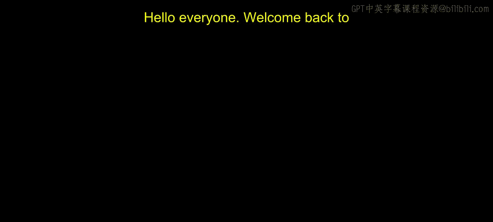
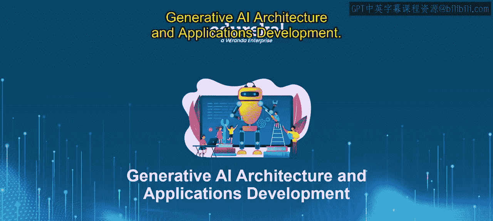
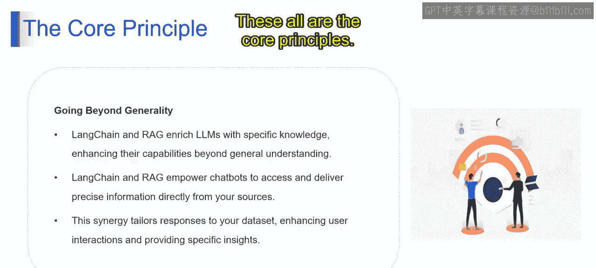
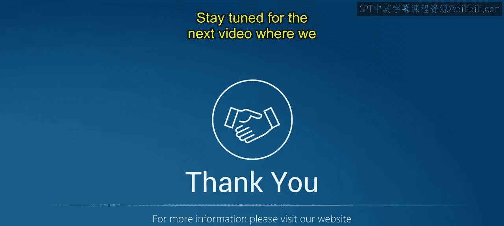

# Edureka《通过LLMs学习生成式AI（基础、应用开发、流行工具，第2、3、4课／共4课）｜Learn Generative AI with LLMs》中英 - P82：45_使用聊天机器人进行问答.zh_en - GPT中英字幕课程资源 - BV1ym421V7gx

Hello everyone， welcome back to Generative AI Architecture and Appplication development Month。😊。

So now let's understand the question answering with the chatbos in this。

 we are going to cover what exactly the question answering with chatbos and how it is going to work by the end of the session you are able to understand the significance of question answering with the chatbos so let's get started first of all。

 let's understand the core principles behind this。 So imagine a knowledgeable friend you can ask any question So large language models in chatbos work similarly but require context as the fuel these models like powerful engines Excel in various tasks such as text generation translation and creative content creation So however。

 while they can recognize broad patterns providing specific and the shades of the information relies on the contextual they receive means context guides elementsms to perform at their。

😊，Enuring the accurate and relevant responses without the context their performance may struggle highlighting the crucial role context plays in optimizing the capabilities of the chatbos for effective question answering So now the second one is of the rack which is nothing but bridging the context gap the function is to bridge the gap between the Lm potential and here specific data for the question and answering here we are having the two step process The first one is of the retrieval and the second one is of the augmentation in the retrieval it contains the data scanning and the context repository in the data scanning line chain tool efficiently scans and selects the relevant information from the data repository in the context repository This becomes a context repository providing input for the large language model then the augmentation。

It will guide the LLM。 The retrieved information actively guides the enlightens。

 the LLM during the generation process。 It will enhance the understanding。

 the augmentation supplements like the LLM's understanding incorporating relevant context for more informed responses means how the workflow happens here First。

 the user can provide the query， and then the retrieval。

 the line chain tools scans the relevant information Then the LLM input Red information becomes the input for the LLM。

 then the augmentation process takes place， means the LLM guided the enhanced。😊。

LLM guided and enhanced by the retrieved context then the response means LLM generates a more accurate and contextually rich response Then the next one is going beyond generality means enriching the specific knowledge means specialized enhancement L chain and rack enhance the LLm's where the specific knowledge moving beyond the general understanding and this synergy tailors the LLm's capabilities for more precise and contextually accurate responses in the specific domains and within this we are going to get the direct source content by empowering the chatbos L chain and rack empowers the chatbos to directly access and deliver the precise information from the sources this direct connection ensures accurate and up to date responses providing the realtime insights then。

😊，The collaboration tailors the responses to specific data sets。

 enhancing the user interactions for a more personalized experience。

 This approach provides contextually specific insights going beyond the general responses to deliver more accurate and valuable information。

 So these all are the core principles。😊。

So stay tuned for the next video where we will elaborate on this topic， thank you。😊。

