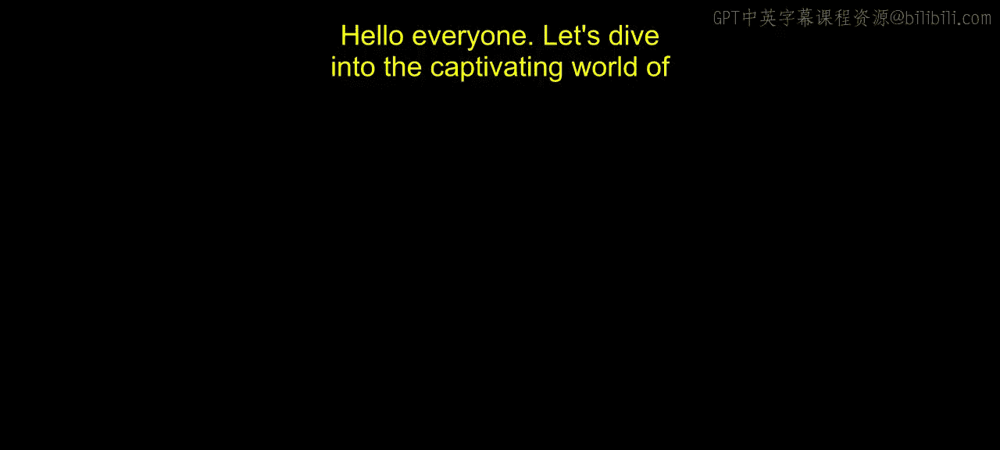
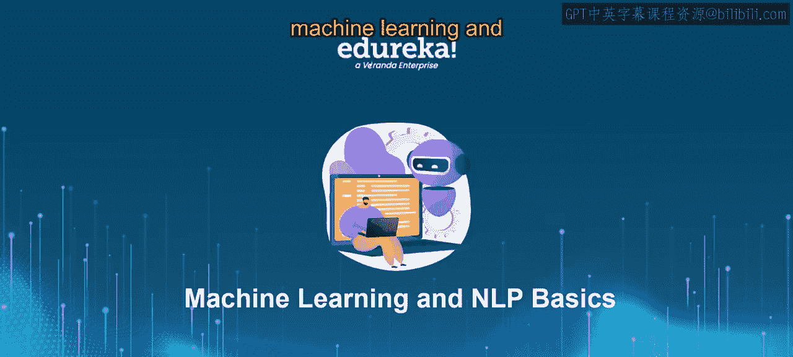
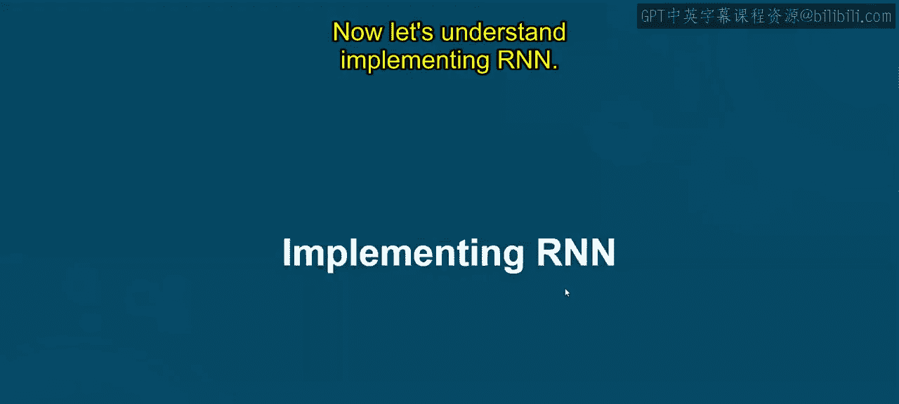
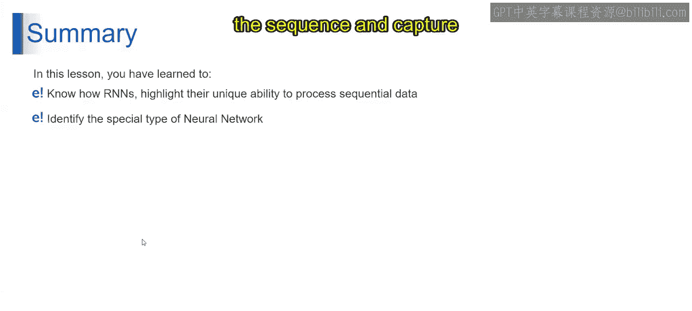

# Edureka《通过LLMs学习生成式人工智能（机器学习和NLP基础，第1课／共4课）｜Learn Generative AI with LLMs》中英字幕 - P82：81_实现RNN.zh_en - GPT中英字幕课程资源 - BV1q4421Q7qh

Hello， everyone， let's dive into the captivating world of machine learning and the foundational concepts of NlP together。

 Now let's understand implementing Rnn In this， we are going to cover the introduction to RN and Rnn to the rescue。

 by the end of the session， you will be able to understand the structure of recurrent neural networks and also able to gain the knowledge on implementing the Rnns。

 So let's get started introduction to real neural networks。

 So let's understand it with an easy example。 So imagine you are writing an email and you start with the first word called dear。

 So as soon as you type dear Google's autocomplete tries to guess what you might type next。

 It might suggest the words like either sir or madam。😊。

Or a friend。 So based on what other people commonly write after dear in the emails。

 this prediction is made by analyzing the sequence of words that often follow dear in a large data set of emails。

 So this is one example。 And considering the example of。

The Google so when you begin start typing in the in the Google Okay， let me show you with an example。

 when you start begin writing something in the Google let's say Im going to write what is can you all see it is suggesting me what is Amazon bedrock and what is bedrock and what is data science and what is my IP and what is F R and what is generative AI so how exactly you are getting so initially the first three are based on my history and the next three you can see here so how exactly the model is predicting all this when you are typing something into the Google。

😊，Means you noticed that Google starts suggesting relevant search queries based on what you have typed so。

 so for instance， it might suggest completion like you guys have seen what is AWS bedrock and what is bedrock or what is generative AI means in this particular Google search suggestion feature we used RNN model to predict what you might be searching for next word based on the sequence of words you have typed so So as you type what is the RN model analyzes the sequence of words and predicts the most likely completion based on the patterns it has learned from analyzing vast amount of search query data So for instance。

 if many people have previously search for what is machine learning let's say after typing what is the。

RNN model might prioritize that completion as it recognizes the sequence of words and their common associations means technically the RNN model processes each word in the sequence like for example in our case。

 let me take an example。😊，It will take the entire test and it start converting into the individual words。

😊，Like this。So the RNN model process each word in the sequence of word comma is and maintains a hidden state that captures information about the context of the input sequence This hidden state helps the model make predictions about the next word in a provided sentence or the sequence means Google search suggestion feature uses rNs to predict the relevant search queries based on the sequence of words you have typed so far this prediction is made by analyzing the patterns in the search data and using a model that can capture the context of the input sequence so that is how Google search query engine work here you can see how do you think Google ordercomp feature will work Google's autocomplete feature will work。

😊，So， as mentioned， RnN is a type of neural network designed to handle。😊。

Sequential data like sentences or the time series data it's great for tasks where the order of the data matters。

 just like in natural language processinging So when you typing in Google autocomplete the RNN model continuously learning from the sequence of data or sequence of words it encounters it looks at the words you have typed so far and predict the next word based on the patterns it has learned from analyzing lots of other sentences in similar context。

 this prediction process is possible because rnN have a memory that allows them to consider previous inputs when making predictions for the next step。

 this makes them well suited for tasks like predicting the next word in a sentence as in the case of Google's auto。

😊，Complete so now let's understand RN end to the rescue so here we are having a diagrammatic representation of free feed forward neural network and the recurrent network the recurrent neural network have networks with loops in them here we have seen so allowing information to process it's a special type of neural network designed for sequence problem so let's understand this in a feed forward neural network you can think of information flowing in one single direction from the input to the output it's like conveyor belt in the machine process where you put in your input data。

😊，You can say that as an ingredient and the machine processes them in the hidden layer and you get the final output for you。

😊，So in the feed forward neural network what exactly is happening So we are providing the input and then the machine is processing something and we are getting the output at end。

 So now imagine you are cooking a recipe that requires you to remember what you did in the previous steps。

 for instance， making a you need to remember how much flour you added before。😊。

You can decide how much water to add next this is where the recurural neural network comes in means in an RNAN there are loops in the network that allows information to persist it's like having a shelf with good memory who can remember what they did in previous steps of cooking this memory helps rN handle the sequence of the data like words in the sentence or the time series data so in feed forward neural network the information flows straight through without any memory of past inputs but in the recurural neural network each step considers both the current input and the information from the previous step。

😊，To put it simply feed forward neural network， the input goes in。

 get processed in the hidden layer and output comes out。

 It's like one way street where coming to the regularal neural network input goes in gets processed along with the memory of the previous steps of the hidden layer and the output comes out it's like a chef following a recipe rememberbering what they did in the earlier steps means orinance designed to handle the sequence problems by retaining the information from the previous steps unlike feed forward neural networks which process input independently of past information this memory aspect makes orinance greatfoot tasks like language translation time series prediction and anything else。

😊，The order of the data matters。 So now let's understand the flow of the information。

So let's break down how each neuron in RNA uses its internal memory to maintain information about the previous input using the example here we are having the example of let's eat grandpa this much more different than let's eat kma grandpa so let's understand this imagine each neuron in R as a tiny part of a brain that remembers that it has seen before when the R encounters the sequence let's eat grandpa okay here we are having these two things let's eat grandpa without karma and with kma so the R process each word sequentially so as I mentioned first of all it will convert the provided sentence into individual word。

😊，Goods。🤢，Here this is how it will try to pass the sequence of sentence。 She means what happens here。

 Let's consider the first one， Let's eat grandpa without kma The RN process each word sequentially as it encounters each word it updates its internal memory to include that word meaning in the context of the sequence so far。

 By the time it gets to grandpa， it has the sentence So what the sentence is about it is nothing but eating with grandpa right eating with grandpa now let's contrast that with the second example of let's eat kma grandpa where there is a commma after eat this small pronounce this small punctuation change completely change complete。

😊，Alters the meaning of the provided sentence again as the RN process each word it updates its internal memory。

 but when it encounters karma， it understands that a pass has occurred and it remembers that the action of eating is directed towards grandpa possibly in more littleeral sentence。

 so even though the sequence lets eat grandpa and lets eat kma grandpa share most of the same words。

 the R's internal memory allows it to understand the subtle but crucial difference in the meaning between the two sentences based on the provided punctuation means in technical terms each neuron in the RNA maintains the hidden state that。

The information about the sequence of input it has seen so far。

 This hidden state acts as a neural memory， allowing it to remember past input。😊。

So that is the reason it is taking the past input。😊。

And incorporate them into its understanding of the current input。

 this memory aspect enables the RN to capture the complex dependencies within the sequential data like the importance of punctuations in the provided language。

 that is how RNN works。Now， the summary。In this lesson， you have learned about。😊。

Recurrent neural networks which excel in handling the sequential data due to their loop structures。

 allowing them to retain memory of past inputs， this special type of neural network stands out for its capacity to process the sequence and capture the intricate dependencies within the data。

😊。

Thank you。

