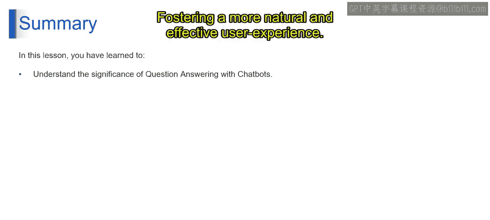

# Edureka《通过LLMs学习生成式AI（基础、应用开发、流行工具，第2、3、4课／共4课）｜Learn Generative AI with LLMs》中英 - P83：46_使用LangChain和RAG构建聊天机器人.zh_en - GPT中英字幕课程资源 - BV1ym421V7gx

Hello everyone， welcome back to Generative AI architectureitecture and App Development monthth。😊。

Now let's understand building a chatboard with Lcha andry the first step is of data preparation as we already discussed in the previous concept。

 we are cleaning and organizing the data to ensure the effective retrieval and chatboard training in the data preparation then in the next step that is retrieval system we are configuring the Laangs retrieval technique to find the relevant information within your data for the user queries。

 then the LLM integration once we retrieve the information we will be connecting the chosen LLM to the Lcha enabling it to access the retrieved information during the response generation。

 then the next one ease of Chaboard design means design the user interface and interaction flow for your chatboard considering the user experience then the fine tuning and testing in this phase we will be refining the chatbo's response。

😊，And retrieval system through ongoing testing and the adjustments。

 So that's about building a chatbo with a L and rack。

 Now let's understand the benefitsfis of using chatbos for question answering The first step is natural and intuitive interaction chatbos provide a conversational interface for users to ask questions in a natural way。

 Then the next one is focused and specific answers。 by leveraging your data。

 chatbos can deliver the targeted and precise questions to the user queries。

 Then contextual understanding chatbos can consider previous interactions and the overall conversation flow to provide the contextually relevant responses。

 Then continuously learning and adapt user interaction and feedback can be used to continuously improve the chatbo's question answering capabilities。

😊，Then the additional advantages chatbos can offer 24 by7 availability。

 handle multiple users simultaneously and potentially integrate with our services for a richer experience。

 So these are are the benefitsts using the chatbos for question answering。

 So now let's understand the examples of the chatbo applications customer service chatbos data exploration chatbos it the customer service chatbos。

 It will provide the 24 by7 support to answer frequently asked questions and help the users navigate complex processes。

 Then data exploration chatbo It will guide the users through the data sets answer specific questions about the data and generate the reports or summaries。

 then personal knowledge assistance。 It will help the users manage tasks schedule the appointment。

 answer questions about the personal information and。😊，Offers reminders， then educational chatbos。

 It will provide the personalized learning experience。

 answer students questions and offer practice exercises or the puzzle。 Then domain specific chatbos。

 it will cater to specific industries or fields offering specialized knowledge and assisting users with the specific tasks within those domains。

 So these are are the examples of chatbo applications。

 So now let's understand the limitations and the considerations。

 The first one is of the data quality。 The effectiveness of chatbos heavily relies on the quality completeness and the relevance of the underlying data used for training and retrieval。

 Then the model limitations chatbos powered by elements inherit the limitations of these models such as potential biases or struggles with the factual accuracy for complex and。

😊，The shades of the queries， Then the next one is of explainability and the trust understanding the reasoning behind the chat board responses can be a challenging due to the complexity of the LLM algorithms potentially hindering users' trust then the security and the privacy the measures must be in place to save code sensitive user data collected through chatbo's interactions and ensure the compliance with relevance。

 privacy and regulations。 Then the next one is of user expectations and education。

 It's crucial to manage user expectations regarding the chatboard capabilities and educate users on how to interact with the chatbos effectively to achieve the desired outcomes。

 So these all of the limitations and the considerations。 Now the summary So in this lesson。

 we understood the power of question answering with the chatbo。😊。

We explore how LangCha's drag system bridges the context gap for LLMMS。

 enabling them to access relevant information within your data and generate the informative answers to the user queries fostering a more natural and effective user experience Thank you。

😊。

