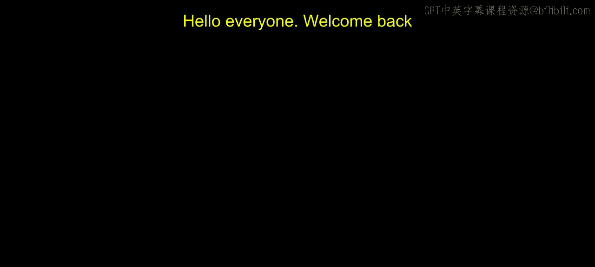
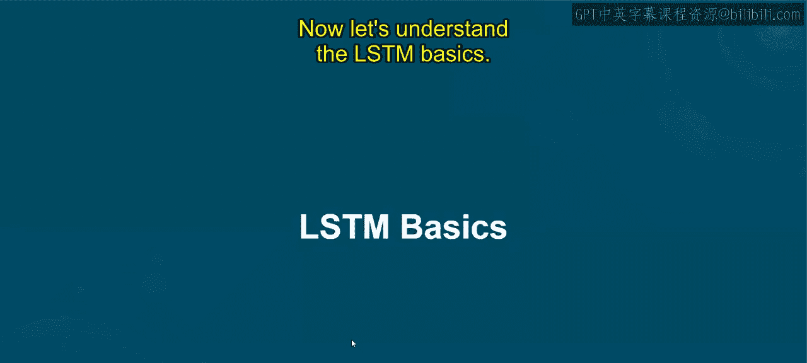
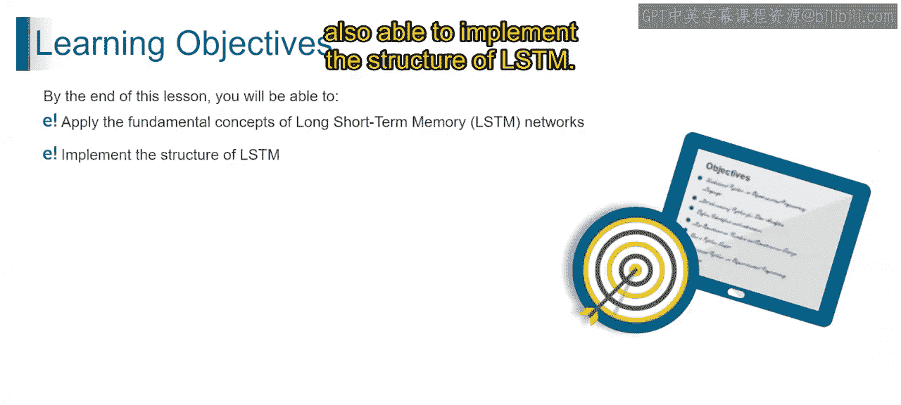
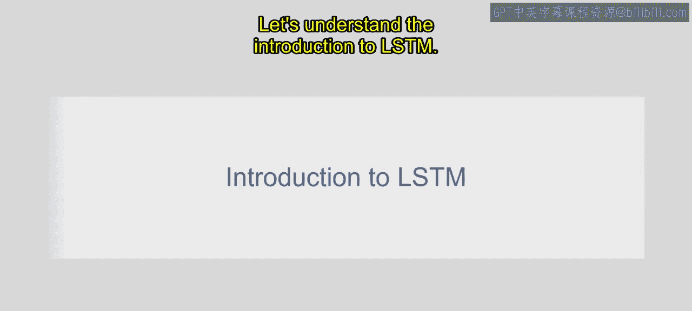
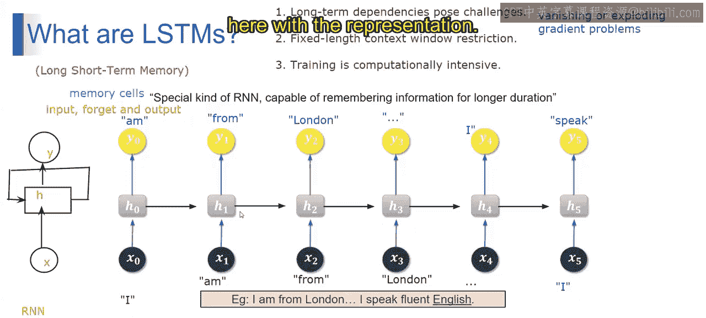

# Edureka《通过LLMs学习生成式人工智能（机器学习和NLP基础，第1课／共4课）｜Learn Generative AI with LLMs》中英字幕 - P83：82_LSTM基础.zh_en - GPT中英字幕课程资源 - BV1q4421Q7qh

Hello everyone welcomee back to machine learning and NLT basics。

 So now let's understand the LSTM basics in this we are going to cover the introduction to LSTM and the structure of LSTM by the end of this session you will be able to apply the fundamental concepts of long short term memory networks and also able to implement the structure of LSTM。

 So let's understand the introduction to LSTM So in general， what is the use of LSTM。

 the name itself is indicating long short term memory it is LSTM networks remember the important information from the past data and use it to make predictions about what comes next in a sequence So you might wonder and you may ask if RNN can predict the next word based on the past sentence why to。

😊。

TheWith understanding of LLms， which also accomplish the same task， right， So here is the case。

 when we are working with the R Ns， we are having some particular limitations， those are。😊。

So these all are the limitations when you are working with the RNN。

 so the first one is of difficulty in capturing long term dependencies means in RNNs struggle with capturing long term dependencies in a sequence as the sequence length increases RNN's phase difficulties in retaining relevant information over the long distance which can lead to vanishing or exploding gradient problem during the training。

😊，So what exactly this vanishing or exploding gradient problem so generally it occurs during the training process when the gradients used to update the network's parameters becomes extremely small or large as they propagate through many steps this can cause the model to have difficulty learning or converge poorly。

😊，In simple terms， vanishing gradient problem refers to a situation where the gradients used to update the parameters of neural network become extremely small as they are propagated backward through the layers during the training potentially hindering the learning process conversely the exploding gradient problem occurs when these gradients becomes exclusively large leading to unstable training and divergence so that is what the problem when you are dealing with the long termm dependenceencies with RNN then the next one is of fixed to length context window restriction RNNs have a fixed length context window。

 meaning they can only consider a limited number of previous time steps to make the predictions at each step this limitation can restrict。

😊，Their ability to capture dependencies， they rely on information from further back in the sequence。

 especially in scenarios where the relevant context extent beyond the model's memory capacity。

 Then the next one is of computationally intensive means training rins are computationally intensive。

 especially for large data sets and complex architectures means rns often require significant computational resources。

 and time to converse during the training， making them less practical for realtime applications or scenarios with constrained computational resources。

 Additionally， their sequential nature limits the potential for parallelization during the training。

 further worsen the computational burden。 So these all are the problems when。😊，We are working with。

Traditional R techniques。So how to overcome with the LSTMs now let's understand。

So LSTM is nothing but long short term memory。The name itself is indicating it is having the long。

 short term memory。 Imagine you are trying to predict whether you will need an umbrella tomorrow based on the weather patterns for the past few days。

😊，So traditional methods might just look at recent days and make a simple prediction， however。

 LstriM is like having a smarter system that can remember not only the recent weather patterns but also longterm trends like the fact that it's been rainy for the past few weeks in your area during the season means LstriM is a type of RNA architecture designed to overcome the limitations of traditional RNA in capturing the longterm dependencies in a sequential data it achieves this by in reducing。

😊，Specialized units， called memo cellss。😊，That can store the information for long periods。

 These memory cells have the gates called。😊，Input， forget and output。

 but right now I am not going to discuss about it brief， but we are having it in the next slide。

 These gates regulate the flow of information allowing LSTM to selectively remember or forget information over the time。

 So let's understand it with one more example LSTMs are indeed a special kind of regularcural neural network designed to remember the information for longer duration so let's break it down using the simple example consider you are inputting a sequence of words that is I am from London I speak flu in English in this particular situation so how the traditional rNN will work let's understand with the diagrammatic representation here This is the traditional RNN representation right so what exactly happens in the traditional RNN the hidden states denotes。

😊，It。At each step depends on the current input， as well as the hidden state from the previous step。

 So this is how it will consider when you are dealing with。😊，The traditional R。

 But when you are considering the LSTM network， the hidden state here H is nothing but the hidden state X is nothing but the input。

 And y is going to be the output in the LSTM。 The hidden states are more complex and involve a mechanism to selectively remember。

 or forget information over the time。 This allows LSTMs to capture the long termm dependencies like。

 for example， here in our case of I am from London I speech learn English。

 Let me explain you with a brief information。😊，Means let's say here so I have represented with the provided information the hidden state is more complex and involves a mechanism to selectively remember or forget the information over the time here if you guys can see for the first input x0 I I giving the I as an input it will go through the hidden state and it can provide the output as m then in the second input I am sending the first gate output and then providing m and then it can send to the hidden layer and then it will produce from and like this it will go till the end means in the each step。

 the LSTM's hidden state not only depends on the current input and also the previous hidden state but also on a memory cell it is going to have an extra memory cell that can store the retrieve information this memory。

😊，Cll is equipped with these gates and controls the flow of information allowing the LSTMs to decide what to remember or what to forget so now let's understand all these here with the representation LSTM structure so stay tuned for the next video where we will elaborate on this topic。

😊。

