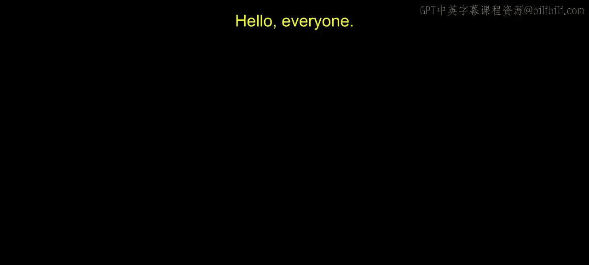
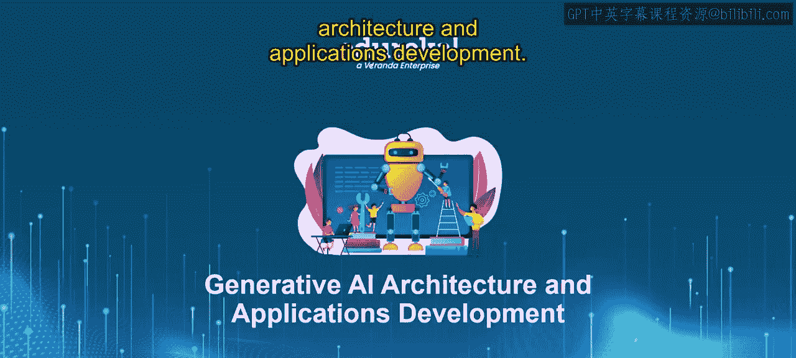
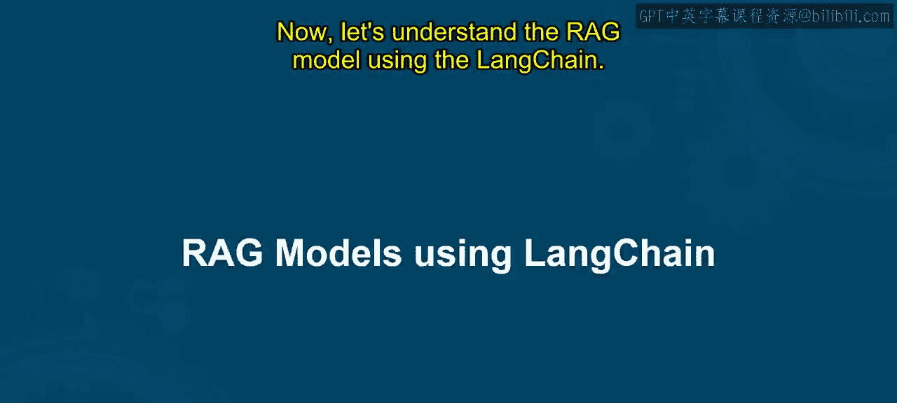
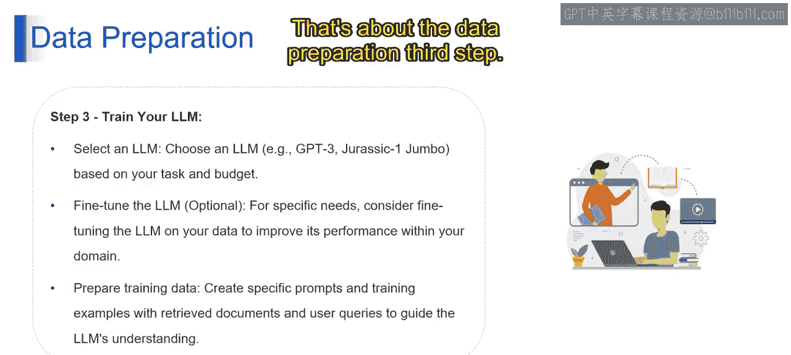
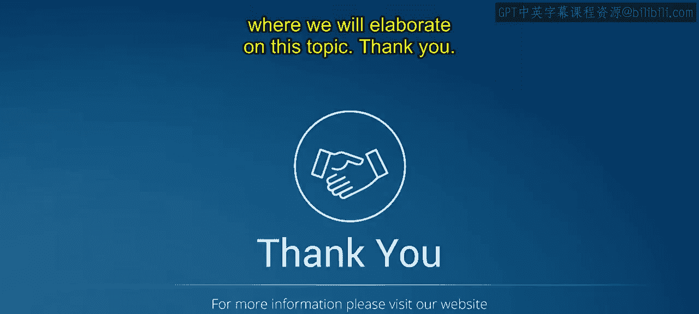

# Edureka《通过LLMs学习生成式AI（基础、应用开发、流行工具，第2、3、4课／共4课）｜Learn Generative AI with LLMs》中英 - P84：47_使用LangChain构建RAG模型.zh_en - GPT中英字幕课程资源 - BV1ym421V7gx

Hello everyone， welcome back to Generative AI Architecture and Appplication development Month。😊。

So now let' us understand the rag model using the line chain。

 so in this we are going to cover the building of rag model using the line chain by the end of the session you are able to understand how to build a rock model using the line chain。

So let's get started in this we are going to perform the multiple steps that is data preparation building the retrieval system train your LLM and integrate LLM and retrieval system and design and develop the chatboard and testing and improvement so let's understand all the steps one by one the first step is of data preparation so in this it contains mainly three things gather and organize the data and clean and structure the data and preprocess the data so gather and organize in this stage you are collecting the data in your format that L can understand like text files data spaces or the spreadsheets whether it is of the PhD files or the PDF files whatever it is we are collecting the information or the data to provide it to the L and then clean and structure here well have to ensure the data is clean consistent。

😊，In the format and the free of the errors it will enhance the retrieval accuracy because if we are removing the noiseisy data and if we are removing the unwanted information。

 it will capture the important information and it will focus on the relevant content more then the preproces depending on the model and the needs consider further preprosing like tokenization normalization or the entity recognition so these all are the things that you will have to perform in the step1 in the step 2 building the retrieval system in this we will be choosing the model and then we will be confering the setting and then we are connecting to the la so first of all choosing the model here we will choose the pre-trained retrieval model offered by the la chain or train your own model using your specific data if needed for optimal performance and to mine specific customization。

😊，That is about choosing the model。 Then the next one is of configuration setting Here you will define the mathematical functions used to measure the semantic similarity but a user's query and the retrieved documents。

 for example， we will use the cosine similarity or the L distance this metric guides the ranking of the retrieved documents here we will specify the number of documents to retrieve for each user query a balance is required between retrieving enough relevant information and computational efficiency Then the next one is of connect to So here we are integrating to the connect the chosen retrieval model that is nothing but the pretrained custom model to the This enables the to interact with the model and leverage its functionalities during the retrieval process La provides tools for seamless integration this step。

😊，Etablishes the core retrieval mechanism within your rag model。

 ensuring efficient and accurate retrieval of relevant information from your data collection。

 So that's about the step2 Now the step here you will be training your LLM model means the very first step in these to select the LLM means you will have to choose the LLM suited to your project needs and the budget。

 popular options like CP3 Jurassic1 jumbo etc。 Consider factors like the task complexity and the desired capabilities when selecting an LLM。

 then the next step is fine tune the LLM。 So here for enhanced performance within your specific domain。

 considering the fine tuning the chosen LLM for your data this involves further training the LLM using your parameter training data allowing it to adapt。

😊，To the language and concepts within your domain then the next one is of prepared training data here you need to create high quality training data specifically designed for your rag model this data should include retrieved documents user queries expected responses and the prompt engineering techniques by providing the LLM with the wellprepa training data here you equip it with the necessary knowledge and skills to excel in your question answering task within your chat port so that's about the data preparation third step。

So stay tuned for the next video where we will elaborate on this topic， Thank you。😊。

