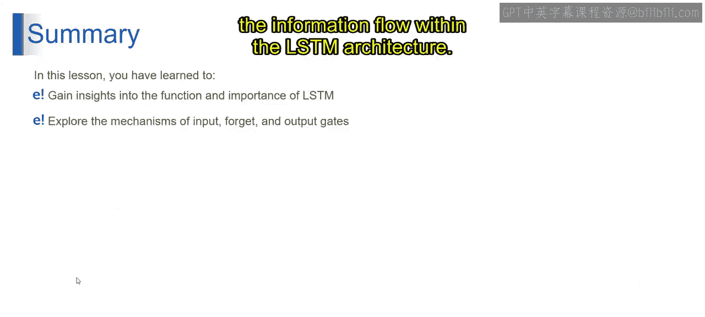

# Edureka《通过LLMs学习生成式人工智能（机器学习和NLP基础，第1课／共4课）｜Learn Generative AI with LLMs》中英字幕 - P84：83_LSTM结构.zh_en - GPT中英字幕课程资源 - BV1q4421Q7qh

So let's now explore the progression from our previous discussion in this。

 we are going to have LSTM is a special case of RNAin which resolve vanishing gradient problem。

 we have seen that the r contains the vanishing gradient problem by retaining the information in the memory So that's the advantage and RNA cells are replaced by LSTM cells in the hidden unit。

 Now you can see this。 the LSTM layers are replaced to hold the memory cells and then the hidden states are provided。

 So now let's understand the LSTM structure briefly。😊。

So， as mentioned， LSTM contains。😊，The three different gates that is for gate input gate and the output gate let's understand all this。

 first of all the for gate， the for gate is like it is a filter that decides what information from the previous cell state to keep or discard it takes as input the previous hidden state and the current input and produces a vector of values between0 and1 from each value in this vector represents how much of the corresponding information in the cell state should be for that is that can be。

😊，Forgotten is represented as0 and retain is represented as one。 for example。

 if the output of the for gate for a certain component is0。

 it means the LSTM should for the information associated with that component from the previous cell conversely if the output is1。

 the information should be preserved and passed on to the next step that is about the for gate coming to the input gate。

 the input gate controls how much new information should be added to the cell state similar to the forgate gate。

 it takes the previous hidden state and the current input as input and produces another vector value between the0 and one same exactly like a for gate。

 these values determine the extent to which the new information should be added to the cell state a value close to0 indicate that the corresponding。

😊，ing information is not important， same like， however we represented and should be added to the cell state。

 while the value is close to one such that the information is significant and should be retained。

 That is how input gate will work。 then coming to the output gate。

 the output gate determines what information from the cell state should be passedd as an input or the next hidden state。

 it takes the previous hidden state and the current input similar to the for gate and input gate and produces a vector of values between the zero and one same like this。

 the values control how much of the current cell state should influence the next hidden state。

 For instance， if the output of the output gate for a certain component is0。

 It means that the information is associated with the component in the current。

Cll state will not contribute to the next hidden state。 three states work exactly in a similar way。

 but here the summary of all these gates is that so in this case。

 thegate gate helps the LSTM to decide what to forget from the previous cell state and the input gate controls how much new information should be added to the cell state and the output gate determines what information from the cell state should be passed to the next to hidden state to gather these gates enable LSTMs to selectively remember and forget the information over the time making them effective tasks that require capturing long term dependencies in a sequential data。

 So that is how generally LSTM works with for input and output gate。

So now the summary in this lesson you have gained a clear understanding of LSTMs comprehending their significance in capturing the long termm depends。

 furthermore you have delved into the essential mechanism of input for gate and output gates。

 which plays a pivotboal role in controlling the information flow within the LSTM architecture。😊。

So， thank you。