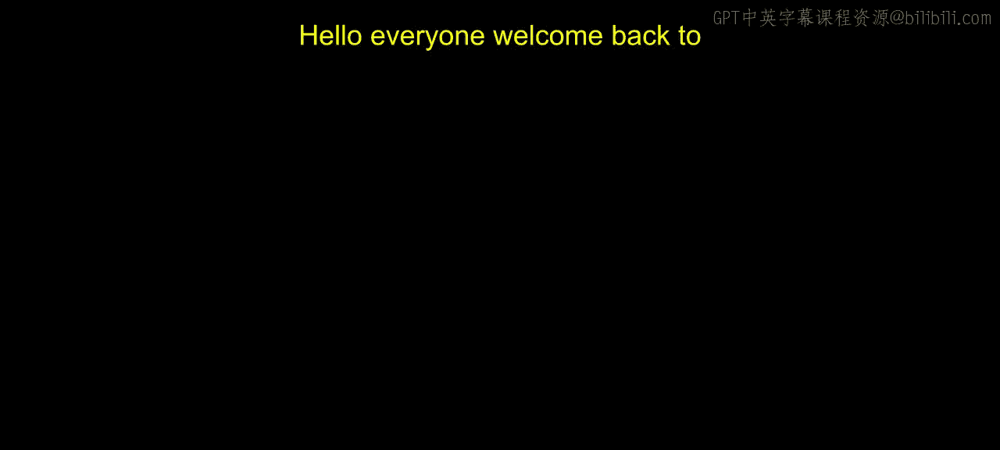
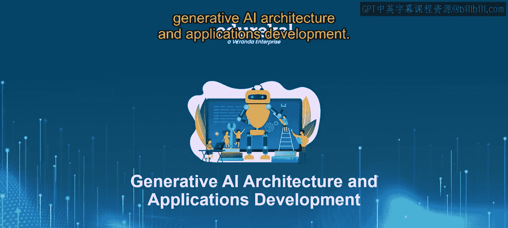
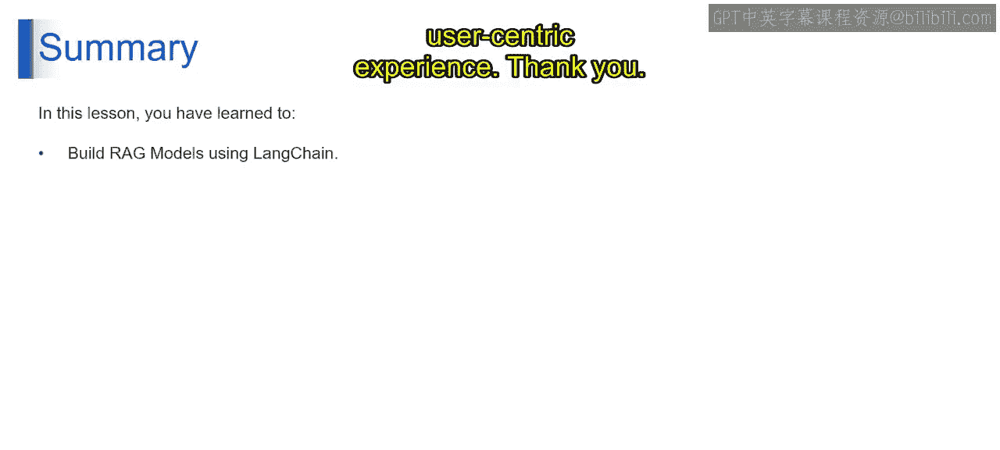

# Edureka《通过LLMs学习生成式AI（基础、应用开发、流行工具，第2、3、4课／共4课）｜Learn Generative AI with LLMs》中英 - P85：48_使用LangChain构建RAG模型续.zh_en - GPT中英字幕课程资源 - BV1ym421V7gx

Hello everyone， welcome back to Generative AI architectureitecture and App Development monthth。😊。

Then the next step is integrate LLM and rerieval system。😊。

In this step we are performing total three different criteria LLM integration rag chain and prompt configuration so in the LLM integration connect your chosen LLM to the chain la chain should be able to interact with the LLM and exchange the data seamlessly then the rag chain so here build a module chain specifically designed for rag functionality this chain will likely involve modules for query processing retrieval trigger information retrieval and data preprocessing and even LLM prompt generation and LLM response processing then the next one is of prompt configuration this will define the mechanism for creating effective prompts for LLMs this might involve templatebased prompt and dynamic prompt generation When we say templatebased prompting it utilizes the pre。

😊，Temps， incorporating the retrieved information and the user queries and the dynamic prompt generation Here we will develop the methods for dynamically building prompt based on the specific retrieved documents and query characteristics by establishing this integration and the prompt configuration you create the communication channel that allows the retrieval system to provide the context to the LLm empowering it to generate informative responses during the question answering that's about the step4 Now the step 5 design and develop the chatbo Here we are performing total three different steps Conal flow interface development and la integration。

 the conversation flow here we will define the chatbo's interaction logic This includes outlining the user query prompts and validation and the chatboard response structures and the。

😊，Intent based on the retrieved information and the LLM outputs。

 then the followup question options or conversation branching based on the user input。

 then coming to the interface development here you will choose the interface modality for your chat whether if it is of the text based interface or the voicebased interface or the graphical user interface。

 you can offer the richer interaction with the visual elements also then coming to the integration here you will connect the design chat with the This enables the chatbo to trigger the retrieval process within the based on the user queries here you will receive and display the informative responses generated by the LLm using the retrieved information This step focus on creating the user facing components of your chatbo ensuring a seamless and informative。

😊，Information experience。 So that's about the step 5。

 Now the step6 is testing and improving here you are performing the rigorous testing and evaluation which are crucial for optimizing your rag model So here we will be performing three different tasks testing evaluation fine tuning and active learning in the testing and evaluation we will evaluate the chatboard response based on the accuracy relevance and user experience Then coming to the fine tuning based on the evaluation results refine various components of your rag model here you will choose the retrieval model you will adjust the parameters or explore alternative retrieval techniques within the line chain to improve the accuracy and the relevance of retrieved information then coming to the LM Consider fine tuning the LLM with the additional training data or adjust in the prompt con。

😊，To enhance its response generation capabilities。 Then the next one is of the prompts means analyze the prompt effectiveness and refined template structures or dynamic generation methods to provide the cleaner context of the LLM。

 Then the next one is of the active learning So in this we will implement active learning techniques to enable the chatbos to learn and improve the continuously This might involve incorporating user feedback mechanism or leveraging the reinforcement learning approaches to guide the model towards optimal performance by iteratively testing evaluating and fine tuning you can ensure your rag model delivers accurate informative and also user friendly responses solidifying its effective for questionansing tasks within your chatbos So these all are the different steps that you can follow。

😊，Now the summary in this lesson we covered like constructing the RA model using the L functionalities。

 we explored a step by step approach covering data preparation for optimal retrieval building the retrieval system to find relevant information training your LLM for language understanding and integrating these components to enable the LLM to leverage retrieved context during the question answering we also delve into the chatboard design and development testing strategies and refinement techniques to ensure your RA model delivers informative and user centric experience。

😊。

Thank you。