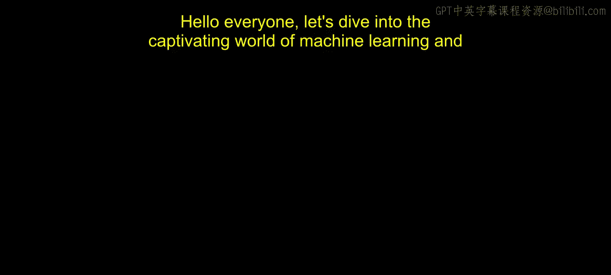
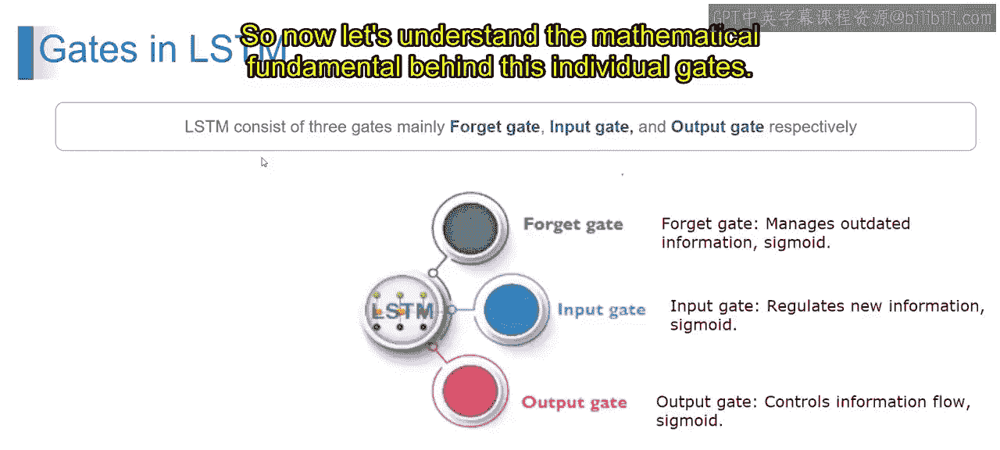

# Edureka《通过LLMs学习生成式人工智能（机器学习和NLP基础，第1课／共4课）｜Learn Generative AI with LLMs》中英字幕 - P85：84_门.zh_en - GPT中英字幕课程资源 - BV1q4421Q7qh

Hello， everyone， let's dive into the captivating world of machine learning and the foundational concepts of NLP together。

 So now let's understand the gates。😊。

In this we are going to cover gates in the LSTM and those are input output and forge gate in brief in this we are by the end of this session you are able to describe the functions and mechanism of the gates within the LSTM network and you are able to identify and explain the rows of input output and for gate gates in LSTMs so let's get started so what exactly the gates in LSTM and why do we even require this so you might wonder in the last module we discussed about it Okay。

 so in the previous session or the module we recognize that LSTM modules so feature three distinct gates those are for gate gate input gate and output gate now in this module we will delve into a brief explanation of each of these gates okay so let's get started so let me start explaining with an example。

😊，So that we can interlink it with this gate。 Okay， so imagine you are in。😊。

You are in charge of the factory and you have gates at various points of entry these gates control the flow of material into and out of the factory。

😊，So imagine you are in charge of the factory and you have gates at various points of entry。

 These gates control the flow of material into and out of the factory。 So in this particular example。

 let's consider all these gates like input output and forget gate。 So first of all， when we are。😊。

First of all， let's understand the input gate， this gate decides whether to allow new material into the factory based on their importance and the relevance to the production process for example。

 if high quality raw materials arrive the input gate might open widely to accept them while the low quality material might prompt the gate to stay closed or open only partial that is what the duty of the input gate then in the same example what the output gate will do So this gate determines which finished products should leave the factory for the distribution for instance。

 if the quality control team approves a batch of products the output gate opens fully to allow them to be shipped out however。

 if there are defects detected the gate。😊，Close to prevent the su products from leaving the factory。

 And finally， the for gate， this gate manages the removal of outdated or irrelevant materials from the factory。

 It ensures that the factory does not become cluttered with unnecessary items that could hinder the production process。

 for example， if certain materials are no longer needed for production。

 the for gate closes to discard them freeing of the space and resources for more critical materials means now let's understand it with the technical understanding。

 So in the context of neural networks， gates are mechanisms that control the flow of information within the provided network。

 they are composed of mathematical operations that determine how much information should be allowed to pass。

😊，Through at each step of the process， the first one is going to be the input gate as based on our understanding in LSTM network。

 the input gate regulates how much new information should be added to the cell state it uses sigmoid activations to determine the relevance of incoming data。

😊，So now let' us understand based on the provided information in the input gate as we discussed in LSTM network。

 the input gate regulates how much new information should be added to the cell it uses smoid activation to determine the relevant incoming data。

 then the next one is of the input gate。😊，In analysisLSCM the input gate regulates how much new information should be added to the cell state it uses sigmoid activation to determine the relevance of incoming data then the output gate this gate controls the flow of information from the cell state to the output and the next hidden state。

 it also employs sigmoid activation it also employs sigmoid activations to decide the relevance of information for the current periodic task then the forgate gate。

 the forgate gate manages the removal of outdated or irrelevant information from the cell state it uses sigmoid activation to determine which transformation from the previous cell state should be retained or discarded means these gates in neural networks acts as filters that regulate。

😊，Its the flow of information allowing the network to selectively process and retain the relevant information while discarding irrelevant or outdated data so thats all about the gates in the LSTM so now let's understand the mathematical fundamental behind this individual gates so stay tuned for the next video where we will elaborate on this topic。

😊。

