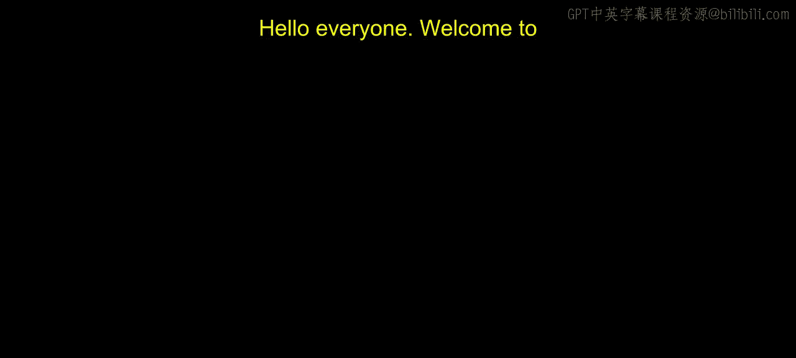
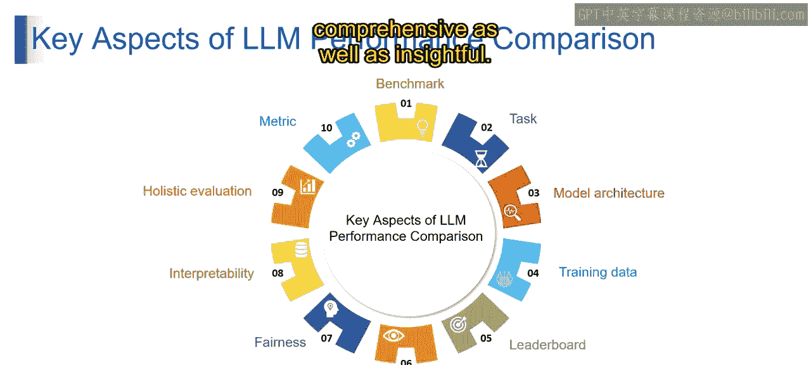
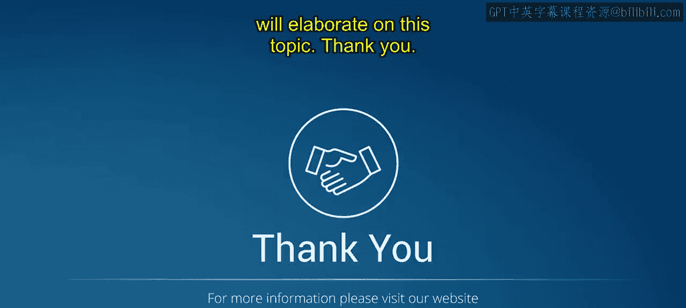

# Edureka《通过LLMs学习生成式AI（基础、应用开发、流行工具，第2、3、4课／共4课）｜Learn Generative AI with LLMs》中英 - P86：49_LLM性能比较.zh_en - GPT中英字幕课程资源 - BV1ym421V7gx

Hello everyone， welcome to Generative AI Architectural and applications development in this module we are going to cover LM performance comparison。

😊。

So let's get started the LLM performance comparison。

 Now let's start by understanding the key aspects of the language model performance comparison。

 Imagine you have a few language models and you are curious to know which one performance better。

 That's where LLM performance comparison comes in。 So here if you guys can understand the key aspects of the LM performance comparison。

 The first one the benchmark， think of benchmark as standardized setoff tasks and evaluation metrics。

 it's like common ground that allows us to measure the performance of the language model in a specific domain Imagine it as a standardized test or language models。

 Now let's dive into the example to make its crystal Gil。 Okay。

 suppose we are evaluating the language models in the domain of machine translation。

 Let's match this。 our benchmark could include tasks。😊。

Ttransranslating the sentence from the English to French or vice versa。

 So each task becomes a standardized challenge and the benchmark ensures fairness and consistency in evaluating the different language models and then the next one is of the task Now within the LLM evaluation domain we have specific challenges known as tasks。

 these task could range from machine translation to question answering or even the summar。

 Each task essentially represents a different skill that the language model is tested on。

 for example， let's stick with our machine translation example。

 one task within this domain could be translating medical documents and another task might involve translating different phases each task evaluates a specific aspect of the language models capabilities giving us a comprehensive。

😊，Understanding of its strengths as well as weakness and then the metrics here。

 just imagine you are a coach evaluating the performance of the players in a soccer match。

 just imagine the situation to make fair assessment you would need a scoring system right in the world of language models。

 all the LLms the metrics play a similar role。 they are like the scoring system used to evaluate how well an LLM performs on the given specific task here if you can see we are providing the accuracy perplexity blue score rockg score and loss function Now let's understand all this individually the first one is of accuracy。

 Just consider the analogy as scoring goals here it measures the percentage of correct responses in factual task。

 It's like counting how many goals。😊，Players scores accurately。 That is about the accuracy。

 Then the next one is of perplexity。 So here， just imagine the analogy as predicting the next move means it estimates how well the LLm or the large language model predicts the next word in a sequence。

 indicating fluency as well as coherence。 Think of it as predicting the next move in a game accurately。

 Then the next one is of blue score。 So here the analogy is translation accuracy。

 So commonly used in machine translation。 It assesses the overlap bit the generated text as well as the reference translation。

 It's like checking how accurately a translation reflects the original text。

 Then the next one is of the rock score。 So here the analogy you can consider as a summarizing the success。

 It evaluates。😊，The quality of summarizes or summaries by measuring the overlap with references summaries it's akin to assess how well a player's summary of match aligns with the official summary Then the next one is of loss function So here the analogy is to adjust the strategies means a mathematical calculation used in training the large language models。

 it measures the discrepancy between the model prediction and the actual data。

 minimizing the loss function is like refining the strategies to guide the model towards the better performance similar to a coach adjusting tactics for improvement in essence。

 just as a coach uses a various metrics to assess the different aspects of a player performance metrics。

 the language model world help as gauge how。😊，LLMs are tackling specific language task。

 Each matrix provides valuable insights into a different dimensions of performance。

 making the evaluation process comprehensive as well as insightful。

 These are are the key aspects of the LLM performance comparison。😊。

So stay tuned for the next video where we will elaborate on this topic， Thank you。😊。

