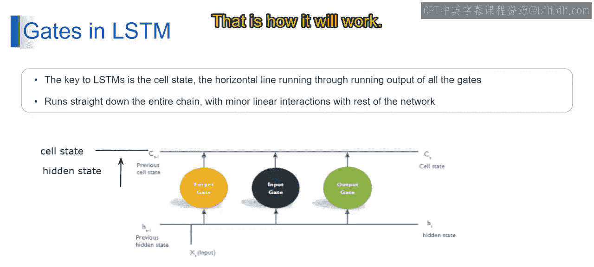

# Edureka《通过LLMs学习生成式人工智能（机器学习和NLP基础，第1课／共4课）｜Learn Generative AI with LLMs》中英字幕 - P86：85_LSTM中的门.zh_en - GPT中英字幕课程资源 - BV1q4421Q7qh

So let's now explore the progression from our previous discussion。😊。

So now let's understand the key to LSTM is the cell state， the horizontal line running through。😊。

Running output of the gates runs straight down the entire chain with minor linear interactions with rest of the network means what exactly it is。

😊，So focusing on the cell state。So these are the key components actually particularly focusing on the cell state and its interaction with the gates cell state。

 it is a crucial component of the LSTMs representing the memory of the network that runs horizontally across the entire chain of LSTM units unlike the hidden states which only passes information vertically。

😊，Sell tape passes the information horizontally where。😊。

Cell state is a crucial component of LSTM representing the memory of the network that runs horizontally across the entire chain of LSTM unit。

 unlike hidden states which only passes the information vertically from one LSTM into the next。😊。

The cell state runs straight down the chain allowing the information to persist over the time。

 the cell state is modified by the operations of the gates with selectively adds or removes information from it thereby allowing the LSTM to retain relevant information over the long sequence then the interactions with the gates。

 the cell state interacts with the gates of the LSTM including the forgate input and output gate the forgate gates takes the previous hidden state that is nothing but Ht minus-1 and the current input as x of t and alongside the previous cell state that is c t minus-1 means the forgate gate takes the previous hidden state Ht minus-1 and the current input state that is nothing but xt as input alongside the previous cell state。

😊，That is Ct minus-1 it denotes which information from the previous cell denote which information from the previous cell state should be retained of a go thereby influencing the current the content of the current state current cell state C the input gate determines how much new information should be added to the cell state it also takes the previous hidden state that is Ht minus-1 and the current input Xt as input alongside the previous cell state C minus-1 and decides the relevance of new information to be added to the current cell state the output gate controls what information from the current cell state should be passed to the output or the next hidden state similar to the for and the input state this takes the previous hidden state Ht minus-1 and the。

😊，Current input state Xt and alongside the cell state of the provided data。

 So that is how it will work。

