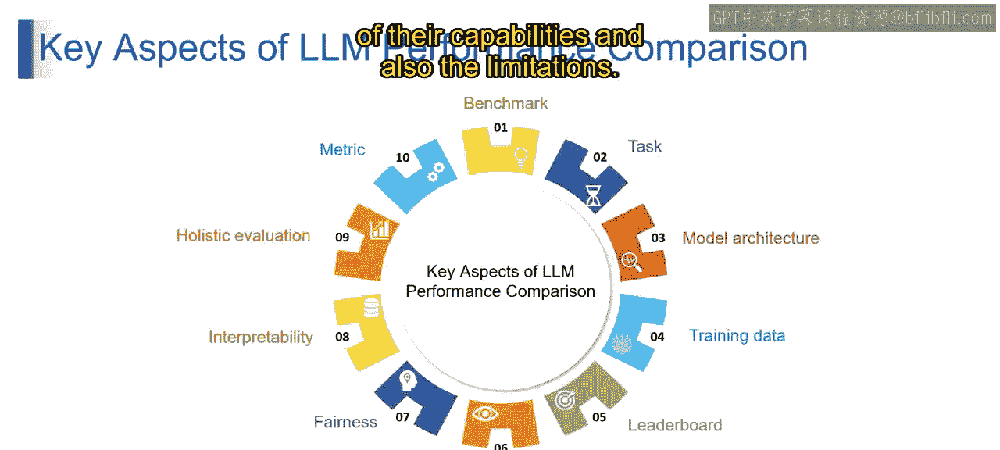

# Edureka《通过LLMs学习生成式AI（基础、应用开发、流行工具，第2、3、4课／共4课）｜Learn Generative AI with LLMs》中英 - P87：50_LLM性能比较的关键方面.zh_en - GPT中英字幕课程资源 - BV1ym421V7gx

Hello everyone， welcome back to Generative AI architectureitecture and Appplication Travel Month。😊。

Now we can go through the individual model architecture， training data， leadership。

 human evaluation and fairness， so lets let me explain each one separately the first one is of model architecture so lets dive into another crucial aspect of large language model evaluation the model architecture this refers to the design and configuration of a neural network that forms the foundation of the language model。

😊，The model architecture plays important role in determining how well the LLM can perform various tasks then the next one is like here the model architecture is like consider the model architecture as a blueprint of our language model just like different buildings have different blueprints language models have different architectures these architectures can be tailored for specific tasks making some model Excel in certain areas while having limitations in the other。

 for example， a language model designed for text sumization may have a different architecture than one specialized in the language translation the way these neural networks are structured affects how efficiently they can understand and generate the language influencing their overall performance that's about the model architecture then the next one is of the training data。

😊，So now let's talk about the lifebl of any language model， the training data。

 this is the vast amount of text and code used to train the model the quality of biases present in this training data significantly impact how well the model can generalize to new tasks and also potential biases it may expect。

 so imagine the training data as a library from which a large language model learn if the library is diverse and representative of different language patterns the model is more likely to perform well across the various tasks however。

 if the library has biases or lack of diversity those biases may be reflected in the model output for example。

 if our language model is trained on predominantly formal language it might。😊。

Truggle with informal language tasks。 Similarlyly， if the training data is biased towards a particular perspective。

 the model may inadvertently generate the biasased results that is about training data。

 Then the next one is of leader board。 So leader board is like core board of the language model world where different models compete and are rank based on their performance on specific benchmark。

 Just picture a platform the tracks and ranks various language models。

 This platform are the leader board provides a snapshot of how well different models are doing in comparison to each other on one specific task。

 It's a dynamic way to stay updated on the state of art in the world of language model。 For example。

 think of。As a sports leader board， each language model is like a team competing in various tasks。

 the leader board tells us which models are leading the pack。

 showcasing their strengths and innovations in different areas。😊。

Then the next one is of human evaluation So moving on to human evaluation while automated metrics are crucial subjective assessments by linguistic domain experts and even lay people provide unique insights into aspects of like human naturalness fairness and creativity that automated metrics might miss in some cases so for example。

 imagine taste testing a dish automated metrics might tell you about the nutritional content but human evaluation captures the flavors and textures and overall dining experience。

 similarly human evaluation enrich riches are understanding of language models so the next one is of fairness it is that refers to the ability of the language models to avoid biases and stereotypes in its。

😊，Enuring it is free from prejudicejuise and discrimination。

 Consider a language model generating job recommendations。

 a fair model would ensure that it does not favor or discriminate against certain demographics providing unbiased suggestions for all the users So that's about the fairness Then the next one is of interpretability。

 So another important aspect is interpretability。 This is the ability of the large language model to explain its reasoning process make its decision transparent and provides insights into the internal workings。

 Think of this interpretability like an open book。 an interpretable model allows us to understand how it reach a specific conclusion or generated a particular output providing clarity and trust in its。

😊，Ma process that is about interpretability。 Then the next one is of holistic evaluation。

 So this approach goes beyond a single metric and considers various aspects like fluency， coherence。

 creativity， relevance fairness and interpretability。

 It offers a comprehensive view of language models performance。 So in summary。

 these key aspects shape the landscape of language moral evaluation。

 providing a multifaceed understanding of their capabilities and also the limitations。😊。

So stay tuned for the next video。😊，Thank you。