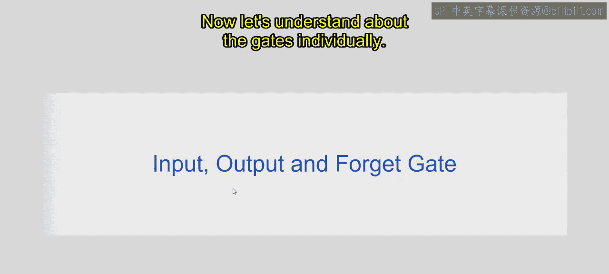
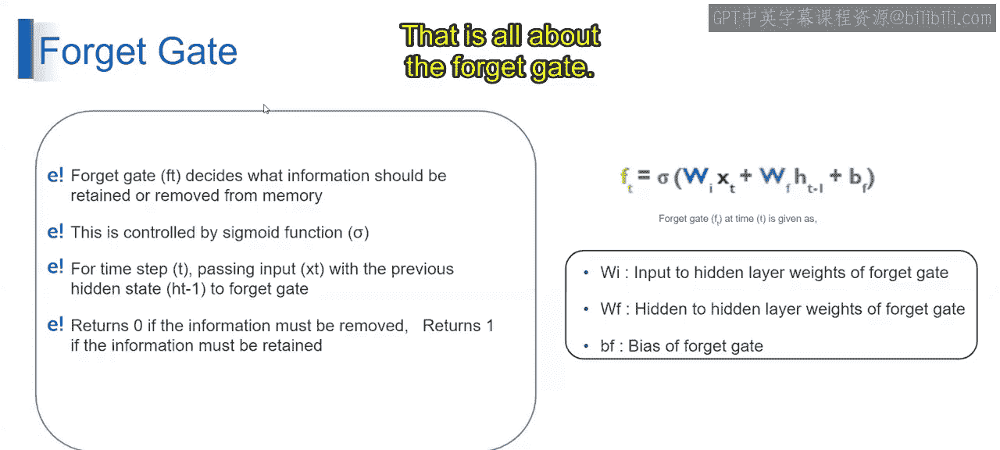
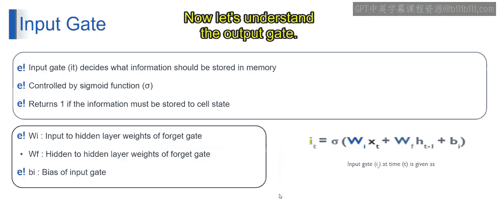
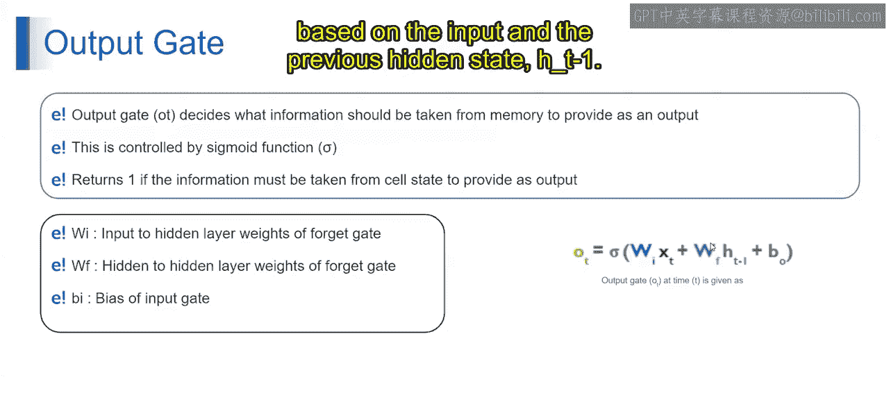
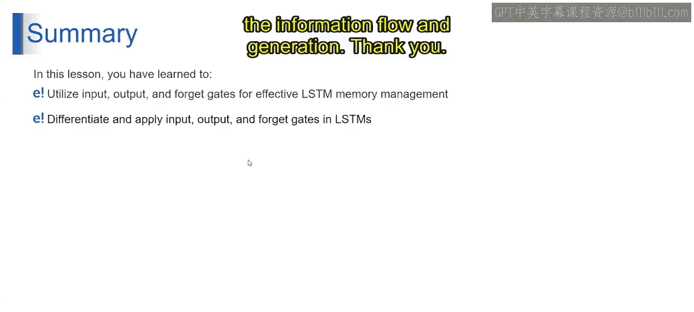

# Edureka《通过LLMs学习生成式人工智能（机器学习和NLP基础，第1课／共4课）｜Learn Generative AI with LLMs》中英字幕 - P87：86_输入、输出和遗忘门.zh_en - GPT中英字幕课程资源 - BV1q4421Q7qh

So now let's understand about the gates individually， the first one is of forgi gate。

 so what exactly it will do the for gate Ft it is represented as Ft is responsible for deciding what information from the previous cell state that is c t minus1 should be retained or forgotten for the current timestamp T this decision is made using the sigmoid activation function that can be represented as sigma which outputs the values between only the zeros and ones。

😊，Indicating the degree of retention or fortten here the formula indicates that sigma of w Xt plus wfxht minus1 plus bf it indicates that the weight of matrix that connect the previous hidden state that is nothing but the Ht minus1 and the current input Xt to the for gate and here Bf represents the bias term in the for gate and Ht minus1 and xt represents the concatednation of the previous hidden state Ht minus-1 and the current input Xt which serves as the input to the for gate where sigma is the sigmoid activation function which squashes the output of the linear transformation to the values better 0 and1 once the for gate is computed it determines。

😊，How much of each component of the previous cell state that is Ct minus-1 in our previous case we were having should be retained or forgotten。

 especially if FT is close to 0， it indicates that the corresponding component of the previous cell state should be forgotten where if it varies if FT is close to1 it suggests that the information should be retained means the forget gate in LSTM network uses the sigmoid activation function to decide which information from the previous cell state should be retained or forgotten for the current time step T based on the input Xt and the previous hidden state Ht minus-1 that is all about the forget gate so now let's understand the input gate。

The input gate I is responsible for determining what new information from the current input that is X should be stored in the cell state that is CT for the current timest this decision is made using a sigmoid activation function even here also which outputs the values between the0 and1 same like in the for gate so what exactly happens in this case lets see。

😊，It indicates the degree of importance for each component of the input here。

 the formula is represented as sigmma wXt plus wfXt minus1 plus B。😊，Here。

 WI represents input to hidden layer weights of forgate gate and WF represents hidden to hidden layer weights of forgate gate and where B is the biasers of the input gate so we can calculate the input gate with respect to this formula it will return one if the information is must be stored to cell state。

 so once the input gate is computed， it determines how much of each component of the current state should be stored into the cell state specifically if IT is close to1。

 it indicates that the corresponding component of the current input should be stored in the cell state while if IT is close to0 it suggests that the information is less important and should not be stored means input gate in LSTM network uses a sigmoid。

function to decide which new information from the current input should be stored in the cell state for the current time step T based on the input Xt and the previous hidden state Ht minus1 so now let's understand the output gate the output gate OT is responsible for determining what information from the cell state should be passed to the output Yt or the next hidden state Ht for the current step T this decision is made using the sigmoid activation function which outputs the values between the0 and1 indicating the degree of importance for each component of the cell state so here is the representation of the formula sigma of W Xt plus wf Ht minus1 plus t0。

 similarly Wi is the input to the hidden layer weights。

OfForge gate and H W F is hidden to hidden layer weights of for gate， then here it is B O。

 It is a bias of output gate。Once the output gate is concluded。

 it determines how much of each component of the cell state should be influenced the output Yt or the next hidden state Ht。

 specifically if Ot is close to1 it indicates that the corresponding component of the cell state should be included in the output or the next hidden state while if Ot is close to0 it suggests that the information is less important and should not be included means output gate in LSTM networks are using the sigmoid activation function to decide which information from the cell should be passed to the output or the next hidden state for the current times stamp T based on the input and the previous hidden state Ht minus1 so that is about the output gate。

😊。

So now the summary in this lesson， you have gained proper understanding of employing input。

 output and for gates to manage memory effectively within LSTM networks。

 additionally you have acquired the ability to distinguish and utilize input output and forgate gates approximately in the LSTM architecture。

 facilitating better control over the information flow and generation。

Thank you。