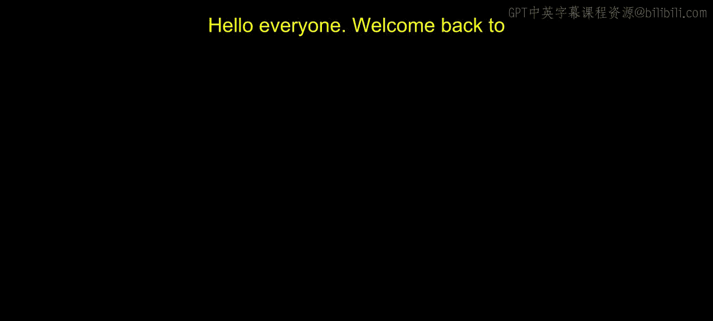
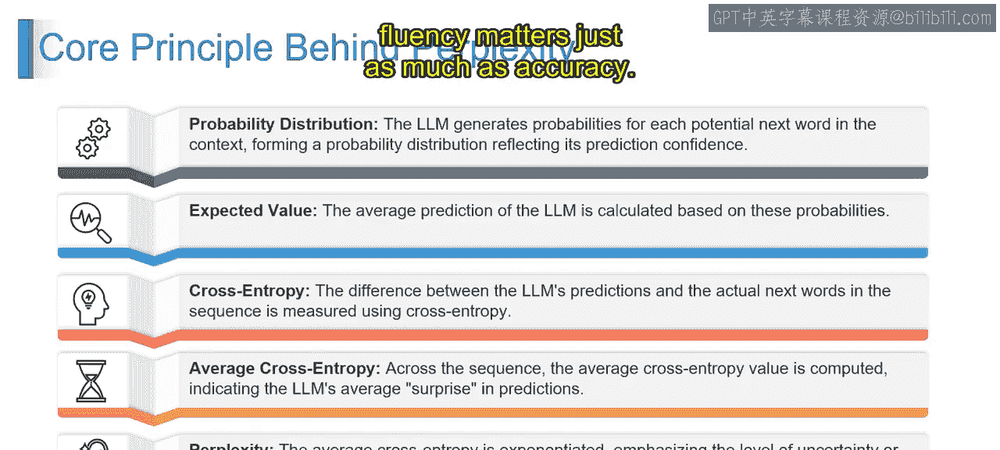

# Edureka《通过LLMs学习生成式AI（基础、应用开发、流行工具，第2、3、4课／共4课）｜Learn Generative AI with LLMs》中英 - P88：51_困惑度.zh_en - GPT中英字幕课程资源 - BV1ym421V7gx

Hello everyone， welcome back to Generative AI architectureitecture and applications development。😊。

Now， let's understand the perplexity。 Imagine your friend hands you two different books。

 One written in a language that you are fluent in and another in your language。

 you are just starting to learn Now just picture this you are reading these books for the first time and you are given a task of predicting the next word in your sentence。

 Just think about it。 which book would be easier for you to predict the next word。 obviously。

 the one in your fluent language。 right， that's the idea behind the publicplexity。

 let's break it down in the example book one in your fluent language might go like this。

 the sun shining and the sky is dash。 So what do you predict the answer is blue seems quite straightforward。

 right， the choices were limited here。 and it was easy to guess based on the fluency and context here。

 but in the book to， Let's say the language that you are learning it for the first time。

 Let's say the language is it。And the sentence is like ill Solestra retaio E E dash Now predicting the next word in this particular sentence might be a trickio because being a learner you have a higher degree of uncertainty the branching factor or the number of possible word choices is higher in the second example so now let's relate it to the formal definition the publicity here in information theory。

 publicity is a measure of uncertainty of probability distribution in the context of language model or the LLs it specifically estimates the average branching factor of the model it tells us on average how many possible choices the model has when predicting the next word in a sequence Now let's understand the key aspect the first one is of the branch。

😊，F think of branching factor as number of branches or the choices the model has in our language example。

 it's like the number of possible words that could fit into the blank space in a sentence。

 the higher the branching factor， the more uncertain and more perplexed with the model might be when predicting the next word。

 then the next one is of the average the term average in perplexity tells us it's not just about the prediction but an overall estimation across multiple predictions。

 it considers the average number of choices the model encounters giving this more comprehensive view of its uncertain Then the next one is of fluency conce dynamics。

 So consider fluency conce dynamics in our example fluency and familiar language made predictions easier。

While the challenge of currentnce in a new language， that is Italian language added to a perplexity。

 these dynamics play a role in how perplexity helps us gauge the model's performance。😊，Now。

 let's understand why is publicity preferred。 So publicplexity offers several advantages。

 Let's explore why breaking it down into the three key reasons that make it preferred choices。

 The first one is of simple interpretation。 Pplexity has the upper hand when it comes to simplicity。

 Unlike some complex metrics that might make your headspan， publicplexity keeps its straightforward。

 Imagine it as a performance score， the lower the better， it's an easy digestible concept。

 even for those who might not be diving into the technicalities。

 a lower publicplexity number directly translates to better model performance。 That's it。

 That is about simple interpretation。 Then widely used。😊。

Moving on publicity is not a newcomer to the science。

 It's a widely used metric deeply rooted in various contexts like language modeling。

 machine translation and speech recognition this widespread adoption enables seamless comparison across different models and tasks It's like a common language spoken by evaluation community。

 allowing us to gauge model performance consistently then the next one is focus on fluency So knowledge lets zoom in our focus on fluency perplexity Unlike some accuracy based metrics Hol and on the smoothness and naturalness of generated text imagine reading a story perplexity case more about how seamlessly the words flow rather than just counting correct and incorrect predictions this makes it particularly value。

😊，When assessing language models in creative or open ended tasks。

 where fluency matters just as much as accuracy。😊。

So stay tuned for the next video where we will elaborate on this topic， Thank you。😊。

