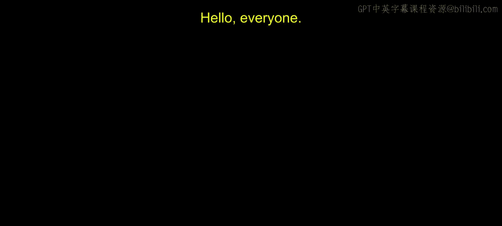
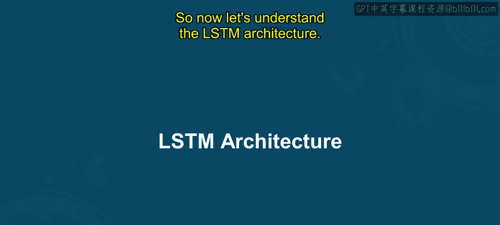
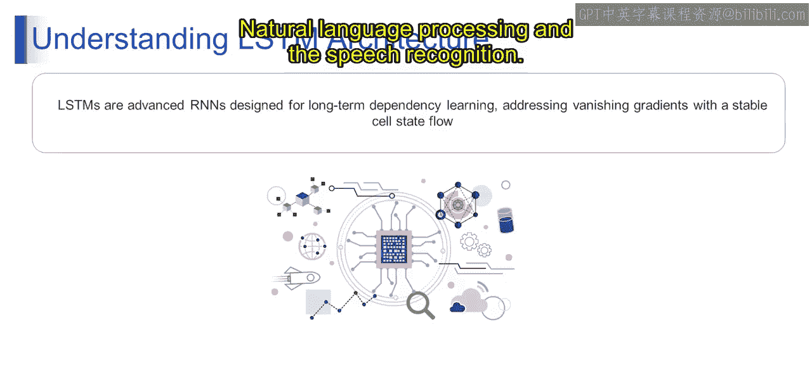
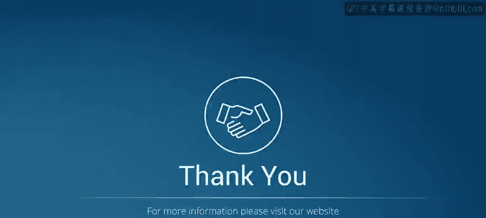

# Edureka《通过LLMs学习生成式人工智能（机器学习和NLP基础，第1课／共4课）｜Learn Generative AI with LLMs》中英字幕 - P88：87_LSTM架构.zh_en - GPT中英字幕课程资源 - BV1q4421Q7qh

Hello everyone， welcome back to machine learning and NLP basics。

 so now let's understand the LSTM architecture in this we are going to understand the architecture of LSTM and the importance of LSTM architecture by the end of the session you are able to describe the components and flow within the LSTM networks and also able to explain why LSTMs are pivotboal for learning in sequential data tasks。

😊。

So let's get started。Understanding LSTM architecture。 so in the previous module。

 we thoroughly examined the functionality of LSTM and its distinctive gating mechanism。

 So in this we will deep dive into the architecture of long short term memory which is a recurrent neural network designed to effectively capture and retain long termm dependencies in sequential data through specialized gating mechanism regulating the flow of information。

 So now let's understand how it is going to work。 So LSTM networks are specialized type of recurrent neural networks。

 which is nothing but Rnms， specially designed to tackle the challenge of learning long- term dependencies in sequential data。

 one of the main issues LSTM addressed is。😊，Fishing gradient problem that we discussed in the last module。

 right， which occurs when the gradients become extremely small during the training process。

 making it difficult for the network to learn effectively。

 So LSTM achieves this by introducing a unique mechanism called cell stick。

 This is what we highlighted in the last class。 It will serve as a stable flow of information throughout the network enabling it to capture and retain important information over the long sequences。

😊，This stable cell state slow allows LSTM network to effectively handle long term dependencies。

 making them particularly well suited for tasks involving sequential data such as time series analysis。

 natural language processing and the speech recognition。😊。

So stay tuned for the next video where we will elaborate on this topic。😊。

