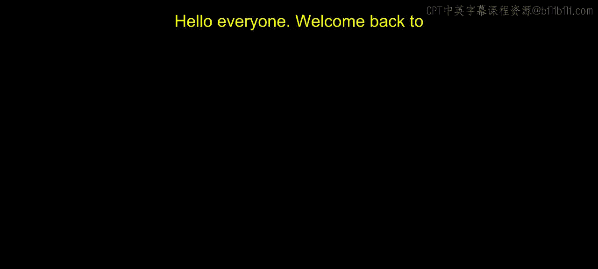
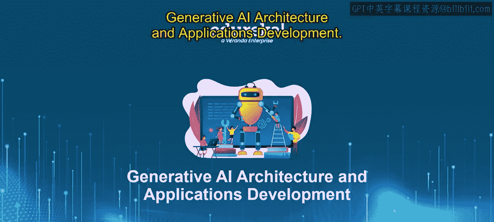
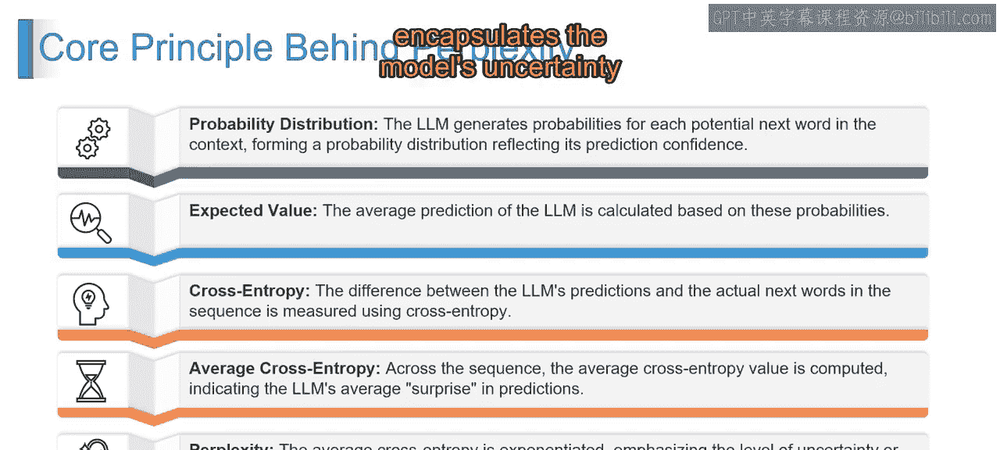

# Edureka《通过LLMs学习生成式AI（基础、应用开发、流行工具，第2、3、4课／共4课）｜Learn Generative AI with LLMs》中英 - P89：52_困惑度背后的核心原理.zh_en - GPT中英字幕课程资源 - BV1ym421V7gx

Hello everyone， welcome back to Generative AI architectureitecture and Appplication Travel Month。😊。

Now let's understand core principles behind perplexity。

 Let's uncover the core principles behind the perplexity。

 breaking down the key steps that bring us to this metric。

 Imagine it as journey from predicting the next word to understanding the models level uncertainty The first one is of the probability distribution at the heart of probabilityplexity is the concept of probability distribution here。

 the language model or the LLm acts like a mindreader generating probabilitybabilities for each potential next word in given sentence or the context This collection of probabilities forms a probability distribution showcasing the models confidence in its predictions then the next one is of expected value we calculate the average prediction of the language model based on this probabilities It's like predicting the most。

😊，Probable next word by taking into account of all potential options and their likelihood giving us a scene of what the model anticipate。

 Now， let's talk about the cross entropy。 This is where rubber meets the road。

 The difference between the language models prediction and the actual next words in the sequence is measured using the cross entropy。

 It's essential assessing how well the models prediction aligned with reality。

 Then the next one is of average cross entropy。😊，So building on that。

 we then calculate the average cross entropy across the entire sequence this value gives us insights into the average surprise。

 The model experiences in its prediction the lower the average cross entropy。

 the less surprises the model is indicating a more accurate prediction overall。

 then the last one is of publicity。 The average cross entropy is exponentiated。

 turning it into more easily interpretpretable metric。

 This transformation emphasizes the level of uncertainty or unpredictability in the text in simple terms higherity means greater uncertainty the model is more perplexed in its predictions In summary。

 the core principle behind the publicity takes through the journey of generating the probabilities calculating the。

😊，Expected values measuring the cross entropy and finally arriving at Mad that encapsulates the models uncertainty and unpredictability that is nothing but the perplexity。

😊。

So stay tuned for the next video where we will elaborate on this topic， thank you。😊。

