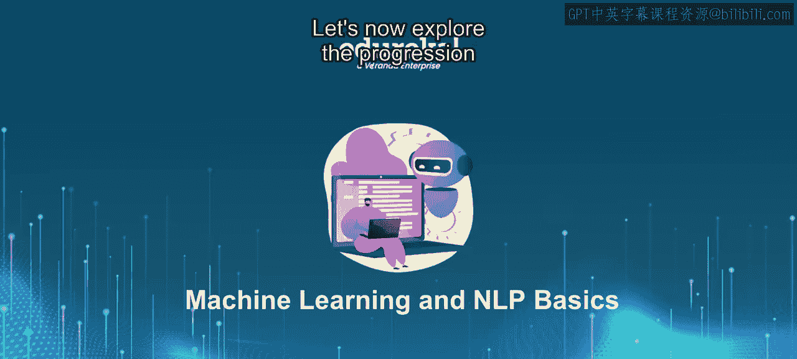
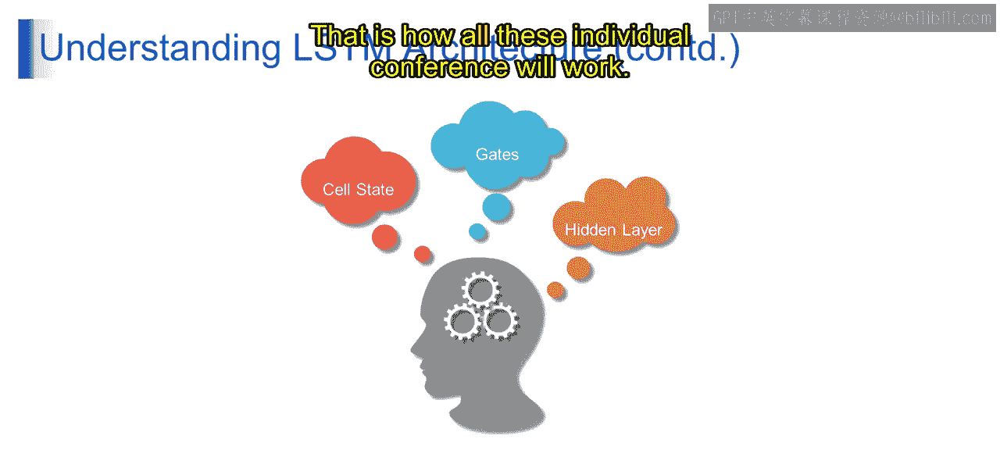

# Edureka《通过LLMs学习生成式人工智能（机器学习和NLP基础，第1课／共4课）｜Learn Generative AI with LLMs》中英字幕 - P89：88_LSTM架构概述.zh_en - GPT中英字幕课程资源 - BV1q4421Q7qh

So let's now explore the progression from our previous discussion。😊。

So now let's understand all this cell state， gates and hidden layer。😊。

So let's break down these three components of LSTM architecture when we see L state。

It is an LSTM network， serves as。😊，A conveyor belt that carries information across the timestamps or times stepss。

 it runs straight down the entire chain of Lstium cell with only minor linear interactions this allows the cell state to carry relevant information over the long sequences thus addressing the vanishing gradient problem。

😊，Imagine the cell state as a highway where information travels smoothly without much disruption。

 For example， let's say we are training a LSTM network to predict the next word in a sequence as the network processes each word in the input sequence。

 the cell state carries information about the context of the sentence。

 such as subject verb agreement or even the tense， for example， let's say we are having a sentence。

 the CAd is on the mat in this particular sentence。

 the cell state might retain information about the subject that is nothing but in our case the CAd and its location on the mat as it progress through the LSTM cells means the subject here is the CAd and the location is going to be a mat。

😊，That is about the cell state then coming to the next one that is gates gates in LSTM are specialized neural network layers that regulate the flow of information into and out of the cell state there are three different main types we discussed those are so these are the main parts that we discussed right for gate gate input gate as well as output gate so what happens here in this particular state each gate is responsible for controlling a different aspect of the information flow such as determining which information is discarded and which new information to store and which information to output these gates use sigmoid function so we discussed in the last class that all these gates use sigmoid and the tanh activation function whether if it is of the sm。

😊，Here in our case， each gate is responsible controlling different aspects of the information flow。

 such as determining which information to discard and which new information to store and which information to output so these gates you sigmoid and tanage activation functions to decide how much information to let through。

 for example， let's continue with our example of predicting next word in a sentence。😊，For example。

 let's continue with our example of predicting the next word in a sequence。

 the forgate gate decides which information from the previous cell to forgate such as irrelevant details from the earlier in the sentence。

 the input gate determines which new information to add to the cell state such as meaning of the current word finally the output gate decides which information from the cell state to use in predicting the next word such as context of the sentence then coming to the hidden layer。

 so what exactly it is going to perform so the hidden layer in the LSTM network contains the me cells they contain the meial cells。

😊，That maintain the cell state and perform computations to update it Each Lstriium cell in the hidden layer processes the input data and updates its internal state based on the current input the previous cell state and the output from the other cells means it will clipap all these things means the hidden layer encapsulates the internal working of the Lstium network where the bulk of the computations occur here means。

 for example， in our sentence of prediction example。

 each Lstium cell in the hidden layer processes a single word from the input sequence。

 it uses the input word， the previous cell state and the output from the other cells to update its internal state and provides an output this output along with the。

😊，Dated cell is then passed to the next Lsteium cell in the sequence means in simple terms。

 it uses the input word and the previous cell state and the output from the other cell to update its internal state and produce an output this output along with the updated state is then passed to the next Lsteium cell in the sequence。

😊，So that is how all these individual compete will work。😊。

So stay tuned for the next video where we will elaborate on this topic。😊。

