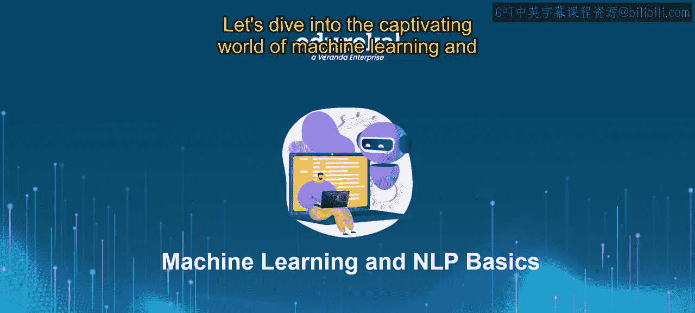
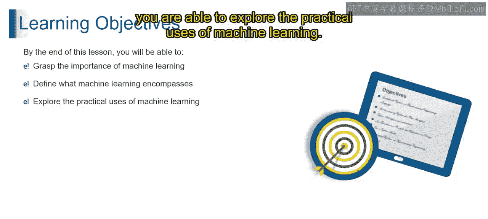
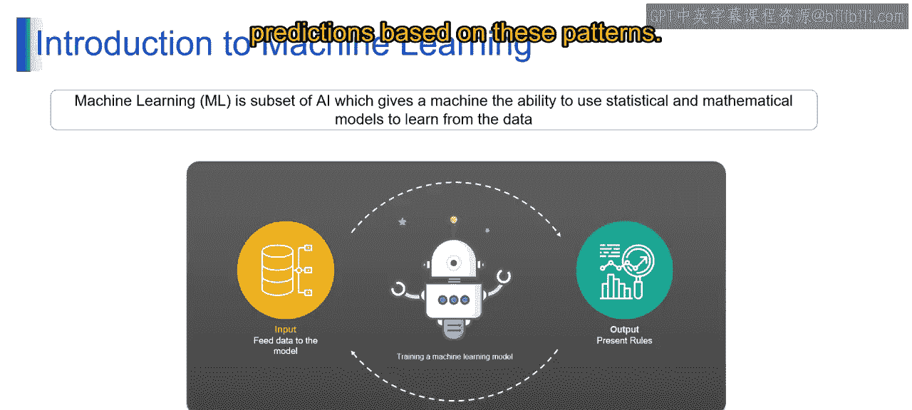
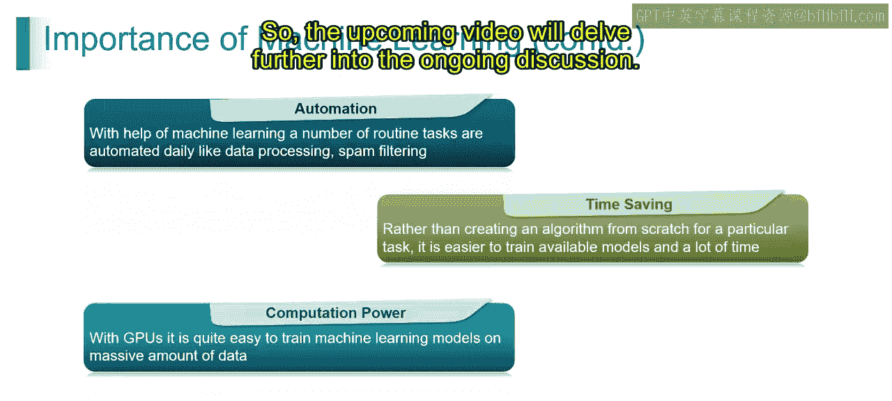

# Edureka《通过LLMs学习生成式人工智能（机器学习和NLP基础，第1课／共4课）｜Learn Generative AI with LLMs》中英字幕 - P8：7_机器学习基础.zh_en - GPT中英字幕课程资源 - BV1q4421Q7qh

Hello everyone， let's dive into the captivating world of machine learning and the foundational concepts of NLP together So now let's understand machine learning fundamentals in this we are going to cover what is machine learning and what the importance of machine learning techniques and applications of machine learning by the end of the session you are able to grasp the importance of machine learning and you are able to define what machine learning encompasses and you are able to explore the practical uses of machine learning so let's get started first of all what exactly machine learning is all about so machine learning is a subset of artificial intelligence that focuses on developing algorithms and techniques enabling computers to understand or learn from the data and improve their performance on specific tasks without being explicitly programmed means。

😊。

The essence machine learning algorithms allow systems to recognize the patterns。

 make predictions or take the actions based on the provided input data the core idea behind the machine learning is to enable the computers to learn from experience iteratively refine their understanding and adapt their behavior accordingly so the machine learning algorithms are designed to analyze vast amount of the data identify the underlying patterns and make decisions or predictions based on these patterns。

 so now let's understand what is the importance of it machine learnings plays a very crucial role in automating data analysis enabling predictions and enhancing decision making processes across the diverse domains think of machine learning as a powerful tool that helps computers learn from the data just like how we learn from the experience。

Means by analyzing large amount of the data machine learning algorithms can identify patternss make decisions or predictions and assist in making smarter decisions without human intervention for example machine learning publish recommendation systems on streaming the platforms helping users discover new content based on their preferences technically machine learning algorithms automate the process of extracting the insights from the data allowing organizations to analyze the vast data efficiency by leveraging the predictive models businesses can anticipate customer behavior forecast trends。

 optimize the processes and even detect anomalish or fraudulent activities this capability leads to increased efficiency cost saving and innovation across various industries。

😊，From healthcare and finance to manufacturing and marketing Now let's understand the importance of machine learning continuation。

 the automation machine learning automates numerous tasks that were traditionally time consuming and probe to the human error tasks such as data processing timem filtering and image recognition can be efficiently automated using the machine learning algorithms freeing of valuable human resources for some strategic endvos then coming to this time savingaving machine learning significantly reduces the time required to develop the solutions for the complex problems instead of creating algorithms from the scratch developers can leverage existing machine learning models and the frameworks saving considerable time and efforts this accelerated development process enables organizations to quickly deploy solutions and adapt to changing。

😊，Business needs then coming to the computational power。

 the advent of powerful computing resources such as graphics processing unit that is GPUs has revolutionized the field of M these high performance computing platforms enable researchers and practitioners to train the complex machine learning models on massive data sets at unprecedented speeds this enhanced computational power facilitates the development of more accurate and sophisticated models leading to breakthroughs in various demands including healthcare finance and autonomous driving so the upcoming video will delve further into the ongoing discussion。

😊。

