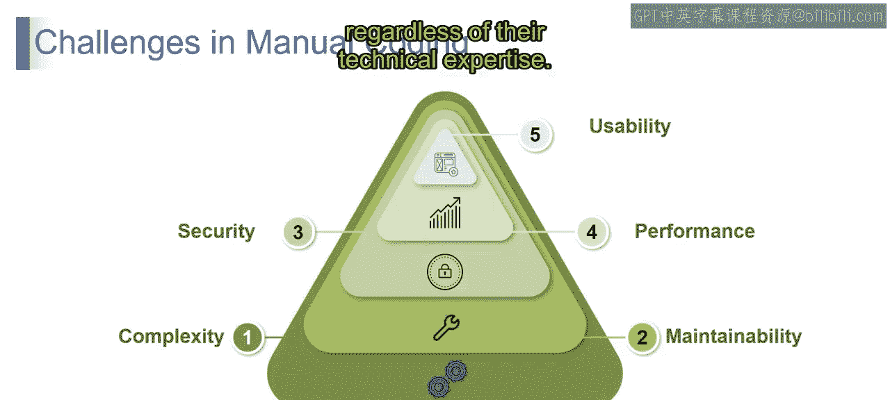
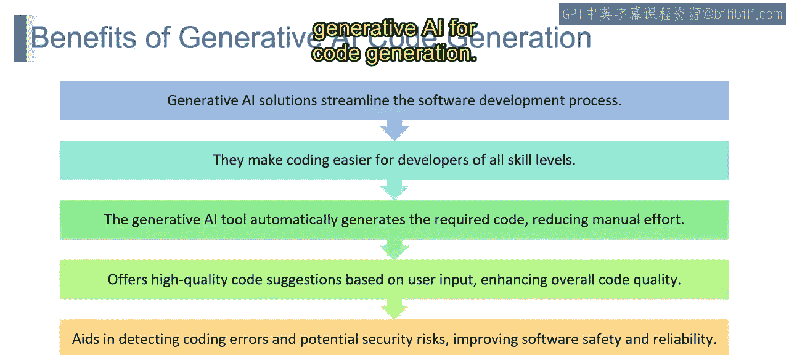
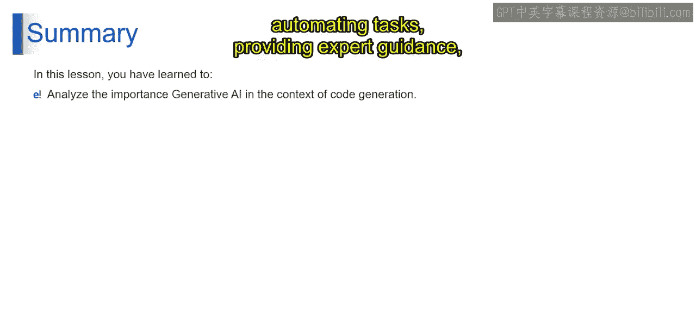

# Edureka《通过LLMs学习生成式AI（基础、应用开发、流行工具，第2、3、4课／共4课）｜Learn Generative AI with LLMs》中英 - P8：7_生成式AI代码生成的优势.zh_en - GPT中英字幕课程资源 - BV1ym421V7gx

So let's now explore the progression from our previous discussion。

 The challenge lies in ensuring that the code remains easy to understand。

 update and debu over the time failures to update or address maintainability issue can turn the code base into tangled chnle that's hard to navigate in fact so that's about maintainability then the next one is of security think of fortress that needs strong walls and vigilant guards Similarlyly in codinging wall security is paramount manualual coding introduces the risk of vulnerabilities such as loophole or bugs that malicious entities can exploit saveguarding again as these threads require malicious attention to detail un constant constant vigilance so that's about security then the next one is of performance Imagine a high speed race where every second counts performance。

😊，Manual coding is akin to optimizing a car for speed。

 writing efficient and optimized code is crucial to ensure that applications run smoothly and response swiftly to user interactions。

 the challenge lies in balancing functionality with the performance as inefficient code can lead to slow applications and frustrated users。

 So then the next one is of usability。 So lastly picture a user friendly app that effortlessly guides you to your destination。

 manual coding must prioritize creating user friendly interfaces and experiences balancing functionality with an intuitive design is challenging as developers needs to ensure that end users can interact seamlessly with software regardless of their technical expertise。

 So these all the challenges in the manual coding。 So now let's understand when。😊。

Of generative AI in code generation。 So imagine having a personal assistant that organizes thoughts effortlessly generative AI solutions act as digital assistance of the coding world streamlining the software development process they optimize the workflows。

 making the journey from concept to code more efficient and seamless then the next to one ease of accessibility for all the developers This gene AI opens the door to a world where coding becomes accessible to developers of all the skill levels it's like having a tutor that adapts to your learning space or pay with intuitive code generation Even beginners can confidently dive into the coding landscape empowering broader community of developers then the next to one ease of automated code generation Think of a tool that takes care of the repetitive aspects of the coding。

 leaving you to focus on the creative。😊，Gen AI does just that by automatically generating the required code This automation not only reduces manual effort。

 but also accelerates the development process， turning coding tasks into a breeze then the next one ease off high quality code suggestion Imagine receiving expert guidance while crafting your masterpiece generative AI provides high quality code suggestions based on user inputs It's like having a coding mentor offering insights and improvements。

 enhancing the overall quality of the code and promoting best practices in software development then the last one ease off enhancing software safety and reliability So consider having a vigilant assistant that scan your work for potential pitfalls generative AI aids in detecting coding errors and security risks It's like having a trusted guardian。

😊，Ensuring that your code is not only functional but also robust and secure so these all the benefits of generative AI for cogen so in summary we delvet into the pivotal role of generative AI in the context of code generation by analyzing its significance we uncovered how generative AI transforms。

 the coding landscape streamlining process， enhancing accessibility automating tasks providing expert guidance and many more。

Thank you。