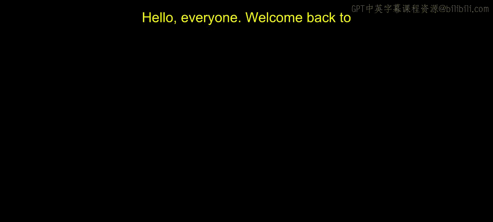
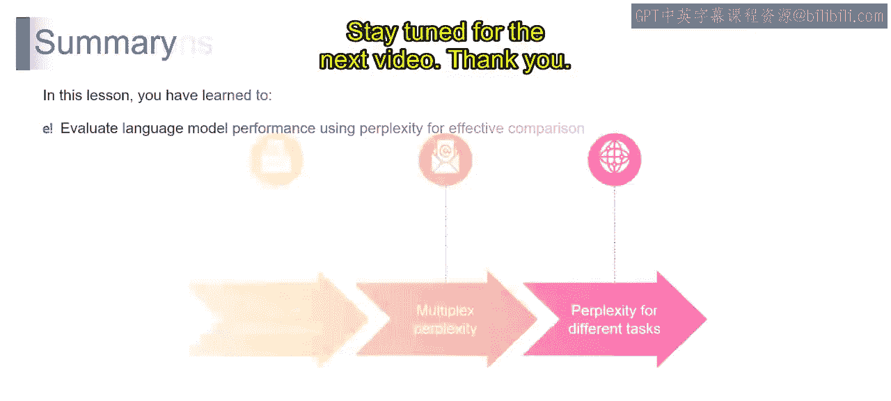

# Edureka《通过LLMs学习生成式AI（基础、应用开发、流行工具，第2、3、4课／共4课）｜Learn Generative AI with LLMs》中英 - P90：53_如何计算困惑度.zh_en - GPT中英字幕课程资源 - BV1ym421V7gx

Hello everyone， welcome back to Generative AI architectureitecture and Appplication Travel Month。😊。

Hello everyone， welcome back。 Now let's understand how to calculate the perplexity。

 So perplexity is a measure used in the language modelling。 The formula calculates。

 it's like this So each word in a sequence from the first word to the last word we need to find the conditional probability of that word。

 given all the previous words。 then we will take the product of these probabilities。

 then raise the product to the power of one divided by the total number of words in a sequence that is nothing but the n。

 So here is the formula。 So then we need to perform div the text into the words。

 This is the very first step。 So what exactly we are doing here。

 So we need to begin by dividing the provided sentence or the text into the words。

 take your text and segment it into the individual words。 For instance， the dog chased the cat。

 It will become the dog chased the cat。 then we need to。😊。

Calculate the word probabilities here means for each word， we need to compute its probability。

 given the preceding words， this is denoted as p of word I， given word minus-1 up to word of I-1。

 Then we need to calculate the product of the probabilities means what exactly we are doing here we will be multiplying the probabilities of all the words in the sequence。

 this gives you a combined likelihood value of the entire sequence of the text。

 whatever we have given then we need to perform race to power of sequence length means we will elevate the product from the above step that is nothing but product of probabilities to the power of the sequence length that is n length。

 That is nothing but n adjusting for the text length。 Then we need to calculate the probabilityity。

 So means the probabilityity is the n root of the values from the race to the power of。😊。

lengthThis represents the average number of choices the language model had at each step。

 So here we have provided one example。 imagine the LLM assigns the following probabilities if you can see here the first one。

 the probability of the is equal to 0。8 the probability of dog given the is equal to 0。

9 then the probability of taste given the dog is equal to 0。

7 then the probability of the dash is equal to 6 and the catd is going to be a 0。5。

 So how to calculate the probabilityity for this particular sentence here is that probabilityity is equal to the multiplication of all the probabilitybabilities of the words I said means it will become 0。

8 into 0。9 into 0。7 dash up to 0。5 to the of number of words how many words we are having totally we are having total 5 words So it is a product。

😊，All the probabilities of the words to the power of one by5。

 That is going to be the approximately equal to 3。2。 This is how you can calculate the publicity。

 In the essence， Calculating publicity involves breaking down the text into the words Comp the probabilities multiplying them and then adjusting for sequence length and arriving at a metric that encapsulate the model's average uncertainty in its prediction。

 Now let's understand the applications of publicity。 So publicity is not just a theoretical metric。

 It finds the practical applications in various scenarios。

 Let's explore three key applications that showcase its veratility and also usefulness。

 The first one is going to be the publicity regulation。 So imagine you are training a language model。

 And you notice it's becoming too confident in its predictions almost too sure。😊，Of itself。

 this is where perity regularization comes into the play by incorporating perplexity as a regularization term during the training。

 you can guide the model to maintain a healthy level of uncertainty it helps prevent overfitting and encourages the model to make more cautious predictions enchanting its generalization capabilities。

 So that's about perplexity regularization。 Then next one is of multiplex perity。

 So now let's talk about multipleplexity in scenarios where a single perplexity value might not capture the complete picture。

 multiple perplexity st So this approach involves calculatingplexity for specific subsets of the data allowing for more nu understanding of the models's performance across different segments。

 It's like having multiple lenses to examine and。😊，tune the models behavior in specific context。

 then the next one is of publicity for different tasks。 Its adaptability。

 then the next one is ofity for different task。ity is not a one size fits all metrics its adaptability shines in publicity for different task。

 whether you are evaluating a language model for translation or question answering or even the sum。

 publicplexity can be tailored to fit the task at hand。 It becomes a versatile yardst。

 providing insights into the models on and predictive capabilities across diverse language task。

 In summary， publicity is not just a number on your report。

 It's a dynamic metric with practical applications from keeping models in check during the training to offer nu insights through multiplex approaches and task specific evaluations。

 publicity proves its。You across various real world scenarios， so stay tuned for the next video。

 Thank you。😊。

