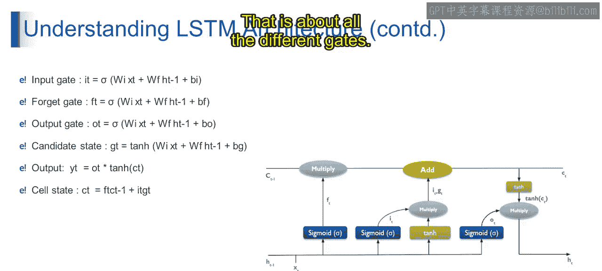

# Edureka《通过LLMs学习生成式人工智能（机器学习和NLP基础，第1课／共4课）｜Learn Generative AI with LLMs》中英字幕 - P90：89_LSTM架构门.zh_en - GPT中英字幕课程资源 - BV1q4421Q7qh

So let's now explore the progression from our previous discussion。

 So now let's understand the individual gates here。 The first one is of the input gate。

 It is represented as I is equal to sigmoid activation function of w I X3 plus w F H T minus1 plus B。

 So in the previous module。 we discussed about three different gates here。😊。

Let's simplify it input gate controls how much information from the current input state should be used to update the cell state that is nothing but the city means imagine you are learning learning to predict the temperature of the next today means the input gate determines how much importance to give to the current weather data that is nothing but temperature humidity etc in updating the memory of the model means input gate IT's computed using sigmoid activation function applied to the combination of the current state input that is Xt and the previous hidden state that is Ht minus1 and corresponding weights that is nothing but W IWF along with the biot that is nothing but B biot is B means it mainly depends on these。

😊，Facts， current input and the previous states hidden state。Then coming to the forgate gate。

The forgate gate describes how much of the previous cell states that is nothing but C T minus-1。

 the previous cell state should be forgotten and retained for the current time step means continuing with our temperature prediction example the forgate gate determines which past weather information such as temperature patterns from the previous state dates should be retained or discarded means technically similar to the input gate。

 the forgate gate that is FT computed using sigmoid activation function applied to a combination of the current input and the previous hidden state and the corresponding weights along with the biot here in our case the biot is Bf then coming to the output gate the output gate regulates how much of the update。

😊，cell state should be exposed to the next hidden state that is Ht out gate is represented with Ot in our example of temperature prediction scenario the output gate determines how much of the current prediction should be based on the updated information means technically the output gate is computed using the signaloid activation function and applied to combination of the current input X T and the previous hidden state Ht minus1 and the corresponding weights W I and WF along with the biot that is nothing but vivo these all three works similar then coming to the candidate gate it is represented as Gt the candidate state represents the new candidate value that could be added to the。

Cll state means sticking without temperature prediction analogy。

 the candidate state should be seen as the new temperature data that could potentially be included in the memory of the cell means the candidate gate is computed using the hyperbolic tangent that is nothing but the tanh function applied to a combination of current input previous hidden state and corresponding weights along with the biot that is about the candidate gate then coming to the output。

😊，The final output Y T， or you can even say cell state that is C。 So output and cell state。

 the output is Y T is the product of the output gate O T and the updated cell state。😊。

Scaled by the hyperbolic tangent function means here it can be represented as Ota into1 h of city that is about the output then coming to the cell state。

😊，The updated cell state it is also known as CT is a combination of previous cell state C minus1 and4ge gate that is Ft。

😊，And the calculated state that is Gt multiplied by the input gate I。

 So that is how it is represented。😊，Together these functions determine how information flows through the LSTM unit updating the cell state and producing the final output means LSTM architecture utilizes these gates and equations to regulate the flow of information through the cell state allowing it to capture and retain the important information over the long sequences。

 making it effective firm task involving sequential data analysis so that is about all the different gates。

😊。

So stay tuned for the next video where we will elaborate on this topic。😊。

