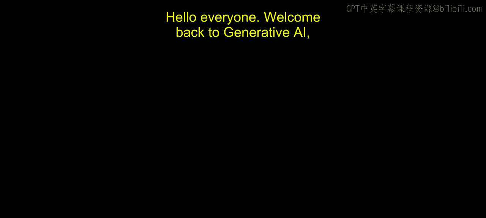
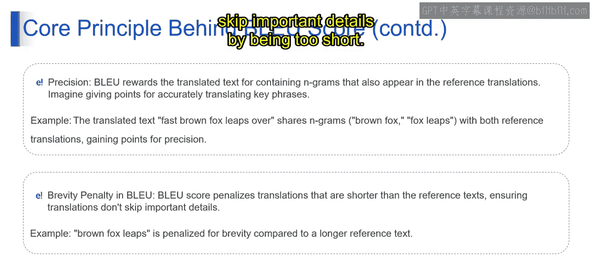
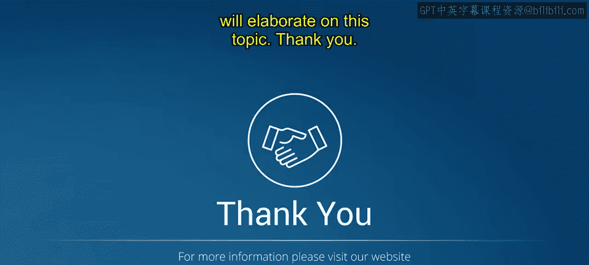

# Edureka《通过LLMs学习生成式AI（基础、应用开发、流行工具，第2、3、4课／共4课）｜Learn Generative AI with LLMs》中英 - P91：54_BLEU分数.zh_en - GPT中英字幕课程资源 - BV1ym421V7gx

Hello everyone， welcome back to Generative AI architectureitecture and applications development。😊。

Now let's understand the blue score the abbrevivation for blue is that bilingual evaluation industry。

 so now let's understand the definition。 blue score is a metric designed to scrutinize the quality of mission translated text think of it as a church that meticulously examines how well the translated text align with the expression of human translation So now let's understand the core principles behind the blue score at its core blue works by measuring the overlap between the translated text and reference translation Imagine you have a sentence in one language and you want to assess how well it aligns with the officially translated versions blue comes into play to analyze this alignment Imagine you have an original sentence that is the quick brown f jumps over the lazy do and here is the mission translation。

😊，The fast brown f leaps over the tide canine。 And here we have the two references for this。

 The first reference translation one is that the agile brown f walls over the sluggish dog and the second translation reference is the nimble brown f pointss across the lethargic ho。

 So these all are the translated text that we are having for our original sentence of the quick brown fox jumps over the lazy talk。

 Now， let's understand how to perform the tokenization for this to begin blue score users tokenization。

 it breaks down both the translated text and reference translation into individual words are so words units。

 This step ensures granular analysis as each unit is considered separately。

 Let's break these sentence into words。 for instance， the。😊，Brown fog becomes the quick brown fox。

 the individual words。 or for example， it's a beautiful day。 Now。

 if we can break down this into the tokenization format。

 it will be like it's separate words than a and beautiful day means the entire sentence is broken down into a individual words。

 Then the next one is of Ngrams as building blocks。

 These are sequence of consecutive words used to analyze both translated text and as well as reference translation。

 So higher order Ngram captures longer phrases， allowing for a deeper comparison of meaning。

 Think of Ngram as a group of words for example here n is equal to two in this case。

 we would have combination like the quick and quick brown brown f f jumps and jumps over and etc。

 means we are clubing。😊，Two different words or two subsequent words together gather when we are saying n is equal to two in n gras。

 That's about n gra。 And the next one is of precision。 blue then assess precision。

 It rewards the translated text for containing n gras that also appear in the reference translation in simple words it gives points for accurately translating key phrases aligning with the reference translation。

😊，In our case of example， what blue does is it reward our mission translation for having matching phrases with the references。

 whatever the references that we are having here in our example our mission translation contains the phrase of brown f and it also has fox leaps both of which are present in the reference translations also imagine giving points picture this like a game where you get points for accurately translating key phrases in our cases since our translation shares the ngrams brown fog and f leaps with both references translations blue gives us points for precision so to sum it up precision in blue is all about acknowled and also rewarding the translated text when it accurately includes key phrases that are also found in the。

😊，ference translations， it's like a scoring system for getting the important parts right。

 How hope that shed light on the precision aspect of blue score。 Now。

 let's understand p penalty in blue。 So blue is fair but form it applies a pev penalty to translations that are shorter than the reference text。

 This ensures that translation don't get away with keeping important details。

 It's like saying no short gets allowed。 Let's explore the br penalty in blue using one simple example。

 Imagine we have our original text。 The quick brown fox jumps over the lazy dog。

 Our machine translation is the fast brown f leads over the targetkenine。

 So let's get back to that slide again。 Yes， here it is。 The quick brown f jumps over the lazy dog。

 The machine translation is the fast brown f。😊，Its over the tide canine Now we have two reference translations for comparison reference one and reference2。

 So brevity Pen in blue。 So blue does not like it when translation are too short in our example。

 if our mission translation was just brown f leaves。

 it might get penalized Why because it's shorter than the reference translation。

 whatever we are having over here。 For example， imagine a translationlator is shorter。

 as I mentioned brown f leaves and one of the references longer。

 the azure brown f was over the sluggish dog blue would notice this difference and apply a pen for brevity。

 it ensures that translation don't skip important details by being too short that's about brevity penalty。

So stay tuned for the next video where we will elaborate on this topic， thank you。😊。

