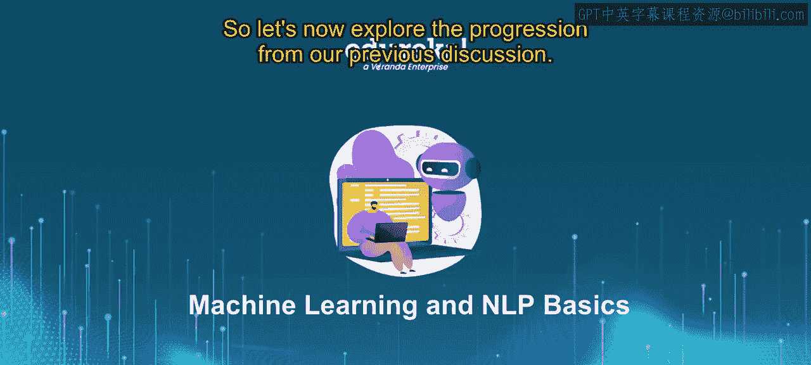
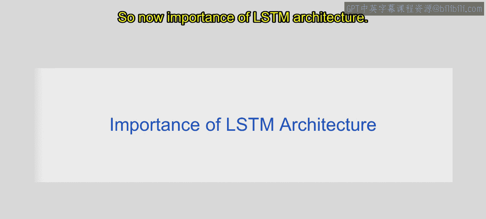
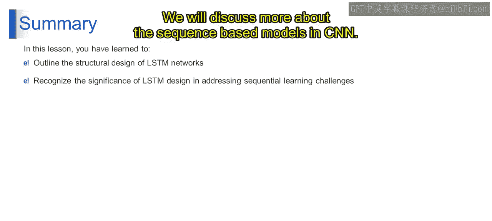

# Edureka《通过LLMs学习生成式人工智能（机器学习和NLP基础，第1课／共4课）｜Learn Generative AI with LLMs》中英字幕 - P91：90_LSTM架构的重要性.zh_en - GPT中英字幕课程资源 - BV1q4421Q7qh

So let's now explore the progression from our previous discussion。

 So now importance of LSTM architecture。 So we now understood how the architectural flow works in the LSTM。

 So here the importance includes modularity。 LSTM architecture offers modularity。

 allowing it for easy integration into various neural network architectures。

 its modular design enables researchers and developers to incorporate LSTM units into their models。

 enhancing flexibility and facilitating experimentation。

 Then the second one is of overcome the vanishing gradient problem。

 This one we already discussed twice。 So one of the key challenge in training the deep neural networks。

 including orance is the vanishing gradient problem where the gradient。😊。

Dimminished as they propagate backward through the layers hindering learning in long sequences。

 LSTM architecture effectively mitigates this issue by incorporating specialized gating mechanisms enabling the network to learn and retain information over the extended periods。

 then the next one is of selective memory so LSTM networks possess the ability to selectively remember or forget information from the previous time steps。

 this selective memory mechanism allows the network to focus on relevant information while discarding irrelevant or redundant data thereby improving the efficiency of sequence modeling tasks now。

 the better gradient flow unlike the traditional。😊。

LSTM architecture facilitates smoother gradient flow during the training by controlling the flow of information through graded connections。

 LSTM network maintain a more stable gradient flow。

 enabling more efficient optimization and faster convergence during the training process。

 then the next one is of versatileat LSTM architecture is highly versatile and can be applied to a wide range of sequence data tasks。

 but not limited to natural language processing speech recognition time series prediction and sequence generation its adaptability to diverse applications makes it a preferred choice for many machine learning practitioners then retain- term dependencies。

😊，LSTM networks excel at capturing and retaining long term dependencies in sequential data by maintaining a persistent self state and selectively updating it through gates LSTM architecture can effectively capture temporal relationships and dependencies spanning across multiple timests。

 making it well suitable for tasks requiring memory and distant past events。

 So these all are the important features of LSTM architecture。😊。

As we have seen it offers several key advantages， including modularity。

 robustness again as the vanishing gradient problem， selective memory capabilities。

 smooth gradient flow versatility across applications and the ability to retain longter dependencies these features collectively make LSTM networks indispensable for various sequential data analysis tasks in machine learning and artificial intelligence so now the summary in this lesson you have grasped the structural components of LSTM networks including gates and cell states and comprehend their crucial role in overcoming challenges inherent in sequential learning tasks by understanding the significance of LSTM design you are now。

😊，Equipped to tackle sequential data analysis effectively leveraging its specialized architecture to capture and retain long term dependencies in the next slide or in the next module we will discuss more about the sequence based models in CNN Thank you。

😊。

