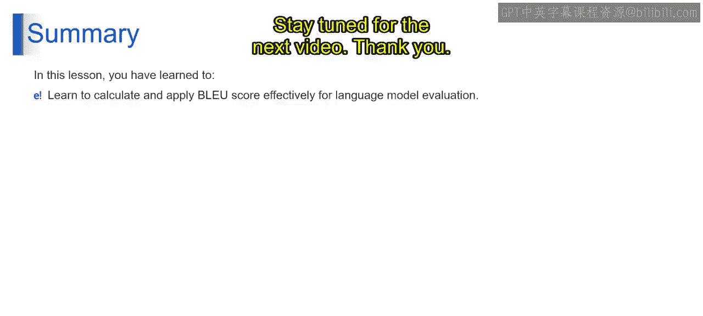

# Edureka《通过LLMs学习生成式AI（基础、应用开发、流行工具，第2、3、4课／共4课）｜Learn Generative AI with LLMs》中英 - P92：55_BLEU分数背后的核心原理.zh_en - GPT中英字幕课程资源 - BV1ym421V7gx

Hello everyone， welcome back to Generative AI architectureitecture and Appplication Travel Month。😊。

Now， let's understand the final score。 After considering precision Ngram over and applied the brvity penalty。

 blue calculates a final score between the0 and1。 higher scores indicate greater similarity to the reference translations。

 The journey concludes with the final score。 Blue combines precision for different Ngram orders and applies the brvity penalty to arrive at a final score between the0 and1。

 higher scores indicate greater similarity to the reference translations。 Then the balancing the act。

 blue works its magic by balancing two principles。 On one hand。

 higher Ngram precision signifies accurate rendering of key phrases。 On the other hand。

 avoiding the probabilityity penalty ensures the translated x captures the full mailing without skipping important ideas。

 It's a delicate act of balance。😊，Then the next one is of beyond the surface。 Remember。

 blue is a valuable tool， but it has its own limits。

 It focuses on factual accuracy and ingram overlap。 Ngram overlap。

 Shi light on surface of translation quality yet， it does not dive into a depth of grammatical correctness。

 stylistic elegance or subtletermini。 In essence， blue score brings a systematic approach to evaluate machine translated text using blend of precision pen and balance to improve the measure of alignment with human generated reference translation。

 Now， let's understand the benefits as well as limitations of the blue score。

 As with any evaluation metric。 blue score comes with its set of advantages and limitations。

 Let's explore both sides to understand when and how to leverage blue score effectively。😊。

So let's focus on the benefits。 The first one is of focus on accuracy blue score excs in its accuracy or focus on accuracy。

 It is designed to reward machine translated text for accuracy capturing key phrases found in reference translations。

 This precision oriented approach makes it a valuable tool when the goal is to ensure fidelity to the original meaning。

 Then the next one is objectivity。 One of blue strong suit is objectivity。

 The metric operates based on the measurable criteria。 ngrams and precision calculations。

 This objectivity brings a level playing field。 enabling consistent evaluation across different translators or the models。

 blue has become a widely used benchmark in the field of machine translation。

 It widespread adoption establishes a common ground for comparison。😊。

Making it easier to assess and communicate the quality of machine translated text across various models as well as tasks than sensitivity to fluency Unlike some metrics that focus solely on the accuracy blue emphasizes the smoothness and naturalness of translated text this sensitivity adds a valuable layer of evaluation especially in tasks pair fluency is as critical as accuracy Now let's understand the limitations the first one is of interpretability While blue provides valuable insights its interpretability has some challenges it may not fully capture the nuances of translation quality beyond factual accuracy grammatical correctness stylistic elegance and subtleter meaning nuances are aspects that blue might not address comprehensively then the next one is of reference dependency。

😊，Litation of blue is its reference dependency。 The metric heavily relies on the reference translations created by human experts。

 This means that the quality of blue assessment is only as good as the quality of the reference translations。

 in cases where reference translations vary blue's effectiveness can be compromised。

 then the next one is of brevity bias。 So blue introduces a brevity bias。

 the brevity penalty while designed to ensure translations don't skip important details can be a double edge sword it may penalize translations that are appropriately concise leading to a potential bias towards longer translations。

 So in conclusion， blue score brings valuable benefits。

 particularly in focusing on accuracy objectivity and providing a widely used benchmark however it also。

has limitations including challenges in interpretability。

 reference dependency and potential biases due to brevity penalty as with any tool understanding its strengths and weakness is key to using blue effectively in the evaluation landscape so stay tuned for the next video Thank you。

😊。

