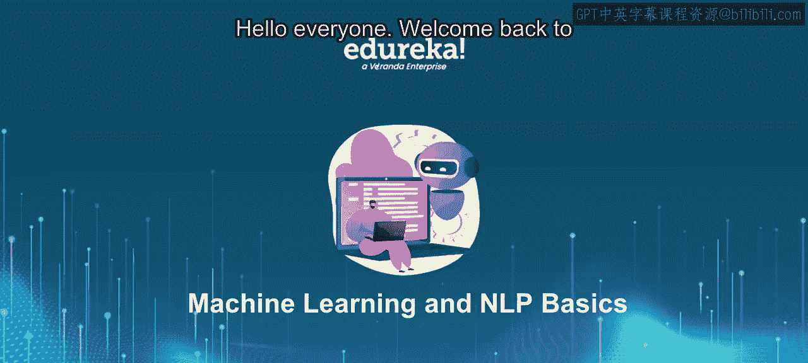
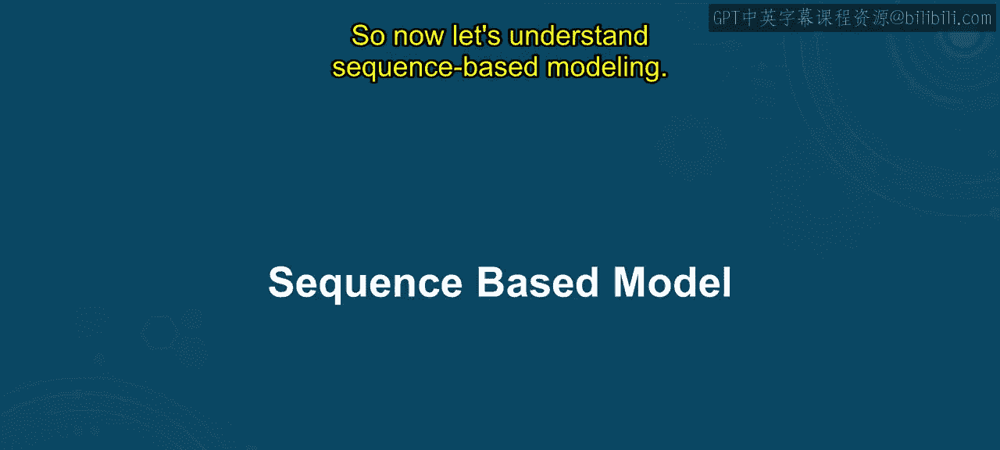
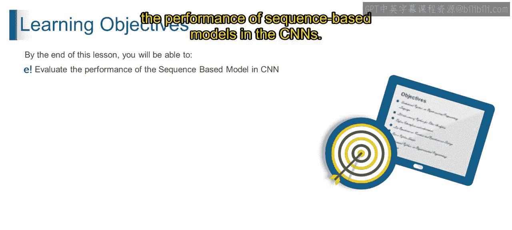
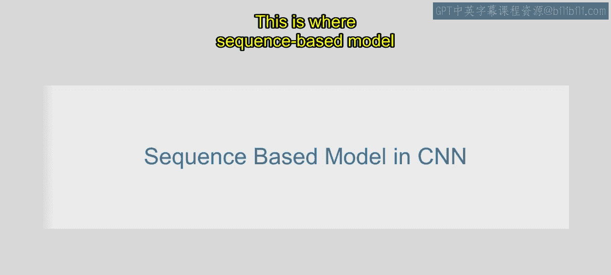
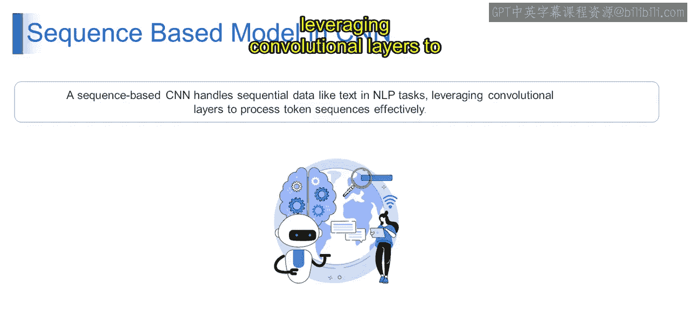

# Edureka《通过LLMs学习生成式人工智能（机器学习和NLP基础，第1课／共4课）｜Learn Generative AI with LLMs》中英字幕 - P92：91_基于序列的模型.zh_en - GPT中英字幕课程资源 - BV1q4421Q7qh

Hello， everyone。 welcomee back to machine learning and NLP basics。

 So now let's understand sequence based modeling in this we are going to cover sequence based model in the CNN by the end of this。

😊。

Lesson， you will be able to evaluate the performance of sequence based models in the CNNns。😊。

So let's get started sequence based model in CNN。 first of all。

 let's understand what exactly a sequence based model in CNN。

 So let's start with an example imagine you have a task of classifying different types of birds from the images。

 you decide to use the CNN， the convolutionional neural network。

 which is a powerful tool for image classification。 However。

 the challenge arises when you need to classify birth based on just on individual images。

 but on sequence of images， this is where sequence based model in CNN comes into play。😊。

So let's say you are tracking the flight patterns of birds over the time using a series of consecutive images。

 each image represents a movement in time and the sequence of images captures the bird's movement to classify the bird paces accurately。

 you need a model that can analyze these sequential image inputs effectively means technically a sequence based model in CNN extends the traditional CNN architecture to handle sequential data inputs。

😊，It incorporates recurrent or attention mechanism to process sequence of inputs effectively in the word classification example。

 the model would use convolutional layers to extract features from each image in the sequence and then employ recurrent or attention mechanism to analyze the temporal dependencies better in the consecutive images means sequencebased model in CNN adapt CNN architecture to handle sequence data。

 allowing it to analyze the patterns and dependencies across a sequence of inputs making it suitable search tasks such as video analysis time series forecasting and natural language processing here is a simple representation a sequencebased CNN handles sequential data。

😊，Like NLP tasks， leveraging convolutional layers to process token sequences effectively。

 so stay tuned for the next video where we will elaborate on this topic。😊。

