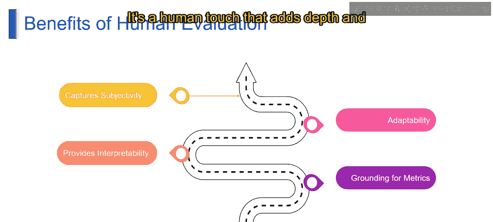

# Edureka《通过LLMs学习生成式AI（基础、应用开发、流行工具，第2、3、4课／共4课）｜Learn Generative AI with LLMs》中英 - P93：56_人工评估.zh_en - GPT中英字幕课程资源 - BV1ym421V7gx

Hello， everyone。 welcomele back to generative AI architecture and application development。

 Now let's understand the human evaluation。 First， let's understand the definition。

 human evaluation brings the human touch to assessing language models picture a panel of judges carefully scrutinizing the outputs of LLm。

 offering their expert opinions on various dimensions。 It's like having a group of seasoned critics。

 evaluating the performance of the language artist。

 Now let's understand the human evaluation process。

 The first one is of fluency at the forefront there is a fluency。

 judges evaluate whether the generated text reads smoothly and naturally It's akin to assessing the flow of a wellwritten story ensuring that the language model can produce the text that feels comfortable and coherent。

 then the next one is of coherence， moving on these coherence judges consider whether。😊。

The content makes sense and follows a logical flow It's about ensuring that the generated text does not just string words together。

 but creates a current narrative。 that the reader can easily follow。

 Then the next one is of accuracy Ac is a crucial aspect judges assess whether the text conveys the intended meaning correctly It's about gauging how well the language model captures the essence of the input and translates it accurately into current language then grammatical correctness。

 proper grammar is essential。 grammatical correctness is a key criterion。

 judges sctinize whether the text adhere to the rules of grammar。

 This ensures that the language model generates text that is not only meaningful but also grammatically sound。

 then style and tone the artistic touch comes with style。😊。

And tone judges evaluate whether the text achieves the desired stylistic effect and maintains an appropriate tone。

 It's about ensuring that the language model can adapt its style to suit different context and intents。

 Then lastly， there is a factual judges assesses whether the statement presented in the text are factually accurate。

 This is particularly important in scenarios where generating accurate information is very crucial。

 Now let's understand So here the key aspects of human evaluation does not just provide a binary good or bad judgment。

 instead， it dell in aspects ensuring a holistic assessment of the language models。

 capabilities and limitations。 Now let's understand the benefits。

 the benefits of human evaluation human。ation brings a unique set of advantages to the table。

 adding depth and nuanced to the assessment of language models。 Let's explore these benefits。

 understanding how the human touch enhances our understanding of the models' performance。

 The first one is of captures subjectivity human evaluation excels at capturing subjectivity language by its nature is subjective and humans are masters at interpreting nuanced expressions and context by involving human judges evaluations can capture subtle nuances emotions and cultural context that automated metric might overlook this subjectivity lens adds richness to the evaluation process ensuring a more holistic understanding of the language models output。

 Then the next one is of adaptability human evaluation brings adaptability to the forefront humans。😊。

Are adept at understanding different styles， tones and context。

 making them well suited to assess language models across diverse scenarios。

 This adaptability ensures that evaluations can be tailored to specific tasks or domains providing insights that are relevant and meaningful in a given context。

 Then the next one is of provides interpretability。

 It is one of the key strengths of human evaluation is its ability to offer interpretability。

 judges can only provide a score， but also articulate the reasoning behind the evaluation。

 This interpretability allows researchers developers and model users to gain deeper insights into why a model might excel or struggle in specific aspects。

 This transforms evaluation from a numerical score into a narrative that unwiil the intricacies。😊。

Of language generation then the next one is of grounding for metrics。

 human evaluation acts as a grounding for metrics while automated metrics have their place。

 they need to be anchored in human judgment to truly makes sense。

 human evaluation can serve as the benchmark against which automated metrics are calibrated and validated This grounding ensures that metrics aligned with human perceptions of quality and effectiveness。

 in assess， the benefits of human evaluation lies in its ability to capture subjectivity adaptpt to diverse context provide interpretability and serve as the essential grounding for automated metrics。

 It's a human touch that adds depth and context to our understanding of language model performance。😊。

So stay tuned for the next video where we will elaborate on this topic， thank you。😊。

