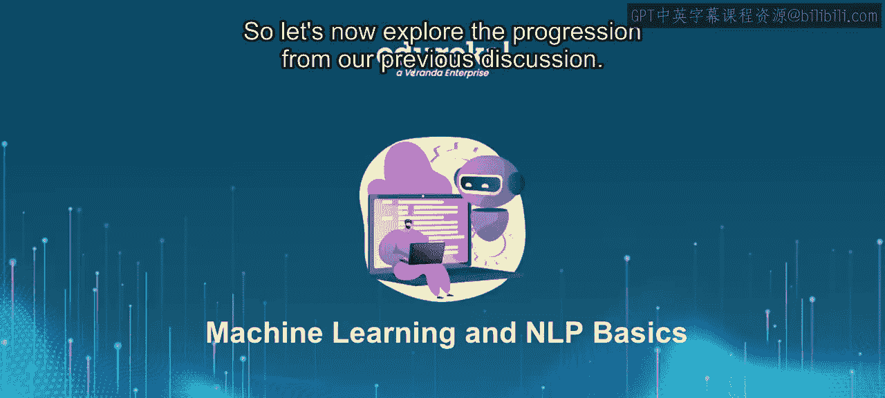
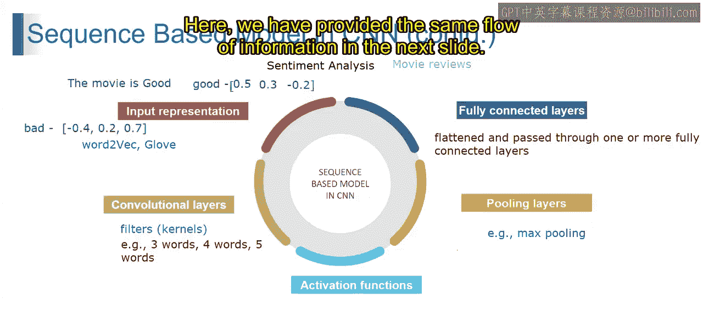

# Edureka《通过LLMs学习生成式人工智能（机器学习和NLP基础，第1课／共4课）｜Learn Generative AI with LLMs》中英字幕 - P93：92_CNN中的基于序列的模型.zh_en - GPT中英字幕课程资源 - BV1q4421Q7qh

So let's now explore the progression from our previous discussion。

 So let's understand all this habit is going to work。😊。

First of all input representation so what exactly it is in the NLP task text to data is represented as sequences of tokens or words or the characters each token is typically encoded as a vector in a high dimensional space using a techniques like word to work and globe。

😊，I'm just giving the example here。😊，These token embeddings serve as the input to the sequence based CNN。

 Then the next step is of convolutional layer。 So convolutional layers in the sequence based CNN Pophones feature extraction by applying the filters。

 filters are nothing but kernels we discussed in the other class。😊。

Means convolutional layers in the sequence based CNN perform feature extraction by applying the filters or also known as kernels over the input token sequences these filters slide across the input sequences capturing local patterns and generating the feature maps each filter learns to detect specific features all the patterns in the text data then the next one is of activation functions。

😊，For example， Relu so after convolutional operation the activation functions such as Relu。

 nothing but rectified linear unit are applied element device to the feature maps Relu introduces non nonlinearity to the model enabling it to learn complex patterns and the relationships in the text data then the next one is of polling layers。

😊，If you guys remember， we were discussing about it in the other module where we were talking about the multiple pooling layers。

 max layer and add some layer and all these things。😊。

So what happens here pooling layers example maximum pooling downs sampleble the feature maps by reducing the special spatial dimensions while retaining the most relevant information maximum pooling for example selects the maximum value within each pooling window effectively preserving important features while reducing computational complexity and overfitting then the next one is of fully connected layers finally it is the output of the convolutional and pooling layers if flattened and passed through one or more fully connected layers that is what we discussed on the other day right。

😊，What exactly these fully correct layers will do？😊。

These layers perform high level feature aggregation and transformation integrating information from the different parts of the input sequence。

 the last fully connected layer typically produces the final output prediction such as class probabilities in classification task or predicted values in the regression task。

😊，Let us consider it with the example of sentiment analysis。

 imagine we have a data set of movie reviews in our case。😊，While each review is a sequence of words。

 our task is to classify each review as either positive or the negative based on its sentiment first of all。

 input representation so how it goes is start by representing each word in the review as the word embedding for instance。

 lets say the word good。😊，In this example， the word good。

 whatever we are representing good might be represented as a vector let's say for example 0。

5 andm just talking about one single word that is let's say for example we start by representing each word in the review as a word embedding vector for instance in this particular thing the movie is good let's say for example the word good might be represented by a vector 0。

50。3 and minus 0。2 and the bad might be represented as。😊，Maybe like this。Okay。

 these embeddings capture the semantic information about the each word that is about the input representation。

 then coming to the convolutional layers。😊，So， here what exactly happened。

 we start by representing each word in the review as word embedding back to so in our example of the movie is good。

😊，We represented let's say for example， 0。530。3 and minus0。2 and the bad we represented as minus 0。

40。2 and 0。7 these embeddings capture the semantic information about the each word then coming to the convolutional layer next we pass these word embeddings through the convolutional layers these layers apply filters of different sizes for example three words4 words or five words like that。

😊，Across the sequence of the embeddings to detect the patterns like different sequences indicative of sentiment then coming to the activation function after convolution we apply an activation function like Relu to introduce nonlineity。

 for instance， if the result of a convolutional operation is negative the relu sets it to0 by effectively capturing only positive sentiment indicators。

😊，Means what exactly happened here after convolution。

 we apply a activation function like relu activation to introduce the non nonlinearity。

 for example if the result of a convolutional operation is negative Relu sets it to zero effectively capturing only positive sentiment indicators then coming to the pooling layer then we use the pooling layer example max pullinging to downsample the feature maps mass pooling selects the maximum value within the each pooling window representing the most important features while reducing the dimensionality of the data then finally fully connected layers。

😊，The output of the pooling layers is flated and passed through the fully connected layers。

 These layers aggregate the extracted features across the entire sequence and produce the final output indicating the sentiment of the review whether if it is of positive or negative means a sequence based c first sentiment analysis takes word embeddings as an input and applies the convolutional layer with the filters of the different sizes to capture the patterns in the sequence data then activation functions to introduce the non nonlinearity and then pooling layers to down sampleample the feature math and then fully connected layers aggregate features for final prediction this architecture enables the model to effectively analyze sentiment in the text data by。

😊，Turningearning the patterns and dependencies within the input sequence here we have provided the same flow of information in the next slide。

 so stay tuned for the next video where we will elaborate on this topic。😊。

