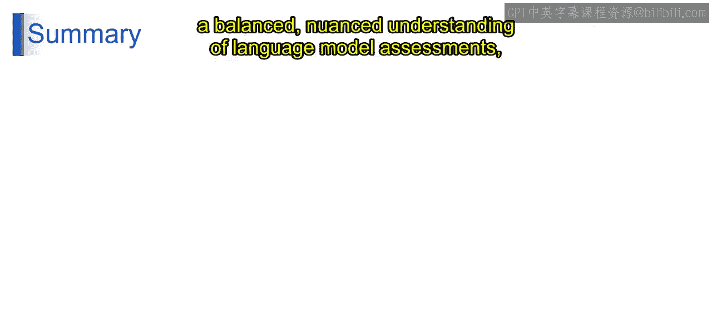

# Edureka《通过LLMs学习生成式AI（基础、应用开发、流行工具，第2、3、4课／共4课）｜Learn Generative AI with LLMs》中英 - P94：57_人工评估的局限性.zh_en - GPT中英字幕课程资源 - BV1ym421V7gx

Hello everyone， welcome back to Generative AI architectureitecture and Appplication Travel Month。😊。

Now let's understand limitations of human evaluation while human evaluation brings invaluable insights。

 it comes with its set of challenges and limitations as well。

 let's explore these constraints to better understand and landscape of assessing language models through human judgment。

 The first one is of subjectivity and bias， the inherent subjectivity and bias of human judgment。

 pose a challenge in evaluation，  different judges may interpret text differently based on their backgrounds Exp and perspectives。

 this subjectivity introduces variability in assessments。

 making it challenging establish a universally consistent standard Additionally， biases。

 whether conscious or unconscious may influence judgments impacting the reliability of the evaluation process。

 Then the next one is cost and scalability。 The practical aspect。😊。

Of cost and scalability present significant challenges， human evaluation。

 especially when involving expert judges can be resource intensive and time consuming as the scale of evaluation increases or the need for expert input growth the cost and logistic become substantial this limitation may hinder the feasibility of conducting large scale comprehensive assessments。

😊，Then the next one is agreement and reliability。 The level of agreement and reliability among human judges is a critical consideration。

 achievingieving consensus on the evaluation criteria and ensuring consistent judgment can be difficult in reliability the degree to which different judges agree can vary impacting the robustness of the evaluation。

 This challenge raises questions about the consistency and reliability of human assessments。

 Then the next one is of ethical consideration。 Human evaluation introduces ethical considerations into the assessment process。

 ensuring faith treatment of judges， avoiding potential biases and maintaining ethical standards are crucial aspects。

 Additionally， the impact of judges on individual or communities should be carefully considered。

 especially when evaluating models。😊，Gerate content with societal implications。

 The last one is of specific applications。 The applicability of human evaluation may be constrained in specific applications for certain tasks or domains human judges may lack the expertise needed for accurate assessments in such cases relying solely on human evaluation may not provide comprehensive insights necessitating a combination of automated metrics and domain specific evaluation In summary。

 the limitations of human evaluation stem from the inherent subjectivity and bias the practical challenges of cost and scalability the need for agreement and reliability among judges。

 ethical consideration and constraints in specific applications recognizing and addressing these limitations is essential for a balanced nuanced understanding of language model assessments。

So stay tuned for the next video， thank you。😊。