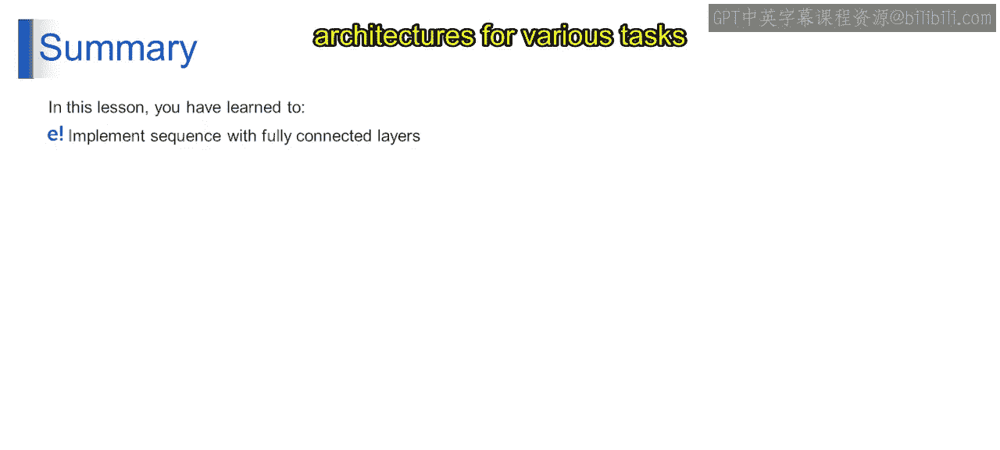
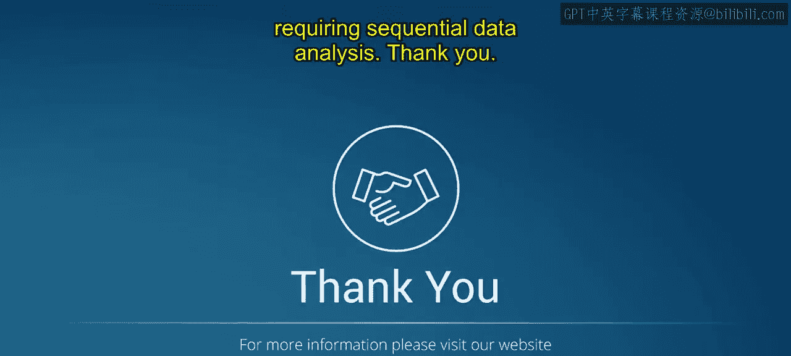

# Edureka《通过LLMs学习生成式人工智能（机器学习和NLP基础，第1课／共4课）｜Learn Generative AI with LLMs》中英字幕 - P94：93_CNN中基于序列的模型续.zh_en - GPT中英字幕课程资源 - BV1q4421Q7qh

So let's now explore the progression from our previous discussion Here is the same representation how the technique is going to take place。

 first of all， input embeddings， then convolution activation pooling and finally classification or regression based on the provided problem statement So these all are the different steps involves Finally the summary So in this lesson you have acquired the ability to construct sequence based models utilizing fully connected layers facilitating the analysis of sequence data with enhanced feature aggregation and prediction capabilities this knowledge empowers you to effectively implement and leverage sequence based architectures for various tasks requiring sequential data analysis Thank you。

😊。

