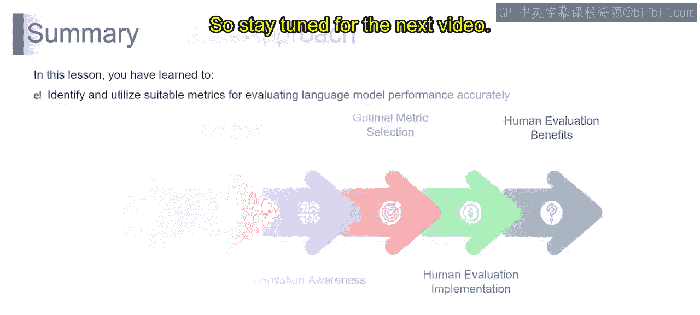

# Edureka《通过LLMs学习生成式AI（基础、应用开发、流行工具，第2、3、4课／共4课）｜Learn Generative AI with LLMs》中英 - P95：58_选择正确的指标.zh_en - GPT中英字幕课程资源 - BV1ym421V7gx

Hello everyone， welcome back to Generative AI architectureitecture and applications development。😊。

Now let's understand choosing the right metric， let's understand the definition first so evaluating the right performance of your language model is akin to conducting an orchestra Each metric functions as a unique instrument contributing to a harmonious understanding of its strengths and weaknesses the choice of metrics is paramount to avoid dissonant result and ensure a clear nuance assessment for this first we need to define your objective the first step in choosing the right metric is to define your objective What are you aiming to achieve your language model different task or applications may prioritize specific aspects like accuracy fluency or creativity clarifying your goals helps tailor the evaluation criteria to align with your objectives then you need to mention task specific metrics each。

😊，Which tasks may demand metrics that are particularly relevant to its nuances。 For example。

 machine translation might emphasize blue score while a creative writing task could benefit from metrics assessing fluency coherence and style tailoring metrics to the specific requirement of the task ensures a more accurate evaluation。

 Then we need to perform balanced evaluation。 achieving a balanced evaluation is very， very crucial。

 Just as an orchestra needs a mix of instruments to produce a harmonious sound。

 your evaluation should encompass a variety of metrics。

 B accuracy metrics with fluency coherence and style related metrics to gain a comprehensive understanding of language models performance Then we need to consider multiple perspectives。

 Think about multiple perspectives， different stakeholders may have varying priorities。

 developers and users。😊，And domain experts might emphasize different aspects of model performance。

 choosing metrics that accommodate these drivers' perspectives。

 ensure a well roundunded evaluation that align with your needs of various stakeholders。

 then you need to understand comparative metrics in the spirit of conducting an orchestra。

 In comparative metrics， comparing your language models performance against benchmark or previous various providers valuable context whether it's comparing against industry standards or benchmark models。

 These comparative metrics offer insights into the models， relative strengths and also weaknesses。

 then you need to understand relevance。 ensure real world relevance。

 metrics chosen for evaluation should align with your real world scenarios and applications。

 consider the practical implications of your language models output。😊。

And chooseose metrics that reflect its performance in the context of its intended use In the essence。

 choosing the right metric is an art requiring a thoughtful blend of task specific considerations balance and a keen awareness of diverse perspectives of stakeholders like a skilled conductor selecting metrics that harmonies well ensures a comprehensive and meaningful evaluation of your language models performance Now understand how to fine tune your evaluation approach fine tuning your evaluation approach for large language model is like adjusting the tuning of musical instruments in an orchestra。

 it requires precision and an ear for harmony。 Let's explore key considerations in tuning your evaluation approach to ensure it aligns with your goals and provides understanding of your language。

estPerance， the first one is of goal alignment。Goal alignment align your tuning with your goals。

 clearly define your objectives and ensure your evaluation approach is in harmony with them。

 whether you prioritize accuracy， fluency or task specific nuances a wellalign approach ensures that the evaluation metric。

 resonate with your intended outcomes。 then the next one is of metric types。

 understand the metric types at your disposal，  different metric serve different purposes Some emphasizes accuracy while others focus on fluency or creativity。

 familiarize yourself with your range of metric types and strategically choose or combine them based on the specific aspects of language model performance you wish to assess。

 then the next one is of limitation awareness be aware of the limitations just as a musician are just their playing based on the instruments limitation。

 understand the comes。Trains of your chosen metrics acknowledge the areas where certain metrics might fall short or introduce biases。

 This awareness allows you to interpret results more accurately then optimal metrics selection select metrics optimal consider the specific task or or application of your language model opt metrics that align with the nature of the task。

 blue score for translation， perplexity for the language modeling or fluency assessment for creating writing Okay。

 the optimal metrics is the one that best captures the nuances of your models performance in the given context。

 then human evaluation， implement。 Inpo human evaluation as a key tuning element human judgment provides a depth of understanding that automated metrics may lack implement human evaluation。

Judicially considering the specific aspect of language model performance that benefit most from human insights use it as a complementary tuning instrument in your evaluation and symbol then the last one is of human evaluation benefits recognize the benefits of human evaluation human judgment brings subjectivity context awareness and interpretability to the evaluation process leveraging these benefits to gain insights into aspects like fluency coherence and stylistic nuances that automated metric may not fully capture so stay tuned for the next video Thank you。

😊。

